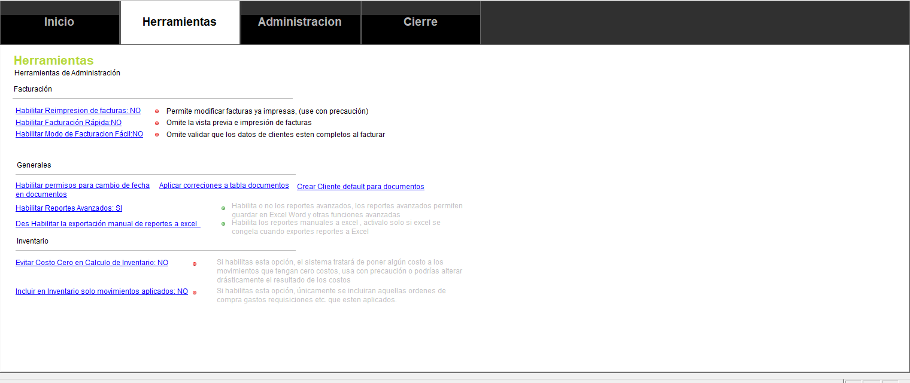

<!---
description: Opciones de inventario que cambian las existencias y los costos de sus productos, y cómo configurarlas desde la pantalla de Parámetros.
--->

# 📦 Parámetros de inventario

Estas opciones definen qué documentos cuentan para las existencias y cómo se calcula el costo de sus productos. Si dos empresas tienen los mismos documentos y ven números distintos, la diferencia suele estar en estas opciones.

!!! danger "Antes de cambiar una opción"
    Los movimientos de inventario se **recalculan**: no se actualizan al guardar cada documento. Un cambio en esta pantalla aparece en los reportes solo después de ejecutar **Recalcular costos**.

    Haga una copia de respaldo antes de cambiar una opción, y revise sus reportes antes y después.

Abra **Parámetros** desde la pestaña **Configuración** y haga clic en **Param Gen**. En la pestaña **Herramientas**, busque la sección **Inventario**. Haga clic sobre una opción para cambiar su valor.

{ align=center }

---

## 📋 Qué documentos cuentan para el inventario

| Opción | Qué hace | Valor inicial |
| :--- | :--- | :---: |
| **Incluir en Inventario solo movimientos aplicados** | Solo cuentan los documentos aplicados. Un documento guardado pero sin aplicar no cambia las existencias. Es la causa más común de que una compra "no aparezca". | Activa |
| **Incluir cotizaciones en movimientos de inventario** | Muestra las cotizaciones en el historial de movimientos de la ficha del producto. Las cotizaciones nunca cambian existencias ni costos. | Activa |

!!! info "Las cotizaciones no cambian los saldos"
    Esta opción solo muestra u oculta las cotizaciones en la ficha del producto. Cambiarla no modifica saldos, kardex ni reportes de existencias, así que no necesita recalcular costos.

---

## 💰 Cómo se calcula el costo

| Opción | Qué hace | Valor inicial |
| :--- | :--- | :---: |
| **Método de costeo de inventario** | Define cómo se calcula el costo promedio con el que se valoran las salidas de cada producto. Ver la tabla de métodos más abajo. | Costo promedio |
| **Evitar costo cero en cálculo de inventario** | Si una entrada llega con costo cero, el sistema usa el último costo promedio conocido. Si no existe, usa el precio de referencia del producto. Así una compra sin costo no distorsiona el promedio. | Desactivada |
| **Respetar costo en OA kits y devoluciones sobre compra** | Usa el costo capturado en el documento, en lugar de recalcularlo. | Desactivada |

### Métodos de costeo

| Método | Cómo calcula el costo |
| :--- | :--- |
| **Costo promedio** | Promedio ponderado de todas las entradas hasta la fecha del movimiento. Es el método inicial. |
| **Costo promedio mensual** | Promedio calculado por período mensual. |
| **Costo promedio vigente** | Toma el costo promedio vigente del último movimiento del producto, según el último recálculo. |

!!! warning "El método se aplica a todo el historial"
    Al recalcular, **todos los movimientos anteriores** se vuelven a costear con el método elegido. Así que el cambio altera cifras de períodos ya cerrados.

    El sistema pide confirmación antes de cambiarlo. Cambie el método al inicio de un ejercicio, no a mitad de un período.

!!! info "Devoluciones sobre compra"
    Con **Respetar costo en OA kits y devoluciones sobre compra** activada, la devolución sale del inventario al costo del documento original. Si ese costo es distinto del costo promedio, el promedio que muestra el kardex puede no coincidir con el valor del inventario dividido entre las unidades. Si necesita que ambas cifras coincidan siempre, desactive esta opción.

---

## 🔢 Decimales y bodega

| Opción | Qué hace | Valor inicial |
| :--- | :--- | :---: |
| **Decimales de costos y saldos** | Cuántos decimales usan los importes del inventario: costo, saldo, costo promedio y último costo. Puede elegir de 2 a 6. | 2 |
| **Bodega inicial** | La bodega que aparece al crear un documento nuevo. | 01 |

!!! warning "Los decimales no corrigen importes ya guardados"
    Si aumenta los decimales, los cálculos futuros tendrán más precisión, pero los importes ya redondeados no cambian. Defina esta opción al iniciar y evite cambiarla después.

---

## ❓ Preguntas frecuentes

??? question "Registré una compra y el reporte de existencias no la muestra"
    Revise, en este orden:

    1. Que el documento esté **aplicado**.
    2. Que haya ejecutado **Recalcular costos**.

??? question "¿Puedo cambiar el método de costeo a mitad de año?"
    Puede hacerlo, pero el recálculo también cambia los meses anteriores. Las cifras dejarán de coincidir con los estados financieros que ya emitió. Hágalo al cierre del ejercicio y documente el cambio.

---

## 🔗 Páginas relacionadas

- [Gestión de inventario](../../../modulos/inventario/GestionInventario.md)
- [Registro de Órdenes de Compra (OC)](../../../modulos/compras/registro_ordenes_compra.md)
- [Reportes de inventario](../../../Reports/categorias/inventario.md)

---
