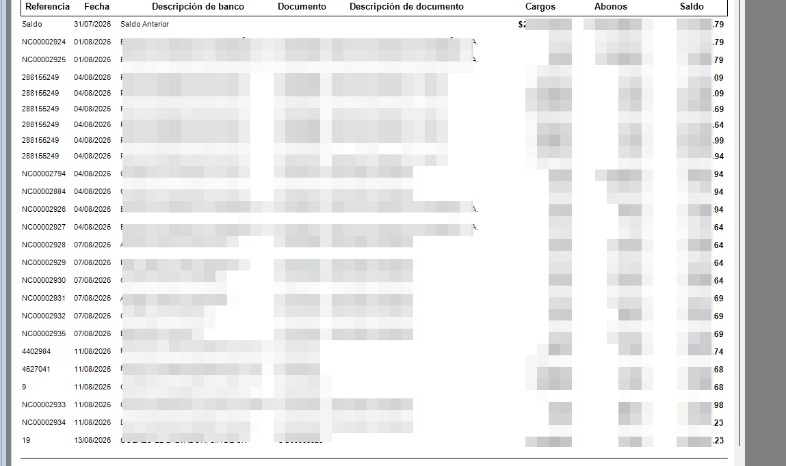

# **Reportes de bancos**

Esta página reúne el detalle de los reportes incluidos en la categoría de bancos en el sistema **ContaPortable**, con especial atención a los saldos y movimientos bancarios relevantes para control y conciliación.

!!! info "De un vistazo"
    - ⏱️ **Tiempo:** 5 minutos
    - 🎚️ **Nivel:** Básico
    - ✅ **Resultado:** Saldos y movimientos del banco consultados y cuadrados

!!! tip "Diagrama de la categoría de bancos"
    ``` mermaid
    graph TD
      A[Reportes de bancos]:::root

      subgraph "Subcategorías"
        B[1. Estado de cuenta y conciliación]
      end

      A --> B

    click B "#1-estado-de-cuenta-y-conciliacion" "Ir a estado de cuenta y conciliación"
    ```
---

## 📋 **1. Estado de cuenta y conciliación**

!!! tip "Diagrama de los reportes contenidos en la subcategoría"
    ``` mermaid
    graph LR
      A[Estado de cuenta y conciliación]:::root

      subgraph "Listado de reportes:"
        B[1.1 Estado de cuenta bancario - BAN12]
      end

      A --> B

    click B "#11-estado-de-cuenta-bancario-ban12" "Ir al reporte de estado de cuenta bancario"
    ```
---

### **1.1 Estado de cuenta bancario (BAN12)**

!!! info "Descripción del reporte"
    Este reporte permite consultar el estado de cuenta de una cuenta bancaria, mostrando el movimiento del período con saldos, cargos, abonos y la información relevante para revisar la conciliación operativa.

    Se puede consultar por banco, cuenta, fecha y otros parámetros del período, y suele utilizarse para revisar el flujo real del saldo disponible en cada cuenta.

    La vista principal del reporte está orientada a la revisión del movimiento y la comparación con la conciliación contable o bancaria.

Vista previa del reporte: muestra el estado de cuenta con movimiento bancario, saldos actualizados y detalle de cada transacción.

{ align=center }

??? abstract "1.1 Estado de cuenta bancario - Descargas de ejemplo"
    - **[Descargar versión PDF :fontawesome-regular-file-pdf:](../../assets/reportes/bancos/BAN12.PDF){ .md-button }**
    - **[Descargar versión Excel :material-microsoft-excel:](../../assets/reportes/bancos/BAN12.xlsx){ .md-button }**

### **1.2 Auxiliar de bancos (BAN11)**

!!! info "Descripción del reporte"
    El auxiliar de bancos muestra los movimientos de una cuenta bancaria. Incluye también los **egresos sin detalle** (los que no tienen cargos o desglose asociado), igual que el estado de cuenta BAN12. Así los dos reportes cuadran entre sí.

    Vista previa del reporte: muestra el auxiliar de bancos con los movimientos de la cuenta y su saldo.

    { align=center }

---

## 🔗 **Módulos relacionados**

- [Gestión de bancos, cuentas y chequeras](../../modulos/bancos/mantenimiento_bancos_cuentas_chequeras.md) — para definir la estructura y configuración de las cuentas bancarias.
- [Conciliación bancaria](../../modulos/bancos/Conciliacionbancaria.md) — para comparar los movimientos bancarios con la contabilidad.
- [Reportes de proveedores](proveedores.md) — la categoría complementaria del lado de cuentas por pagar.
