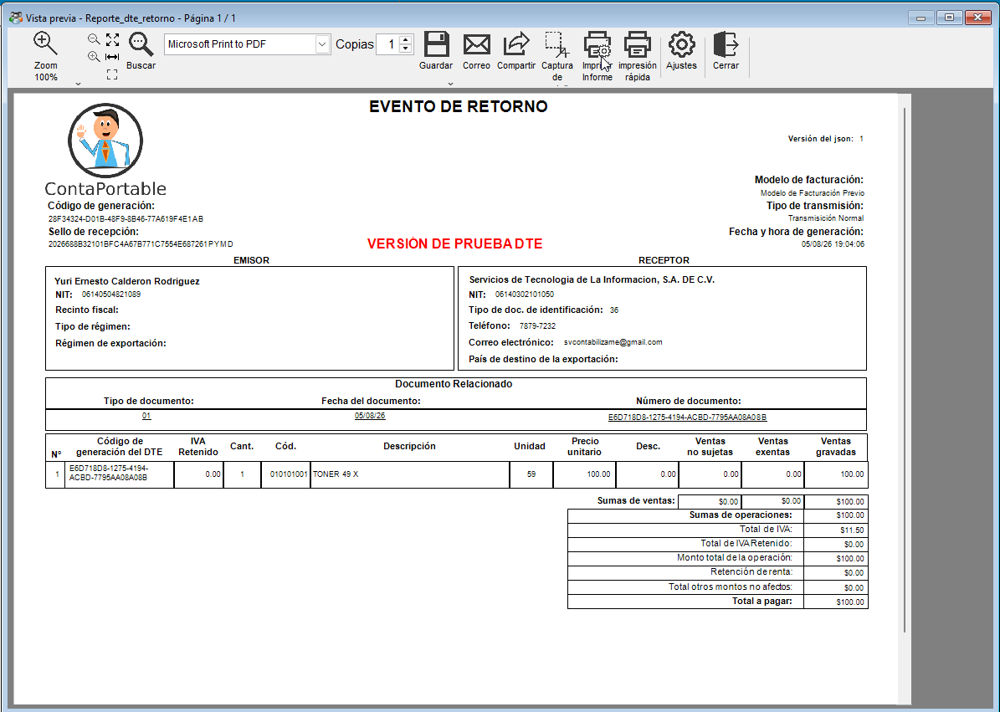
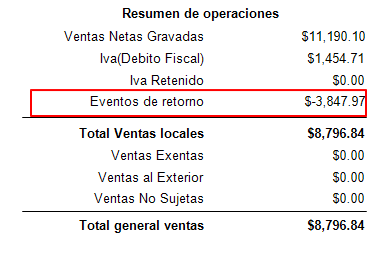

<!---
description: Cómo los eventos de retorno de DTE se reflejan en los libros de IVA, los anexos F07, los reportes de clientes e inventario de ContaPortable.
--->

# 🔄 Eventos de retorno en los reportes

Cuando un cliente devuelve un bien que ya facturó con DTE, y el evento de retorno se transmite a Hacienda, los reportes descuentan el monto devuelto en forma automática.

!!! abstract "En esta guía aprenderá a"
    - Saber en qué documentos aplica el evento de retorno.
    - Revisar que el retorno cumpla las condiciones para descontarse.
    - Encontrar el retorno en los libros, anexos, reportes de clientes e inventario.
    - Generar el reporte del período correcto.

{ align=center }

---

## 📌 ¿En qué documentos aplica?

| Documento | ¿Aplica? |
| :--- | :---: |
| Factura de **consumidor final** | ✅ Sí |
| Factura de **exportación** | ✅ Sí |
| Documento de **sujeto excluido** (compras, casilla 66) | ✅ Sí |
| Comprobante de **crédito fiscal** (ventas a contribuyente) | ❌ No |

!!! note "Crédito fiscal"
    Para los comprobantes de crédito fiscal, la figura equivalente es la **nota de crédito**, que tiene un efecto similar.

---

## ✅ Condiciones para que el retorno se descuente

El retorno modifica los reportes solo cuando cumple las dos condiciones siguientes:

- El evento fue **transmitido y procesado** por Hacienda.
- La factura original **no está anulada**. Si la factura se anula, no hay monto que descontar.

Si el evento se invalida después, deja de considerarse en los reportes en forma automática.

---

## 📊 Dónde se refleja

Al generar un reporte, el sistema busca los retornos del **período consultado** y descuenta el monto del documento original. El retorno afecta el mes en que se aplicó, no el mes de la factura.

=== "🧾 Libros de IVA y anexos F07"

    El descuento aparece en:

    - Libro de ventas al consumidor, en sus variantes.
    - Libro de ventas al contribuyente, en sus variantes.
    - Listado de facturas de IVA.
    - Resumen de liquidación de IVA.
    - Libro de compras y anexo de compras a sujeto excluido (casilla 66).
    - Anexo de ventas a consumidor final y anexo de compras a sujeto excluido, tanto en pantalla como en el archivo CSV que se entrega a Hacienda.

    **Libro detallado de consumidor final.** La factura original se mantiene visible. Debajo de ella aparece una fila negativa marcada como **[RETORNO]**, con el mismo marcador en las columnas *Del* y *Al*.

    ![Fila [RETORNO] en el libro detallado de consumidor final](../../../assets/Informes_anexos/F07/eventosRetorno/02_fila_retorno_libro_detallado.png){ align=center }

    **Resumen de operaciones.** Incluye la línea **Total eventos de retorno deducidos**, que muestra cuánto se descontó por retornos en el período. Las líneas de ventas netas gravadas e IVA se muestran en bruto. Solo el total general aparece neto.

    { align=center }

=== "👥 Reportes de clientes"

    El monto devuelto reduce el saldo pendiente del cliente, igual que un abono. Aplica en:

    - Movimientos y documentos emitidos por cliente.
    - Facturas pendientes de cobro y avisos de cobro.
    - Antigüedad de saldos.
    - Resúmenes de venta: ventas por cliente, conceptos, productos, familias y departamentos.
    - Facturas de sujeto excluido.

    **Cantidades vendidas.** En los reportes de productos vendidos, la mercadería devuelta se resta de la cantidad. El precio promedio y los totales por familia quedan con lo realmente vendido.

=== "📦 Reportes de inventario"

    La mercadería devuelta aparece como **reingreso** al inventario. Aplica en:

    - Movimientos, entradas y salidas de producto.
    - Historial de producto y consulta de existencias.
    - Listado para toma de inventario.

    !!! warning "Recalcule costos antes de consultar"
        Los reportes de inventario leen los movimientos ya calculados. Para que el reingreso aparezca, ejecute **Recalcular costos**, igual que con cualquier venta o compra.

---

## 📋 Recomendaciones

- Confirme que el evento esté transmitido y procesado antes de generar los reportes del período.
- Si la devolución corresponde a una factura de meses anteriores, genere el reporte con el **período del evento**.
- Recalcule costos antes de consultar los reportes de inventario.
- Revise el libro antes de entregar un anexo cuando haya retornos de facturas de períodos ya declarados.

---

## 🔗 Páginas relacionadas

- [Reportes de impuestos](../../../Reports/categorias/impuestos.md)
- [Reportes de clientes](../../../Reports/categorias/clientes.md)
- [Reportes de inventario](../../../Reports/categorias/inventario.md)
- [Anexos F07: generales](anexos_f07.md)

---
