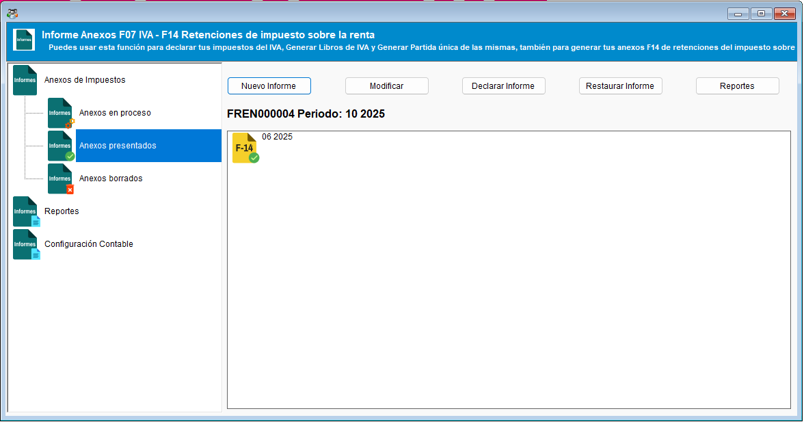
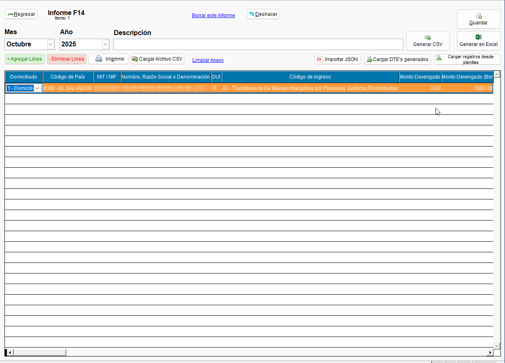
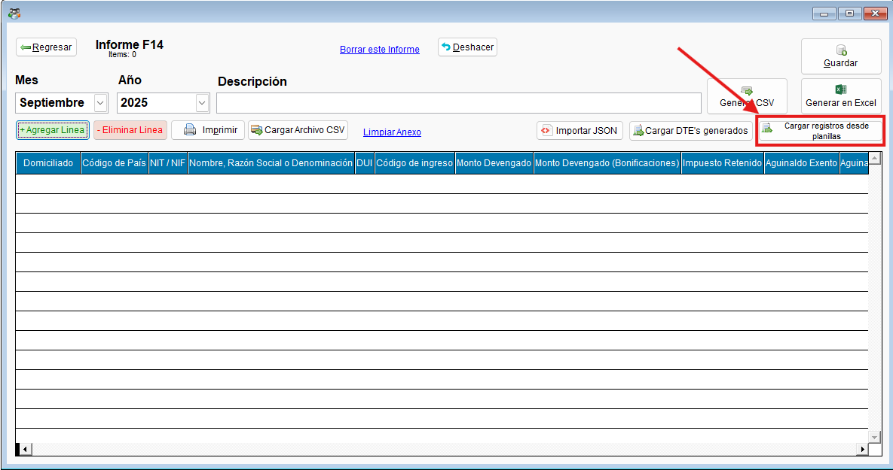
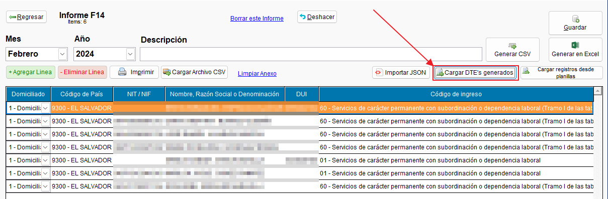
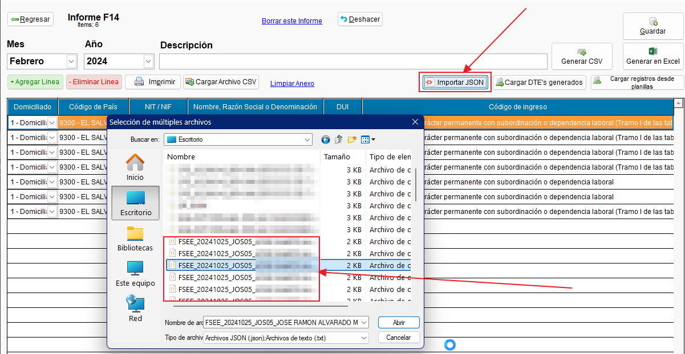
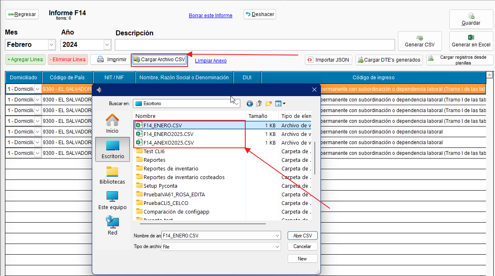
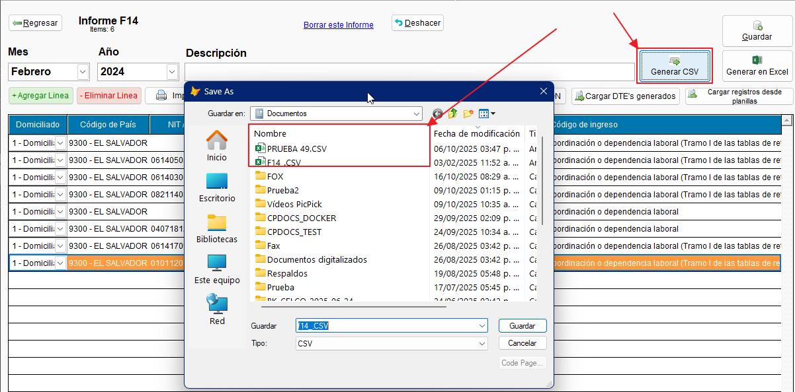

<!---
description: Guía para elaborar el Anexo F14 de retención de renta en ContaPortable: registro manual, importación desde planillas, DTE, JSON y CSV, y generación del archivo para declarar.
--->

# 🧾 Anexo F14: retención de renta

El Anexo F14 reporta las retenciones de renta que la empresa aplicó en el mes. Se prepara conforme al manual del Ministerio de Hacienda y se declara como parte del F910.

!!! abstract "En esta guía aprenderá a"
    - Crear un informe F14 para un mes y un año.
    - Cargar los registros desde planillas, desde DTE de sujetos excluidos, desde un JSON o desde un CSV.
    - Revisar y corregir los registros antes de declarar.
    - Generar el archivo CSV y los reportes consolidados.

!!! info "Manuales oficiales"
    - [Manual del Ministerio de Hacienda, versión 16 (octubre 2025) :fontawesome-regular-file-pdf:](../../../assets/Informes_anexos/F14/F14_Manual_MH_V16_Octubre_2025.pdf){ .md-button }
    - [Plantilla y sitio oficial de ContaPortable :material-web:](https://www.contaportable.com/anexos-f07-f14){ .md-button }

---

## 📌 Antes de empezar

!!! info "Requisitos"
    - Los contribuyentes que recibieron la retención deben estar registrados. Vea [Listado de contribuyentes](../../contribuyentes/ListadoContribuyentes.md).
    - Tenga los datos del mes: montos devengados, montos retenidos y el código de ingreso de cada registro.

---

## 🚪 La pantalla principal

La pantalla principal administra los informes F14. Desde aquí crea, modifica, declara, restaura y consulta cada anexo.

{ align=center }

| Panel | Qué muestra |
| :--- | :--- |
| **Anexos en proceso** | Los informes que todavía está preparando. |
| **Anexos presentados** | Los informes ya declarados o generados. |
| **Anexos borrados** | Los informes eliminados, que puede restaurar. |

| Botón | Qué hace |
| :--- | :--- |
| **Nuevo informe** | Crea un informe para un mes y un año. |
| **Modificar** | Abre el informe seleccionado para editarlo. |
| **Declarar informe** | Marca el informe como declarado. Después puede quedar bloqueado para cambios. |
| **Restaurar informe** | Mueve un informe borrado a **Anexos en proceso**. |
| **Reportes** | Genera vistas previas e impresiones del informe. El archivo CSV para declarar se obtiene aparte. |

---

## ✍️ Crear y editar un informe

!!! example "Paso a paso"
    1. Presione **Nuevo informe**.
    2. Elija el **mes** y el **año** del período.
    3. Escriba una **descripción** si lo necesita. Es una nota interna.
    4. Agregue los registros, como se explica en las secciones siguientes.
    5. Presione **Guardar**.

{ align=center }

### Campos de la cuadrícula

La cuadrícula es la tabla donde se registra cada retención. Las columnas principales son:

- **Domiciliado** y **Código de país**.
- **NIT / NIF**, **DUI** y **Nombre o razón social**.
- **Código de ingreso**.
- **Monto devengado** y **Monto retenido**.

### Botones del editor

| Botón | Qué hace |
| :--- | :--- |
| **+ Agregar línea** | Agrega una fila vacía para escribir un registro. |
| **- Eliminar línea** | Quita la fila seleccionada. |
| **Deshacer** | Revierte la última acción. |
| **Guardar** | Guarda la cabecera y todas las filas. |
| **Imprimir** | Imprime el detalle de los registros. |
| **Limpiar anexo** | Borra **todos** los registros del informe. Úselo con cuidado. |
| **Generar en Excel** | Exporta la cuadrícula a Excel para revisarla. |
| **Borrar este informe** | Elimina el informe completo. |

!!! warning "Limpiar anexo borra todo"
    **Limpiar anexo** elimina todos los registros del informe, no solo el seleccionado. Revise antes de confirmar.

---

## 📥 Cargar registros

Puede cargar los registros de cuatro maneras. Elija la que se ajuste a su información.

| Origen | Cuándo usarlo |
| :--- | :--- |
| **Planillas** | Las retenciones salen de la planilla del mes. |
| **DTE generados** | Los sujetos excluidos se emitieron desde Facturación. |
| **JSON** | El sujeto excluido se recibió como archivo JSON. |
| **CSV** | Tiene el detalle en un archivo preparado con la plantilla oficial. |

### 1. Desde planillas

Importa los registros de la planilla del mismo mes y año del informe.

{ align=center }

### 2. Desde DTE generados

Importa los registros de sujetos excluidos emitidos desde Facturación en el mes y año del informe.

{ align=center }

!!! note "Sujetos excluidos que solo existen como orden de gasto"
    Un sujeto excluido (FSE, DTE 14) que solo existe como **Orden de Gasto** no se lleva con esta opción. Agréguelo a mano o con **Importación de JSON**. Si el documento existe en Facturación, se carga desde allí.

### 3. Desde JSON

Importa un archivo JSON de sujeto excluido como registro del mes y año del informe.

{ align=center }

### 4. Desde CSV

Cada línea del archivo se convierte en un registro del informe. Use la plantilla oficial para evitar errores de columnas.

{ align=center }

---

## 📤 Generar el archivo CSV

Genera un archivo CSV con los registros del mes y año del informe. Ese archivo es el que se presenta.

{ align=center }

!!! tip "Antes de generarlo"
    Revise la cuadrícula. El archivo refleja exactamente lo que hay en el informe, incluidos los errores.

---

## ✅ Declarar y consolidar

1. Revise los registros y guarde.
2. Presione **Declarar informe** cuando esté listo.
3. Genere los **Reportes** para revisar o imprimir el consolidado.

!!! tip "Para el F910"
    Los informes mensuales se pueden consolidar en un solo reporte. Ese reporte es el que se usa para presentar el F910.

---

## ❓ Problemas frecuentes

??? question "No encuentro un registro que sé que está en la planilla"
    Revise que el mes y el año del informe coincidan con los de la planilla. La importación toma solo ese período.

??? question "El sujeto excluido no aparece al importar desde facturación"
    Si el documento existe solo como orden de gasto, no se importa desde facturación. Use **Importación de JSON** o agréguelo a mano.

??? question "Quiero recuperar un informe que borré"
    En **Anexos borrados**, seleccione el informe y presione **Restaurar informe**.

---

## 🔗 Páginas relacionadas

- [Anexo F14 de la quincena 25](anexos_f14Q25.md)
- [Listado de contribuyentes](../../contribuyentes/ListadoContribuyentes.md)
- [Libro de compras y anexos de compras](../../compras/registro_ordenes_compra.md)

---
