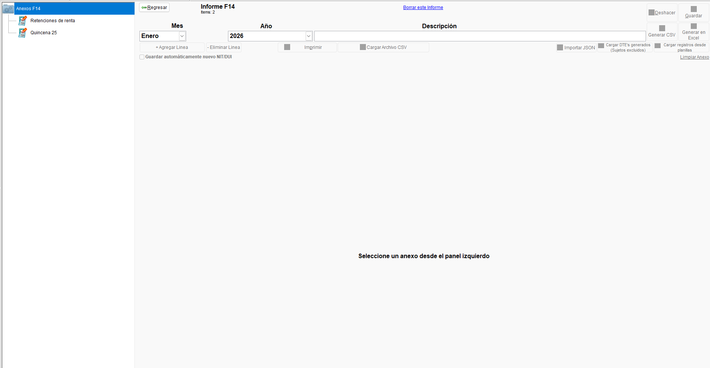
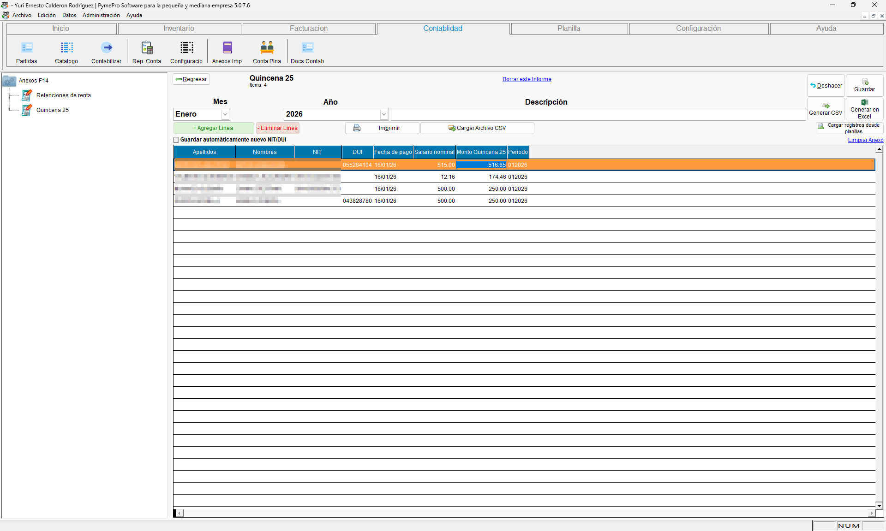
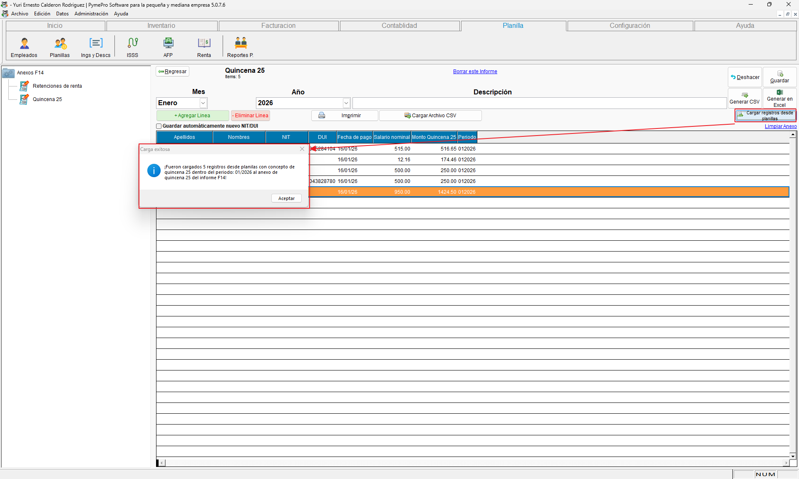
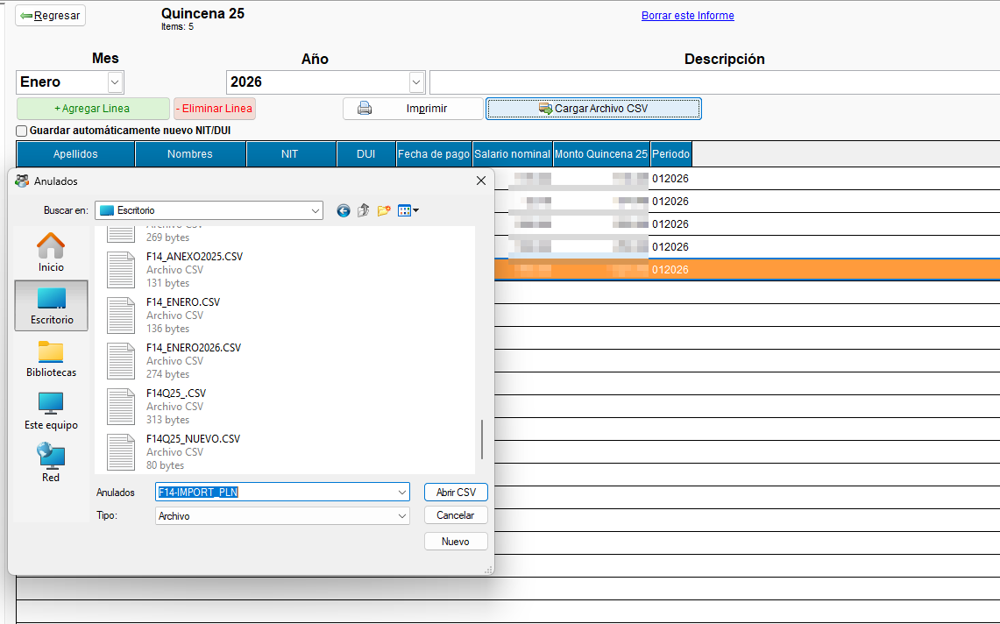
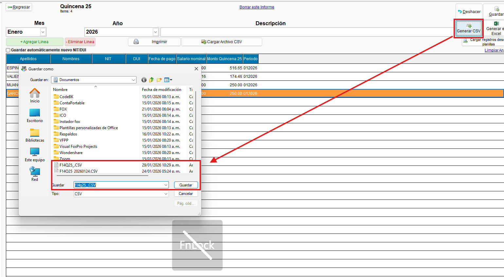
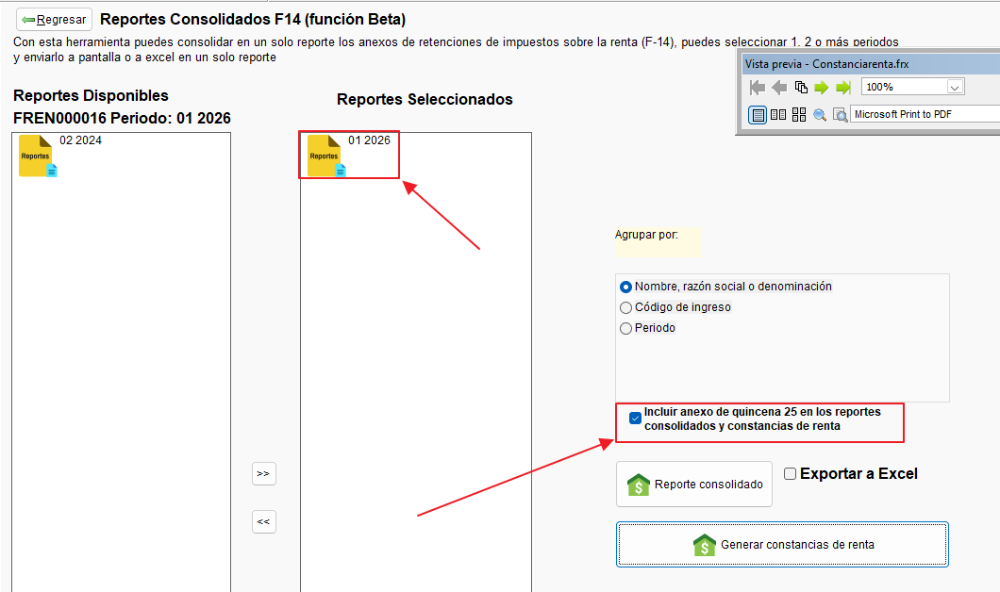
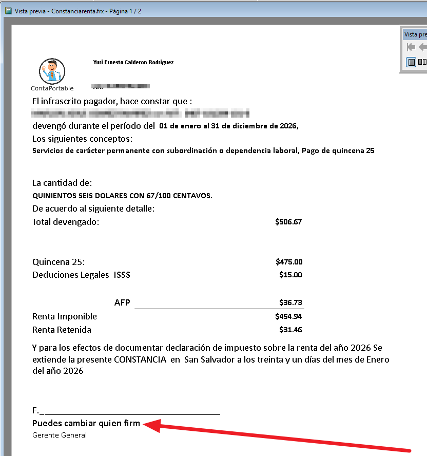

<!---
description: Guía para elaborar el Anexo F14 de la quincena 25 en ContaPortable: pago anual de enero, importación desde planillas, carga y generación de CSV, y su integración con los reportes consolidados.
--->

# 🎁 Anexo de pago de quincena 25 (F14)

El anexo de pago de quincena 25 reporta la prestación anual que se paga a los empleados. Se presenta en el mes de enero.

!!! abstract "En esta guía aprenderá a"
    - Abrir el anexo de quincena 25 desde el selector de anexos.
    - Cargar los registros desde planillas, desde un CSV o a mano.
    - Generar el archivo CSV para declarar.
    - Incluir el anexo en los reportes consolidados y en las constancias de renta.

!!! info "Manual oficial"
    [Manual de carga de anexo de planilla Q25 del Ministerio de Hacienda :fontawesome-regular-file-pdf:](../../../assets/Informes_anexos/F14/Manual%20de%20carga%20de%20anexo%20de%20planilla%20Q25.pdf){ .md-button }

---

## 📌 Antes de empezar

!!! info "Requisitos"
    - Los empleados deben estar registrados en planillas, con su información completa.
    - El anexo se trabaja en el mismo informe F14 que el anexo de retención de renta. Vea [Anexo F14: retención de renta](anexos_f14.md).

---

## 🔀 Elegir el anexo

En el informe F14 aparece un selector con dos opciones:

- **Anexos de retenciones de renta**: el anexo mensual de retención de renta.
- **Anexo quincena 25**: el anexo de pago de quincena 25.

Cada uno se gestiona por separado.

{ align=center }

---

## ✍️ Trabajar en el anexo

{ align=center }

Desde este menú se crean, se editan y se eliminan los registros, y se accede a la importación y a la exportación.

!!! tip "Guardado automático"
    Los cambios se guardan mientras trabaja. Así la información no se pierde si la sesión se interrumpe.

!!! warning "Salario máximo"
    El sistema valida que el monto no supere el salario máximo permitido para la quincena 25. Si aparece este aviso, revise el monto del empleado antes de continuar.

!!! info "Entrega parcial"
    El anexo puede declararse con registros parciales. Así puede presentar primero a los empleados ya verificados y completar el resto después.

---

## 📥 Cargar los registros

### Desde planillas

Importa los datos desde la planilla. Es la opción recomendada cuando los empleados ya están en planillas.

{ align=center }

### Desde CSV

Cada línea del archivo se convierte en un registro del anexo. Prepare el archivo con la plantilla oficial para evitar errores en las columnas.

{ align=center }

---

## 📤 Generar el archivo CSV

Genera el archivo CSV a partir de los registros del anexo. Ese archivo se usa para declarar o para análisis posterior.

{ align=center }

---

## ✅ Declarar e integrar con los reportes

1. Revise los registros del anexo.
2. Declare el anexo del período.
3. Genere los reportes consolidados de F14 y las constancias de renta.

Al declarar el anexo, su información se incluye en los **reportes consolidados de F14** y en las **constancias de renta**, sin proceso aparte. Ambos reportes se generan desde la pantalla principal. Vea [Anexo F14: retención de renta](anexos_f14.md#la-pantalla-principal).

!!! tip "Orden recomendado"
    Declare primero el anexo de quincena 25 y después genere los reportes consolidados y las constancias. Así incluyen la información de la quincena.

{ align=center }

Al generar las constancias de renta, el anexo de quincena 25 aparece como un concepto de pago del empleado, con su monto y sus deducciones.

{ align=center }

---

## ❓ Problemas frecuentes

??? question "Aparece el aviso de salario máximo"
    Revise el monto del empleado en la planilla. El sistema no permite guardar un monto superior al máximo permitido para la quincena 25.

??? question "Los reportes consolidados no incluyen la quincena 25"
    Declare el anexo de quincena 25 del período y vuelva a generar los reportes.

---

## 🔗 Páginas relacionadas

- [Anexo F14: retención de renta](anexos_f14.md)
- [Planillas](../../planillas/planillas.md)

---
