<!---
description: Guía de usuario del Actualizador de ContaPortable. Cómo actualizar el sistema, elegir el canal Estable o Beta, entender el aviso de nuevas versiones, volver a una versión anterior y resolver problemas frecuentes.
--->

# Actualizador de ContaPortable

El **Actualizador** instala las nuevas versiones de ContaPortable. Así mantiene su sistema al día con las mejoras, las correcciones y los ajustes tributarios más recientes del Ministerio de Hacienda.

---

## 📌 Introducción

!!! abstract "En esta guía aprenderá a"
    - Actualizar ContaPortable paso a paso.
    - Entender el aviso de nueva versión y silenciarlo cuando lo necesite.
    - Elegir entre la versión **Estable** y la versión **Beta**.
    - Volver a una versión anterior si surge un inconveniente.
    - Resolver los problemas más frecuentes.

    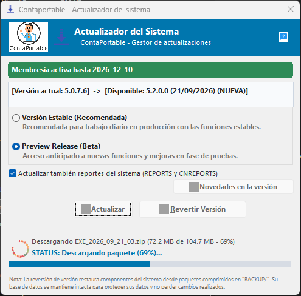{ align=center }

!!! success "Su información contable está protegida"
    La actualización solo cambia los archivos del programa y los formatos de reportes. Sus catálogos, partidas, facturas electrónicas (DTE), inventarios y reportes históricos **no se modifican ni se eliminan**.

---

## 📦 Antes de empezar

!!! info "Requisitos"
    - **Conexión a Internet** para consultar y descargar la nueva versión.
    - **Membresía activa** de ContaPortable, asociada a su licencia.
    - **ContaPortable cerrado**, junto con sus módulos como facturación y planillas.

!!! tip "El Actualizador se renueva solo"
    Antes de actualizar el sistema, el Actualizador comprueba si existe una versión más reciente de sí mismo. Si la hay, se renueva en segundos. Usted no tiene que descargar nada.

---

## 🚀 Actualizar ContaPortable

!!! example "Paso a paso"
    1. Abra el **Actualizador**. Puede hacerlo desde el [aviso de nueva versión](#aviso-de-nueva-version) o desde su acceso directo.
    2. Revise la tarjeta de versiones. Si hay una actualización, muestra su versión actual y la nueva.
    3. Presione **Ver novedades en la versión** si desea saber qué incluye.
    4. Marque **Actualizar también reportes del sistema** si desea actualizar también los formatos de reportes.
    5. Presione **Actualizar** y confirme el inicio.
    6. Espere a que termine la descarga y la instalación. Antes de instalar, el sistema guarda un respaldo automático.
    7. Cuando aparezca el mensaje de actualización finalizada, presione **Sí** para abrir ContaPortable con la nueva versión. Presione **No** para abrirlo más tarde.

=== "1️⃣ ¿Hay una versión nueva?"
    El Actualizador compara su versión con la última publicada en el canal que usa.

    - **Hay una actualización:** verá su versión actual y la nueva. El botón **Actualizar** queda habilitado.
    - **Su sistema está al día:** verá el mensaje **Versión de sistema al día**. No se descarga nada.

    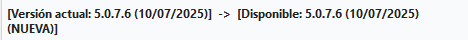{ align=center }
    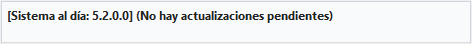{ align=center }

=== "2️⃣ Novedades de la versión"
    El panel **¿Qué hay de nuevo?** resume las mejoras y las correcciones, ordenadas por fecha.

    - Presione **Abrir en ContaPortable Docs** para ver el registro completo en esta documentación.
    - Presione **Cerrar Novedades** para volver a la ventana principal.

    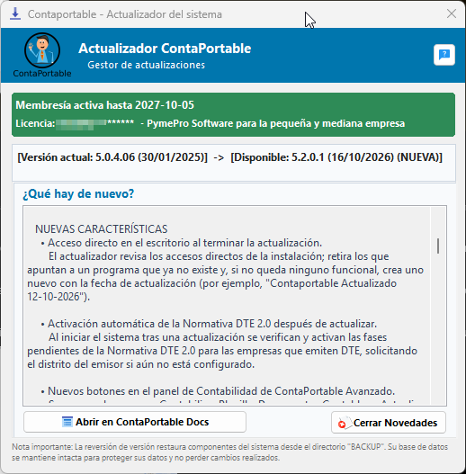{ align=center }

=== "3️⃣ Al terminar"
    El Actualizador le confirma la versión instalada y le avisa si creó un [acceso directo nuevo](#acceso-directo-en-el-escritorio) en su escritorio.

    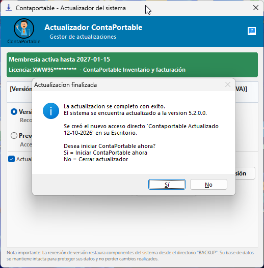{ align=center }

!!! tip "Ayuda desde el Actualizador"
    Presione el botón de ayuda del Actualizador o la tecla ++f1++ para abrir esta guía.

---

## 🔔 Aviso de nueva versión

!!! info "Cómo funciona"
    Al abrir ContaPortable, el sistema revisa en segundo plano si hay una versión más reciente. La revisión no demora la apertura ni interrumpe su trabajo. El aviso solo aparece si la versión publicada es **más reciente** que la suya en su canal.

Cuando hay una versión nueva, aparece un aviso en la esquina inferior derecha de la pantalla, encima de la barra de tareas.

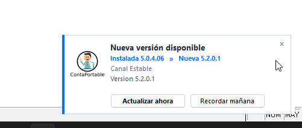{ align=center }

| Elemento del aviso | Qué hace |
| :--- | :--- |
| **Título** | Dice **Nueva versión disponible**. En el canal Beta dice **Nueva versión Beta disponible**. |
| **Versiones** | Muestra la versión instalada y la nueva. |
| **Detalle** | Indica el canal, la fecha de publicación y, si existe, un mensaje sobre la versión. |
| **Actualizar ahora** | Abre el Actualizador. También puede hacer clic en el texto o en el logotipo. |
| **Recordar mañana** | Oculta el aviso de esa versión hasta el día siguiente. Si se publica una versión más nueva, se le avisa de nuevo. |
| **Cerrar (x)** | Oculta el aviso. El ícono de la bandeja sigue disponible para actualizar más tarde. |

!!! tip "El aviso no interrumpe su trabajo"
    Puede seguir escribiendo en la ventana donde estaba. El aviso se cierra solo a los 15 segundos. Si deja el puntero del mouse encima, permanece abierto para que lo lea con calma.

### 🔕 Dejar de ver el aviso de una versión

!!! example "Para silenciar una versión"
    1. En el aviso, marque **No volver a mostrar este aviso de la versión X**.
    2. El botón **Recordar mañana** cambia a **Entendido**. Presiónelo, o cierre el aviso.

    Esa versión no vuelve a avisarse en pantalla ni en el ícono de la bandeja. Si se publica una versión más nueva, el sistema la avisa normalmente.

    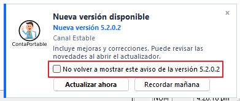{ align=center }

### 🔔 Activar o desactivar los avisos

!!! example "Para cambiar la preferencia"
    1. Abra el **Actualizador**.
    2. Marque o desmarque **Notificar sobre nuevas actualizaciones al iniciar ContaPortable**.

    - **Marcada:** el sistema avisa cuando hay una versión más reciente.
    - **Desmarcada:** el sistema no muestra avisos automáticos al iniciar. Puede volver a marcarla cuando quiera.

    La preferencia se guarda por usuario de Windows y por instalación. No afecta los datos de la empresa.

    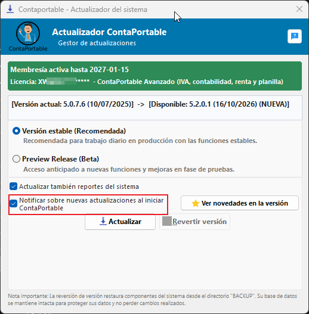{ align=center }

### 🖥️ Ícono en la bandeja del sistema

Mientras haya una actualización pendiente, verá un ícono junto al reloj de Windows. Haga clic en el ícono para abrir el Actualizador. Si su sistema está al día, no se muestra ningún aviso.

!!! note "Si actualizó el sistema de forma manual"
    Si reemplazó los archivos del programa por su cuenta, el sistema detecta la versión instalada al abrirse. El Actualizador deja de mostrar avisos de una actualización que ya tiene.

---

## ⚙️ Canales de actualización

El Actualizador ofrece dos canales. Elija uno en la ventana principal.

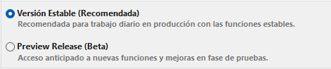{ align=center }

| Canal | Recomendado para | Qué recibe |
| :--- | :--- | :--- |
| **Versión estable** (recomendada) | Trabajo diario en empresas y despachos contables | La versión oficial, probada para su operación. |
| **Preview Release (Beta)** | Probar novedades antes de su publicación general | Nuevas funciones y mejoras en fase de pruebas. |

!!! note "Al cambiar de canal"
    El Actualizador consulta de inmediato la versión disponible en el canal que elija. Los dos canales requieren una membresía activa.

---

## 🔑 Licencia y membresía

!!! info "Datos de su licencia"
    En la parte superior del Actualizador verá:

    - **Licencia:** los primeros 5 caracteres de su clave. El resto se oculta por seguridad.
    - **Tipo de sistema:** por ejemplo, ContaPortable Avanzado o Pymepro.

    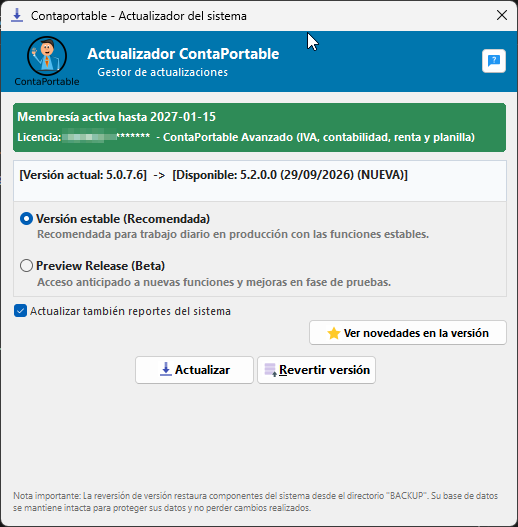{ align=center }

La membresía determina si puede instalar una versión nueva.

| Estado | Qué verá | Qué puede hacer |
| :--- | :--- | :--- |
| **Membresía activa** | Distintivo verde con la fecha de vigencia. | Descargar e instalar en ambos canales. |
| **Membresía requerida o vencida** | Mensaje **Requiere membresía activa de ContaPortable**. | Ver las versiones disponibles. La instalación queda bloqueada hasta renovar. |

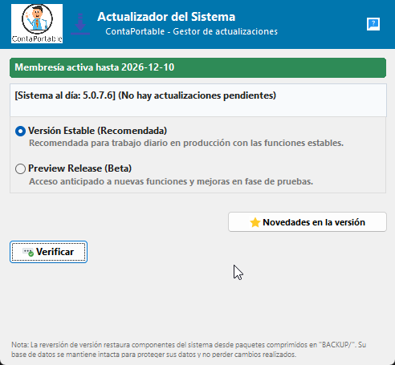{ align=center }
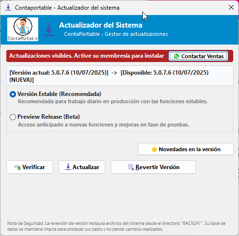{ align=center }

Para activar o renovar su membresía, presione **Contactar ventas**. Se abre un chat de WhatsApp con el equipo de ContaPortable.

### 🆘 Si ya renovó y la membresía no aparece activa

!!! example "Genere un PIN de soporte"
    1. En el Actualizador, busque el mensaje **Si usted renovó su membresía, puede generar un PIN para asistirle en su caso**.
    2. Haga clic en **Click aquí**. Se abre el sitio de soporte.
    3. Genere su PIN y compártalo con el equipo de soporte. Así pueden revisar y vincular su membresía.

    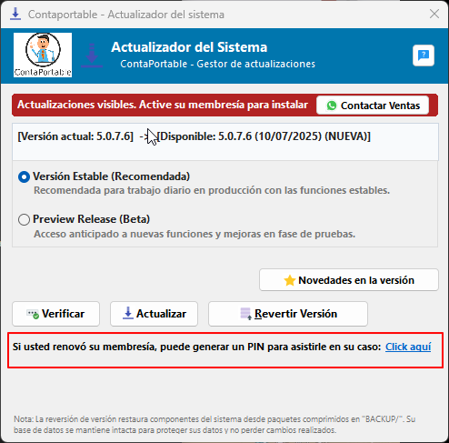{ align=center }

---

## 🖥️ Acceso directo en el escritorio

Al terminar la actualización, el Actualizador revisa los accesos directos de su escritorio que abren **esta** instalación de ContaPortable. Su objetivo es que siempre tenga uno que funcione.

| Situación | Qué hace el Actualizador |
| :--- | :--- |
| Ya tiene un acceso directo que abre el sistema | Lo conserva. No crea otro. |
| Hay accesos directos que ya no funcionan | Los retira. |
| No queda ningún acceso que funcione | Crea uno nuevo con la fecha de la actualización, como **Contaportable Actualizado 13-10-2026**. En Pymepro, el nombre empieza con **Pymepro Actualizado**. |
| Tenía ContaPortable anclado en la barra de tareas y dejó de funcionar | Corrige el anclaje. |

!!! note "Qué no se modifica"
    Solo se revisan los accesos de la carpeta donde está instalado este sistema. No se tocan los de otras instalaciones de ContaPortable, los de otros programas ni el del propio Actualizador.

Cuando se crea un acceso nuevo, el mensaje final de la actualización se lo indica. Puede cambiarle el nombre si lo desea.

---

## 🧾 Normativa DTE 2.0

!!! abstract "Las fases se activan solas"
    Si su empresa emite Documentos Tributarios Electrónicos (DTE), las fases pendientes de la Normativa DTE 2.0 se activan automáticamente. No necesita hacerlo desde el menú. Esto aplica a todos los estilos de facturación electrónica.

    - [Fase 1: Evento de invalidación](../dteNormativaV2/fase1.md)
    - [Fase 2: Evento de retorno](../dteNormativaV2/fase2.md)
    - [Fase 3: Nuevas versiones de todos los DTE](../dteNormativaV2/fase3.md)

El sistema revisa y activa las fases en dos momentos:

1. **Al terminar la actualización.**
2. **Al iniciar ContaPortable.** Así completa lo pendiente, por ejemplo en otras empresas que abra.

!!! note "Orden de activación"
    La Fase 1 se activa primero. La Fase 2 y las nuevas versiones de los DTE se activan cuando la Fase 1 ya está activa. Lo que ya estaba activo no se vuelve a instalar.

!!! warning "Distrito del emisor"
    Para activar las nuevas versiones de los DTE, necesita configurar el **distrito del emisor**. Si aún no lo tiene, el sistema le muestra la configuración al iniciar para que lo seleccione. Si lo deja para después, se lo vuelve a pedir la próxima vez que ingrese.

Cuando se activa algo, el sistema muestra un solo mensaje con el estado de cada fase.

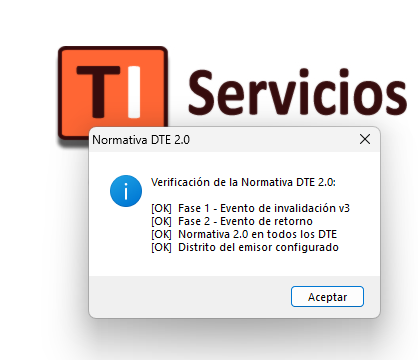{ align=center }

!!! tip "Activación manual"
    También puede activar las fases desde la opción de instalación de la Normativa V2. Cada fase explica cómo.

---

## 🔁 Volver a una versión anterior

Antes de cada actualización, el sistema guarda un respaldo comprimido con la fecha y la hora. Conserva los **3 respaldos más recientes**. Elimina los más antiguos para no ocupar espacio.

!!! example "Para volver a una versión anterior"
    1. Cierre ContaPortable y sus módulos.
    2. Abra el **Actualizador**.
    3. Presione **Revertir versión**.
    4. Seleccione el respaldo que desea restaurar.
    5. Confirme la reversión y espere a que termine.

!!! success "Sus datos no cambian"
    Al volver a una versión anterior, solo se restauran los archivos del programa y los reportes. Su información contable no se modifica.

---

## 🛠️ Problemas frecuentes

??? question "El Actualizador muestra una versión nueva, pero no me deja instalarla"
    Su membresía no está activa o está vencida. Presione **Contactar ventas** para renovarla. Si ya la renovó y no aparece activa, [genere un PIN de soporte](#si-ya-renovo-y-la-membresia-no-aparece-activa).

??? question "El antivirus bloqueó archivos durante la actualización"
    Algunos antivirus analizan los archivos nuevos mientras se instalan. El Actualizador reintenta automáticamente. Si el antivirus sigue reteniendo archivos, **cancela la actualización de forma segura** y su sistema queda en la versión anterior.

    1. Agregue la carpeta de ContaPortable como excepción en su antivirus.
    2. Vuelva a ejecutar la actualización.
    3. Si el problema continúa, contacte a soporte.

??? question "Aparece el aviso «Archivos en uso»"
    Cierre todas las ventanas de ContaPortable y de sus módulos, como facturación y planillas. Si el aviso continúa, reinicie el equipo y vuelva a intentarlo.

??? question "La descarga se interrumpió"
    No se instala nada a medias. El Actualizador verifica que el paquete esté completo antes de instalarlo. Revise su conexión a Internet y vuelva a presionar **Actualizar**.

??? question "Apareció un acceso directo con fecha en mi escritorio"
    Después de actualizar, el Actualizador no encontró un acceso directo que abriera esta instalación. Por eso creó **Contaportable Actualizado** con la fecha. Ese acceso abre la versión recién instalada. Puede cambiarle el nombre.

??? question "Después de actualizar, el sistema me pidió el distrito del emisor"
    Su empresa emite DTE y el sistema está activando la Normativa DTE 2.0. Esa normativa requiere el distrito del emisor. Selecciónelo para completar la activación. Si lo deja pendiente, el sistema se lo vuelve a pedir al ingresar.

??? question "Quiero dejar de ver el aviso por hoy"
    Presione **Recordar mañana** en el aviso. No se le avisará de esa versión hasta el día siguiente. Para no verlo más, [silencie esa versión](#dejar-de-ver-el-aviso-de-una-version).

??? question "¿Puedo cambiar entre Estable y Beta?"
    Sí. Elija **Preview Release (Beta)** para probar novedades antes de su publicación general. Elija **Versión estable** para volver a la versión de producción.

??? question "¿Dónde veo la lista completa de cambios?"
    En el [Changelog](../../changelog.md) de esta documentación. También puede abrirlo desde el botón **Abrir en ContaPortable Docs** del Actualizador.

!!! info "¿Necesita más ayuda?"
    Si soporte se lo solicita, comparta el archivo de registro de la actualización. Se guarda en la carpeta donde está instalado ContaPortable.

---

## 📝 Historial de actualizaciones

??? note "Cambios del Actualizador"
    - **27/10/2026:** configuración automática de parámetros según la edición del sistema, conservando las preferencias del usuario.
    - **26/10/2026:** casilla para silenciar el aviso de una versión, con botón **Entendido**. Casilla de notificaciones en la ventana del Actualizador. El sistema reconoce las actualizaciones manuales.
    - **13/10/2026:** aviso de nuevas versiones con más información y botón **Recordar mañana**, sin interrumpir lo que usted escribe. Novedades más legibles. La Normativa DTE 2.0 también se activa al terminar la actualización, con un solo resumen.
    - **12/10/2026:** revisión y creación del acceso directo en el escritorio al terminar la actualización. Activación automática de las fases de la Normativa DTE 2.0 al iniciar el sistema.
    - **07/10/2026:** se muestran los primeros 5 caracteres de la licencia y el tipo de sistema. Se vuelve a crear el acceso para abrir el sistema si fue eliminado o renombrado.
    - **01/10/2026:** aviso de nuevas versiones e ícono en la bandeja del sistema.
    - **29/09/2026:** enlace para generar el PIN de soporte y mejoras de compatibilidad con antivirus.
    - **22/09/2026:** nuevo Actualizador con validación de membresía, canales Estable y Beta, respaldos y reversión de versión.

---
