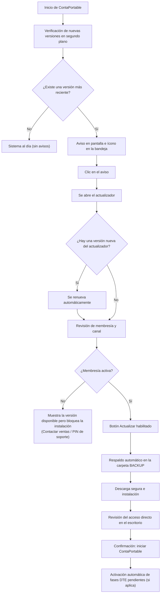

<!---
description: Guía de usuario del Actualizador de ContaPortable. Aviso de nuevas versiones, canales Estable y Preview (Beta), validación de membresía, PIN de soporte, respaldos automáticos, reversión de versión, acceso directo en el escritorio y activación automática de la Normativa DTE 2.0.
--->

# Actualizador de ContaPortable

El **Actualizador de ContaPortable** es la herramienta oficial para mantener su sistema al día con las últimas mejoras, correcciones y ajustes tributarios, conforme a las disposiciones más recientes del Ministerio de Hacienda.

---

## 📌 Introducción

!!! abstract "Gestión integral de actualizaciones"
    El actualizador verifica, descarga e instala las nuevas versiones de ContaPortable. Antes de cada instalación guarda un respaldo automático que le permite regresar a la versión anterior si lo necesita, y al terminar deja listo un acceso directo funcional en su escritorio.

    También le avisa si su sistema ya está al día o si hay una nueva versión disponible en el canal que utiliza (**Versión estable** o **Preview Release - Beta**).

    { align=center }

---

## 🔔 Aviso de nuevas versiones

!!! info "Verificación automática al iniciar"
    Al abrir ContaPortable, el sistema revisa en segundo plano si existe una versión más reciente, sin demorar la apertura ni interrumpir su trabajo.

### 💬 Aviso en pantalla

Cuando hay una nueva versión, aparece un aviso en la esquina inferior derecha de la pantalla, justo encima de la barra de tareas:

- **Título:** "Nueva versión disponible", o "Nueva versión Beta disponible" si utiliza el canal Preview.
- **Versiones:** la instalada y la nueva (por ejemplo: `Instalada 5.0.7.6 » Nueva 5.0.8.1`).
- **Detalle:** el canal (Estable o Preview Beta), la fecha de publicación y, cuando existe, un mensaje sobre la versión.
- **Actualizar ahora:** abre el actualizador para comenzar la actualización (también puede hacer clic sobre el texto o el logotipo).
- **Recordar mañana:** oculta el aviso y no vuelve a mostrarlo para esa misma versión hasta el día siguiente. Si se publica una versión más nueva, se le avisa en la siguiente verificación.
- **No volver a mostrar este aviso de la versión X:** casilla ubicada en el aviso flotante. Al marcarla, el botón **Recordar mañana** cambia automáticamente su texto a **Entendido**; al pulsar Entendido o cerrar el aviso, esa versión específica queda silenciada y no volverá a mostrarse ni en pantalla ni en el ícono de la bandeja del sistema. Si se publica una versión posterior más nueva, el sistema volverá a notificarla normalmente.
- **Cerrar (x):** oculta el aviso; el ícono en la bandeja sigue disponible para actualizar después.

{ align=center }

### 🔕 Control de notificaciones desde el Actualizador

En la ventana principal del Actualizador se encuentra la casilla **"Notificar sobre nuevas actualizaciones al iniciar ContaPortable"**:

- **Marcada:** el sistema comprueba actualizaciones en segundo plano y muestra el aviso en pantalla si detecta una versión más reciente.
- **Desmarcada:** silencia las notificaciones automáticas de inicio para la versión disponible. Puede volver a marcarla en cualquier momento para reactivar las alertas.
- Esta preferencia se guarda por usuario de Windows y por instalación local, sin afectar la base de datos de la empresa.

{ align=center }

### 🛠️ Detección de actualización manual

Si se actualiza ContaPortable de forma manual reemplazando los archivos del programa:

- Al abrir el sistema, se detecta de inmediato la versión instalada y se actualiza el registro interno.
- El Actualizador reconoce que el sistema ya cuenta con esa versión y deja de mostrar avisos reiterados de actualización pendiente.

!!! tip "No interrumpe su trabajo"
    El aviso no le quita el teclado: puede seguir escribiendo en la ventana donde estaba. Se cierra solo a los 15 segundos, pero permanece abierto mientras tenga el puntero del mouse encima, para que pueda leerlo con calma.

<!-- 📷 CAPTURA PENDIENTE: { align=center } -->
<!-- 📷 CAPTURA PENDIENTE: { align=center } -->

!!! note "Solo versiones más recientes de su canal"
    El aviso solo aparece cuando la versión publicada es **más reciente** que la instalada en el canal que utiliza (Estable o Beta). Nunca se le avisa de versiones anteriores.

### 🖥️ Ícono en la bandeja del sistema

- Mientras haya una actualización pendiente, se muestra un ícono en el área de notificación de la barra de tareas de Windows (junto al reloj).
- Al hacer clic sobre el ícono se abre el actualizador.
- Si el sistema ya está al día, no se muestra ningún aviso.

---

## 📦 Requisitos y membresía activa

!!! info "Requisitos previos"
    - **Conexión a Internet** para consultar y descargar las nuevas versiones.
    - **Membresía activa de ContaPortable** asociada a la licencia registrada en el sistema.
    - **Cerrar ContaPortable y sus módulos** (facturación, planillas, etc.) antes de instalar, para evitar archivos en uso.

### 🔑 Datos de su licencia

En la parte superior del actualizador se muestran:

- **Licencia:** solo los primeros 5 caracteres de su clave de licencia; el resto se oculta con asteriscos por seguridad.
- **Tipo de sistema:** la descripción del sistema instalado (por ejemplo, ContaPortable Avanzado o Pymepro).

<!-- 📷 CAPTURA PENDIENTE: { align=center } -->

### 🔒 Política de membresía

!!! note "Validación de membresía en línea"
    - **Membresía activa:** se muestra el distintivo verde :material-check-circle: **Membresía Activa** con su fecha de vigencia. Puede descargar e instalar en ambos canales.
    - **Membresía requerida o vencida:** se muestra el distintivo :material-alert-circle: **Requiere membresía activa de ContaPortable**. Puede ver qué versiones y mejoras hay disponibles, pero la instalación permanece bloqueada.

    { align=center }
    { align=center }

    Para activar o renovar su membresía, presione **Contactar ventas** para comunicarse con el equipo de ContaPortable por WhatsApp.

### 🆘 PIN de soporte

!!! tip "Si ya renovó y la membresía aún no aparece activa"
    Cuando la membresía no se muestra activa (por ejemplo, porque todavía no está vinculada a su licencia), el actualizador muestra el mensaje **"Si usted ya renovó su membresía puede generar un PIN de soporte para asistirle"** con el enlace **Click aquí**.

    Al hacer clic se abre el sitio de soporte para generar su PIN; compártalo con el equipo de soporte para que puedan revisar y vincular su membresía.

    <!-- 📷 CAPTURA PENDIENTE: { align=center } -->

---

## ⚙️ Canales de actualización (Estable y Beta)

!!! info "Selector de canales"
    ContaPortable ofrece dos canales de actualización:

    { align=center }

| Canal | Recomendado para | Características |
| :--- | :--- | :--- |
| **Versión estable (Recomendada)** | Trabajo diario en empresas y despachos contables | Versión oficial probada para sus procesos de producción. |
| **Preview Release (Beta)** | Probar novedades antes de su publicación general | Acceso anticipado a nuevas funciones y mejoras en fase de pruebas. |

!!! tip "Cambio de canal"
    Al cambiar de canal, el actualizador consulta de inmediato la versión disponible en el canal elegido. Ambos canales requieren membresía activa.

---

## 🚀 Instalación segura

### 🔄 Actualización automática del actualizador

Antes de actualizar ContaPortable, el actualizador comprueba si existe una versión más reciente de sí mismo. Si la hay, se renueva automáticamente en segundos y continúa con la actualización, sin que usted tenga que descargar nada manualmente.

### 🛡️ Descarga e instalación protegidas

- Las descargas se realizan por conexión segura y se verifica que el paquete esté completo antes de instalarlo; una descarga interrumpida nunca se instala a medias.
- La instalación se completa sin pedirle confirmar cada archivo.
- Si el ejecutable de su sistema fue eliminado o renombrado, el actualizador lo vuelve a crear con el nombre que corresponde a su sistema (por ejemplo, `contaportable.exe` o `pymepro.exe`).

### 🧱 Compatibilidad con antivirus

!!! warning "Archivos bloqueados por el antivirus"
    Algunos antivirus analizan o bloquean los archivos nuevos mientras se instalan. El actualizador reintenta automáticamente; si aun así el antivirus retiene archivos, **cancela la actualización de forma segura** y muestra un mensaje indicándolo, sin dejar el sistema a medio actualizar.

    En ese caso, agregue la carpeta de ContaPortable como excepción en su antivirus (o solicite apoyo a soporte) y vuelva a intentar.

---

## 🖥️ Acceso directo en el escritorio

!!! abstract "Siempre un acceso funcional después de actualizar"
    Al terminar la actualización, el actualizador revisa los accesos directos de su escritorio que abren **esta** instalación de ContaPortable:

    - Si ya tiene un acceso directo que abre el sistema desde esa carpeta (por ejemplo, a `contaportable.exe` o `pymepro.exe`), lo conserva y no crea otro.
    - Si hay accesos directos rotos hacia esa carpeta (apuntan a un programa que ya no existe, por ejemplo porque el ejecutable fue renombrado o eliminado), los retira.
    - Si no queda ningún acceso funcional, crea uno nuevo con la fecha de la actualización:
        - **Contaportable Actualizado DD-MM-YYYY** (por ejemplo, `Contaportable Actualizado 13-10-2026`)
        - **Pymepro Actualizado DD-MM-YYYY** para Pymepro
    - Si tenía ContaPortable anclado en la barra de tareas y el anclaje dejó de funcionar, también se corrige.

!!! note "Otros accesos directos no se modifican"
    Solo se revisan los accesos directos de la carpeta donde está instalado este sistema. Si en el equipo hay varias instalaciones de ContaPortable, los accesos de las demás no se modifican, aunque estén rotos; tampoco los de otros programas ni el del propio actualizador.

Cuando se crea un acceso directo nuevo, el mensaje final de la actualización se lo indica.

<!-- 📷 CAPTURA PENDIENTE: { align=center } -->
<!-- 📷 CAPTURA PENDIENTE: { align=center } -->

---

## 🧾 Activación automática de la Normativa DTE 2.0

!!! abstract "Fases de la Normativa 2.0 sin pasos manuales"
    Si su empresa emite Documentos Tributarios Electrónicos (DTE), las fases pendientes de la Normativa DTE 2.0 se activan automáticamente, sin tener que hacerlo desde el menú:

    - [Fase 1 — Evento de invalidación](../dteNormativaV2/fase1.md)
    - [Fase 2 — Evento de retorno](../dteNormativaV2/fase2.md)
    - [Fase 3 — Nuevas versiones de todos los DTE](../dteNormativaV2/fase3.md)

    Aplica a todos los estilos de facturación electrónica.

### 🔁 Cuándo se activan

1. **Al terminar la actualización:** el actualizador activa las fases pendientes de la empresa de la instalación.
2. **Al iniciar ContaPortable:** el sistema vuelve a verificar y completa lo que haya quedado pendiente, por ejemplo en otras empresas que abra o si faltaba el distrito del emisor.

!!! note "Orden de activación"
    La Fase 1 se activa primero. La Fase 2 y las nuevas versiones de los DTE solo se activan cuando la Fase 1 está activa. Si una fase ya estaba activa, no se vuelve a instalar.

!!! warning "Distrito del emisor"
    Para activar las nuevas versiones de los DTE es necesario tener configurado el **distrito del emisor**. Si aún no lo tiene, al iniciar el sistema se le mostrará la configuración para seleccionarlo. Si decide hacerlo después, se le volverá a solicitar la próxima vez que ingrese.

### 🖥️ Resumen de la activación

Cuando se activa algo al iniciar el sistema, se muestra un solo mensaje con el estado de cada fase:

```text
Verificación de la Normativa DTE 2.0:
[OK]  Fase 1 - Evento de invalidación v3
[OK]  Fase 2 - Evento de retorno
[OK]  Normativa 2.0 en todos los DTE
[PENDIENTE]  Distrito del emisor configurado
Lo pendiente se volverá a intentar la próxima vez que ingrese al sistema.
```

!!! tip "Registro para soporte"
    El resultado de cada activación queda anotado en el archivo de registro de la actualización (`UpdateCP_log.txt`, en la carpeta donde está instalado ContaPortable). Si necesita asistencia, puede compartirlo con el equipo de soporte.

!!! tip "Activación manual"
    Las fases también pueden activarse manualmente desde la opción de instalación de la implementación de la Normativa V2, como se describe en cada fase.

<!-- 📷 CAPTURA PENDIENTE: { align=center } -->

---

## 📚 Flujo de actualización paso a paso



=== "1️⃣ Detección de versiones"
    Al abrir el actualizador se consulta la versión disponible en el canal seleccionado:

    - **Actualización disponible:** se muestra la versión actual y la nueva (por ejemplo, `5.0.0.0` :material-arrow-right: `5.0.7.6`) y se habilita el botón **Actualizar**.
    - **Sistema al día:** se muestra **"Versión de sistema al día"** y no se descarga nada.

    { align=center }
    { align=center }

=== "2️⃣ Revisión de novedades"
    Antes de instalar puede consultar los cambios incluidos con el botón **Ver novedades en la versión**:

    - Se muestra la sección **¿Qué hay de nuevo?** con el resumen de mejoras y correcciones, ordenado por fecha (por ejemplo, "22 de septiembre de 2026"), separado en **Nuevas características** y **Corrección de errores**, con cada cambio en viñeta y su descripción debajo.
    - Con **Abrir en ContaPortable Docs** puede consultar el registro completo en esta documentación.

    { align=center }

=== "3️⃣ Descarga e instalación"
    1. Marque **Actualizar también reportes del sistema** si desea refrescar también los formatos de reportes.
    2. Presione **Actualizar** y confirme el inicio de la actualización.
    3. El sistema guarda automáticamente un respaldo en la carpeta `BACKUP` antes de modificar cualquier archivo.
    4. Se descarga e instala la nueva versión.

    { align=center }

=== "4️⃣ Finalización e inicio"
    Al terminar, el actualizador le confirma la versión instalada, le indica si creó un acceso directo nuevo en su escritorio y le ofrece:

    - **Sí:** iniciar ContaPortable de inmediato con la nueva versión.
    - **No:** cerrar el actualizador y abrir ContaPortable más tarde.

    { align=center }

!!! tip "Ayuda desde el actualizador"
    Presione el botón de ayuda o la tecla ++f1++ para abrir esta documentación desde el actualizador.

---

## 🔁 Reversión de versión

!!! note "Regresar a la versión anterior"
    - Cada vez que instala una actualización se guarda un respaldo comprimido con fecha y hora en la carpeta `BACKUP`.
    - Se conservan los últimos **3 respaldos**; los más antiguos se eliminan automáticamente para no ocupar espacio.
    - Si necesita regresar a una versión anterior, presione **Revertir versión** y seleccione el respaldo deseado.

    { align=center }

### 🛡️ Su información contable está protegida

!!! danger "La base de datos no se modifica"
    La actualización y la reversión solo reemplazan los archivos del programa y los formatos de reportes.

    **Sus datos contables nunca se reemplazan ni se eliminan:** catálogos, partidas, facturas electrónicas (DTE), inventarios y reportes históricos permanecen intactos durante todo el proceso.

---

## ☑️ Validaciones realizadas 🧪

!!! example "Escenarios verificados"
    ??? example "Aviso de nuevas versiones"
        - :material-check-circle: Verificación automática al iniciar el sistema.
        - :material-check-circle: El aviso se muestra solo con versiones más recientes del canal en uso, indicando canal Estable o Beta.
        - :material-check-circle: **Actualizar ahora** abre el actualizador.
        - :material-check-circle: El aviso no quita el teclado a la ventana en uso y permanece abierto con el mouse encima.

    ??? example "Activación automática de la Normativa DTE 2.0"
        - :material-check-circle: Activa la Fase 1 y la Fase 2 y deja pendiente la Fase 3 cuando falta el distrito del emisor.
        - :material-check-circle: Con el distrito configurado, activa todas las fases.
        - :material-check-circle: Si se ejecuta de nuevo, no repite lo que ya está activo.
        - :material-check-circle: No aplica a empresas que no facturan electrónicamente.

    ??? example "Actualización automática del actualizador"
        - :material-check-circle: Se detecta y se instala la nueva versión del actualizador sin intervención del usuario.

    ??? example "Respaldo y reversión"
        - :material-check-circle: Se genera el respaldo antes de instalar y se conservan los últimos 3.
        - :material-check-circle: La reversión restaura la versión anterior sin afectar la base de datos.

    ??? example "Acceso directo en el escritorio"
        - :material-check-circle: Se conserva el acceso directo existente cuando funciona.
        - :material-check-circle: Se crea **Contaportable Actualizado DD-MM-YYYY** cuando no hay ninguno funcional.
        - :material-check-circle: No se modifican accesos de otras carpetas ni de otros programas.

---

## ❓ Preguntas frecuentes

??? info "¿Qué es el aviso que aparece en la esquina de la pantalla al abrir ContaPortable?"
    Es el aviso de nuevas versiones. Aparece cuando hay una versión más reciente en el canal que utiliza. Puede presionar **Actualizar ahora** para abrir el actualizador o ignorarlo y seguir trabajando; se cierra solo a los 15 segundos.

??? info "¿Cómo dejo de ver el aviso por hoy?"
    Presione **Recordar mañana**. No se le volverá a avisar de esa misma versión hasta el día siguiente. Si se publica una versión más nueva, sí se le avisará.

??? info "¿Por qué el actualizador muestra una versión nueva pero no me permite instalarla?"
    Su membresía no está activa o está vencida. El actualizador le muestra qué hay disponible, pero la instalación requiere membresía activa. Presione **Contactar ventas** para renovarla. Si ya la renovó y no aparece activa, use el enlace del **PIN de soporte**.

??? info "¿Por qué se creó un acceso directo con fecha en mi escritorio?"
    Porque después de actualizar no se encontró un acceso directo que abriera correctamente esta instalación (por ejemplo, el ejecutable fue renombrado o eliminado). El acceso **Contaportable Actualizado DD-MM-YYYY** abre la versión que se acaba de instalar. Puede renombrarlo si lo desea.

??? info "¿Por qué el actualizador se actualiza a sí mismo antes de actualizar ContaPortable?"
    Para que la descarga sea segura y compatible con su equipo, primero verifica si existe una versión más moderna del actualizador. Si existe, se renueva en segundos y luego continúa con la actualización del sistema.

??? info "¿Puedo cambiar entre la versión Estable y la Beta?"
    Sí. Elija **Preview Release (Beta)** para probar novedades antes de su publicación general, o **Versión estable** para mantenerse en la versión de producción.

??? info "¿Puedo volver a una versión anterior si surge algún inconveniente?"
    Sí. Abra el actualizador, presione **Revertir versión** y seleccione el respaldo deseado. Sus datos contables no se ven afectados.

??? info "¿Qué hago si el actualizador indica que el antivirus bloqueó archivos?"
    La actualización se cancela de forma segura y su sistema queda en la versión anterior. Agregue la carpeta de ContaPortable como excepción en su antivirus o contacte a soporte, y vuelva a intentar.

??? info "¿Qué debo hacer si aparece el aviso 'Archivos en uso'?"
    Cierre todas las ventanas de ContaPortable y de sus módulos (facturación, planillas, etc.). Si el aviso persiste, reinicie el equipo antes de volver a intentar.

??? info "Después de actualizar, el sistema me pidió el distrito del emisor. ¿Por qué?"
    Su empresa emite DTE y el sistema está activando la Normativa DTE 2.0, que requiere el distrito del emisor. Selecciónelo para completar la activación. Si lo deja pendiente, se le volverá a solicitar al ingresar.

??? info "¿Dónde puedo consultar la lista completa de cambios?"
    En el [Changelog](../../changelog.md) de esta documentación, también accesible desde el botón **Abrir en ContaPortable Docs** del actualizador.

---

## 📝 Historial de actualizaciones

??? note "Cambios del actualizador"
    - **27/10/2026** — Configuración automática de parámetros según la edición del sistema, conservando las preferencias personalizadas del usuario.
    - **26/10/2026** — Casilla para silenciar el aviso de versión en la notificación flotante (con botón **Entendido**) y casilla de notificaciones en la ventana del Actualizador; reconocimiento de actualizaciones manuales.
    - **13/10/2026** — Aviso de nuevas versiones con más información, botón **Recordar mañana** y sin interrumpir lo que está escribiendo; novedades más legibles; activación de la Normativa DTE 2.0 también al terminar la actualización, con un solo resumen y registro para soporte.
    - **12/10/2026** — Revisión y creación del acceso directo en el escritorio al terminar la actualización; activación automática de las fases de la Normativa DTE 2.0 al iniciar el sistema después de actualizar.
    - **07/10/2026** — Se muestran los primeros 5 caracteres de la licencia y el tipo de sistema; se vuelve a crear el ejecutable del sistema si fue eliminado o renombrado.
    - **01/10/2026** — Aviso de nuevas versiones e ícono en la bandeja del sistema.
    - **29/09/2026** — Enlace para generar PIN de soporte; mejoras de compatibilidad con antivirus.
    - **22/09/2026** — Nuevo actualizador con validación de membresía, canales Estable y Beta, respaldos y reversión de versión.

---
