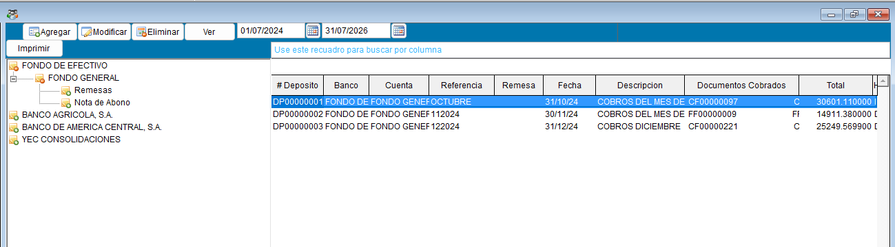
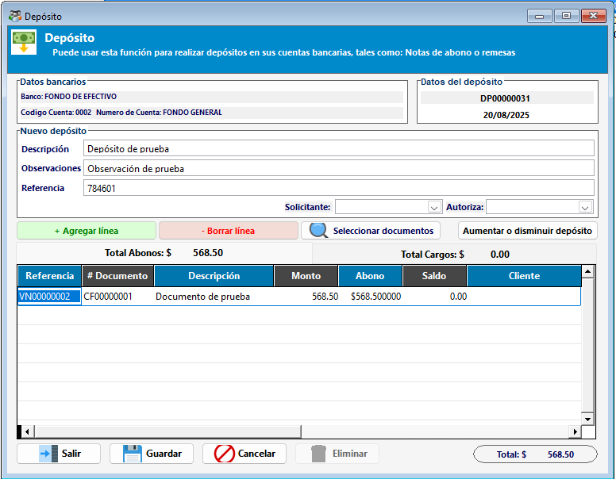
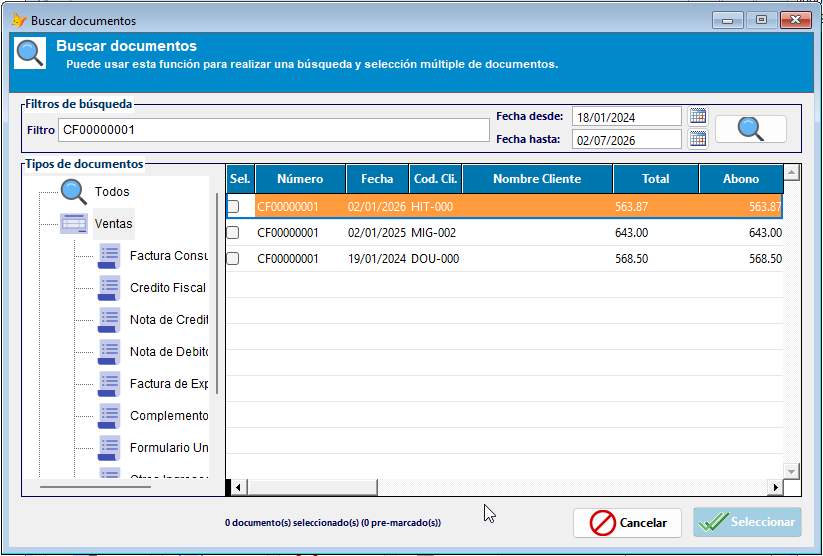
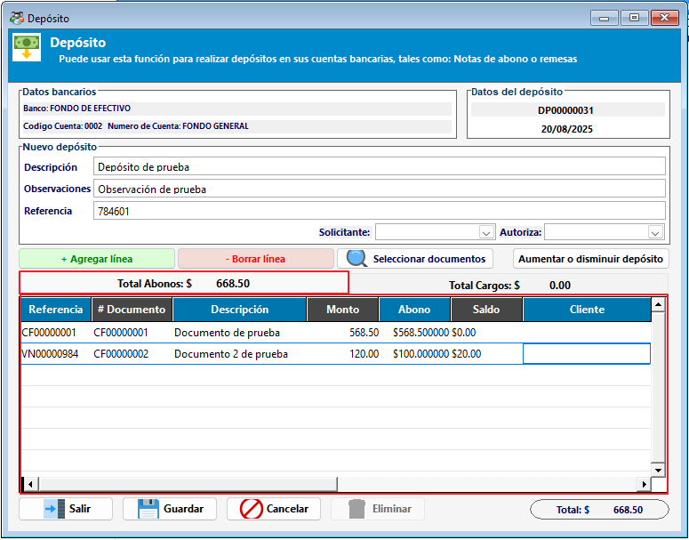
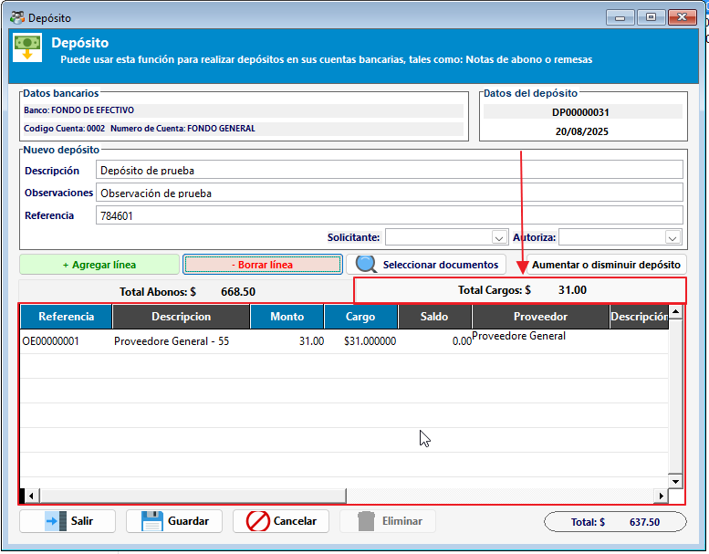
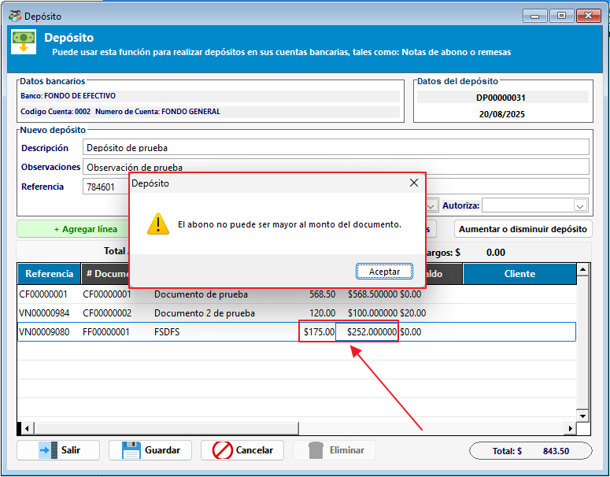

<!---
description: Guía para registrar depósitos bancarios, aplicarles los documentos que compensan y registrar los cargos del banco en ContaPortable.
--->

# 💵 Depósitos bancarios Actualizado

Un depósito bancario registra el dinero que entra a una cuenta. Con este módulo también aplica el depósito a los documentos que cubre, por ejemplo facturas a crédito de clientes.

!!! abstract "En esta guía aprenderá a"
    - Registrar un depósito con su fecha, su referencia y su monto.
    - Aplicar varios documentos pendientes en una sola operación.
    - Registrar los cargos que aplicó el banco, como comisiones o retenciones.
    - Guardar el depósito y corregir los avisos antes de hacerlo.

    { align=center }

---

## 📌 Antes de empezar

!!! info "Requisitos"
    - La **cuenta bancaria** donde se recibió el depósito debe estar creada. Si no lo está, revise [Mantenimiento de bancos, cuentas y chequeras](mantenimiento_bancos_cuentas_chequeras.md).
    - Tenga a la mano la **boleta o referencia** del banco y el monto recibido.
    - Si el depósito compensa documentos, estos deben estar pendientes de pago en el sistema.

---

## 🚀 Registrar un depósito

!!! example "Paso a paso"
    1. Abra el módulo de **Depósitos bancarios**.
    2. Seleccione la **cuenta** donde se recibió el depósito.
    3. Presione **Nuevo**.
    4. Escriba la **fecha**, la **referencia** o número de boleta, y el **monto** total.
    5. Escriba una **descripción** si lo necesita.
    6. Presione **Buscar documentos** y seleccione los documentos que cubre el depósito.
    7. Si el banco cobró comisiones o retenciones, regístrelas en la sección de **cargos**.
    8. Revise el total y presione **Guardar**.

### 📝 Datos generales

Estos son los datos que debe completar al crear el depósito.

| Campo | Qué escribir |
| :--- | :--- |
| **Cuenta bancaria** | La cuenta donde se recibió el dinero. |
| **Fecha** | La fecha del movimiento en el banco. |
| **Referencia** | El número de boleta o de operación. Use un dato que pueda buscar después. |
| **Monto total** | El monto que recibió en la cuenta. |
| **Descripción** | Un texto que explique el depósito. Es opcional. |

{ align=center }

!!! tip "Sugerencias en la descripción"
    Al escribir en **Descripción**, el sistema muestra las descripciones que ya usó en depósitos anteriores de la cuenta.

    - Siga escribiendo para filtrar la lista. No distingue entre mayúsculas, minúsculas ni tildes.
    - Use las flechas **↑** y **↓** para recorrer la lista. Pulse **Enter** o **Tab** para elegir una. Pulse **Esc** para cerrarla.
    - Si necesita una descripción nueva, escríbala con normalidad.

---

### 📑 Aplicar los documentos

Aplique los documentos que cubre el depósito. Así el sistema sabe qué saldos quedaron pagados.

1. Presione **Buscar documentos**.
2. Revise el listado. Si es largo, filtre por fecha o por cliente.
3. Seleccione los documentos que corresponden al depósito. Puede marcar varios a la vez.
4. Revise el **monto pendiente** y el **monto aplicado** de cada uno.

{ align=center }

Después de seleccionarlos, el detalle muestra cada documento aplicado. Revise que cada línea corresponda al documento correcto.

{ align=center }

!!! tip "Documento escrito y elegido en el buscador"
    Si escribe el número de un documento en una línea del detalle y luego lo elige en el buscador, el documento **reemplaza esa misma línea**. No queda una línea adicional.

!!! note "Documentos anulados"
    El buscador no muestra las ventas invalidadas con monto negativo. Tampoco permite agregar una venta invalidada al depósito.

!!! warning "Si el abono supera el saldo pendiente"
    El sistema revisa que el abono no supere el saldo del documento. Según la configuración de su empresa, puede:

    - **Ajustar el abono al saldo disponible**, con un aviso. Así no se registra un sobreabono.
    - **Pedir confirmación.** Si usted acepta, se registra el sobreabono y la autorización queda en la bitácora.

    Quien administra el sistema define cuál de los dos comportamientos aplica.

---

### 🧾 Registrar los cargos del banco

Si el banco cobró una comisión, una retención u otro cargo en la misma operación, regístrelo en la sección de cargos. Así el depósito cuadra con lo que llegó realmente a la cuenta.

1. Escriba el monto de cada cargo.
2. Verifique que la suma de cargos y documentos aplicados concuerde con el depósito.

{ align=center }

---

### ✅ Guardar y validar

Antes de guardar, revise:

- Que el monto total del depósito sea el que recibió en el banco.
- Que los documentos aplicados estén asociados.
- Que los cargos, si existen, estén registrados.

!!! warning "El sistema no guarda con avisos pendientes"
    Si hay una inconsistencia en el detalle o en los datos generales, el sistema no guarda el depósito. Corrija el aviso y vuelva a presionar **Guardar**.

{ align=center }

!!! tip "Montos con decimales"
    Puede escribir montos con hasta **6 decimales**. En el listado de depósitos, el total se muestra siempre con **2 decimales**.

---

## ❓ Problemas frecuentes

??? question "No puedo guardar el depósito"
    Revise los avisos que aparecen en pantalla. Lo más común es que no haya documentos aplicados, o que un documento se haya aplicado por más de su saldo. Corríjalos y vuelva a guardar.

??? question "Un documento no aparece en el buscador"
    El buscador no muestra las ventas invalidadas con monto negativo. Si el documento es una venta invalidada, no se puede aplicar al depósito.

---

## 🔗 Módulos relacionados

- [Mantenimiento de bancos, cuentas y chequeras](mantenimiento_bancos_cuentas_chequeras.md): crear y configurar las cuentas bancarias.
- [Conciliación bancaria](Conciliacionbancaria.md): comparar los depósitos con el estado de cuenta del banco.
- [Transferencias bancarias](transferenciasBancarias.md): mover dinero entre cuentas.
- [Gestión de clientes y Resumen de Facturas](../facturacion/gestion_clientes.md): los documentos que los depósitos pueden cubrir.

---
