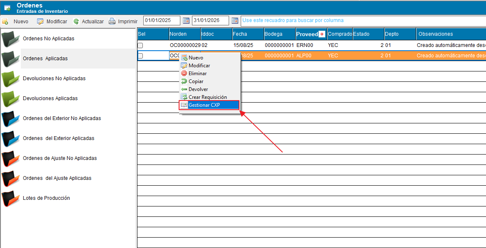
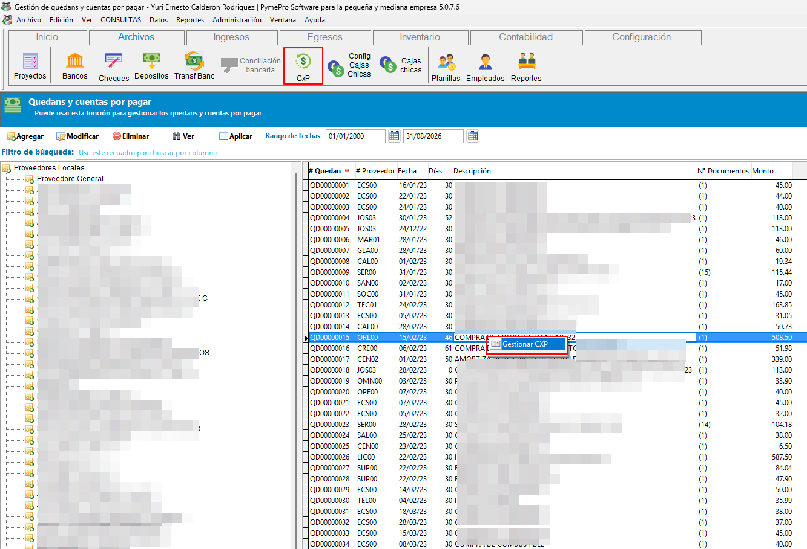
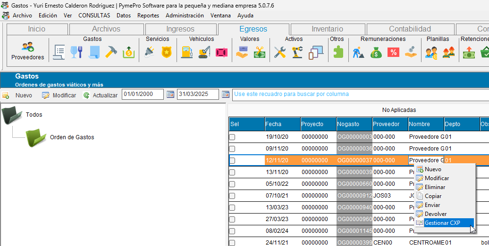
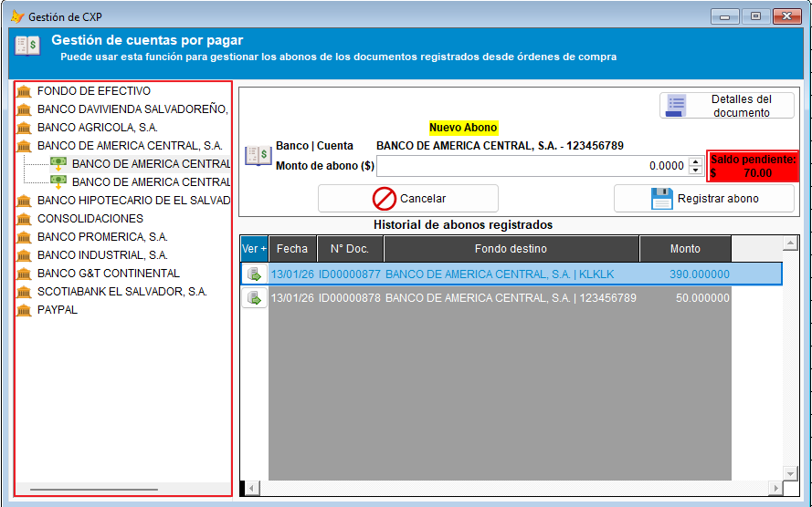
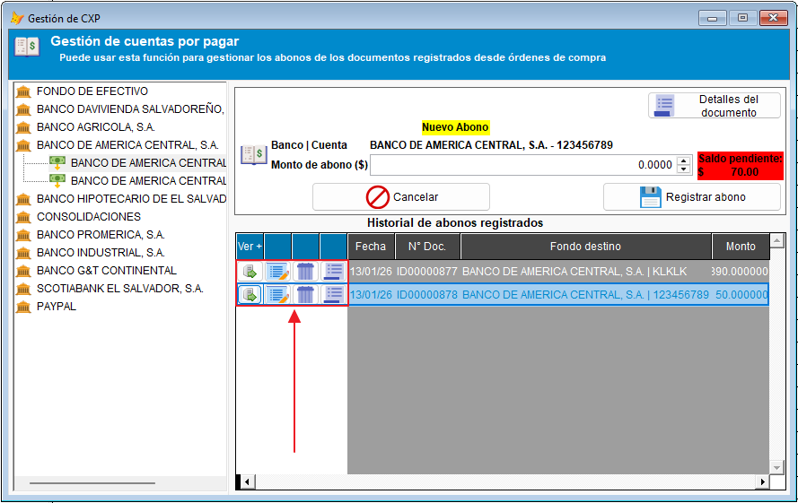
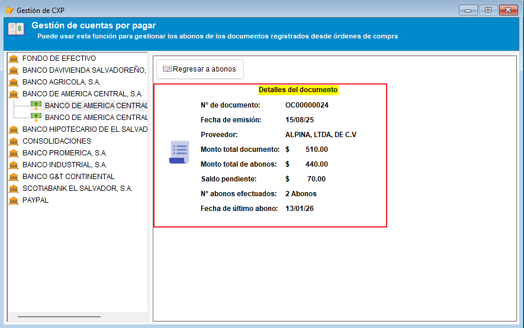
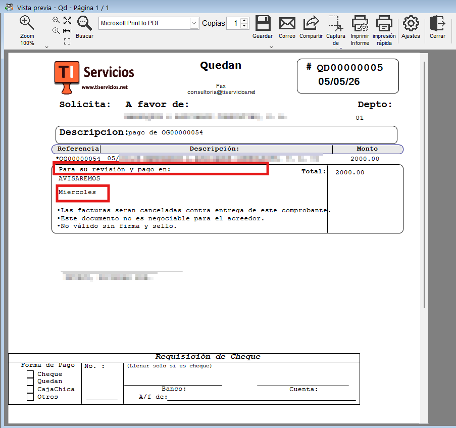

<!---
description: Guía para registrar, modificar y consultar los pagos a proveedores de una orden de compra, un quedan o una orden de gasto en ContaPortable.
--->

# 💰 Gestión de cuentas por pagar (CXP)

Use la gestión de CXP para registrar los pagos a un proveedor, cambiarlos o eliminarlos, y consultar cuánto queda pendiente. Es la misma ventana para **Órdenes de compra**, **Quedans** y **Órdenes de gasto**.

!!! abstract "En esta guía aprenderá a"
    - Abrir la gestión de CXP desde cualquier documento de compras.
    - Registrar, modificar y eliminar un abono.
    - Consultar el saldo y el detalle del documento.
    - Elegir el día de aviso de pago en un quedan.

!!! tip "¿Busca registrar una orden de gasto nueva?"
    Esta página cubre los pagos de un documento ya guardado. Para crear una orden de gasto, vea [Registro de Órdenes de Gasto (OG)](registro_ordenes_gasto.md).

---

## 📌 Antes de empezar

!!! info "Requisitos"
    - El documento debe estar guardado.
    - La cuenta bancaria desde la que paga debe existir. Si no existe, créela en [Gestión de bancos, cuentas y chequeras](../bancos/mantenimiento_bancos_cuentas_chequeras.md).

---

## 🚪 Abrir la gestión de CXP

!!! example "Paso a paso"
    1. Abra el listado de **Órdenes de compra**, **Quedans** u **Órdenes de gasto**.
    2. Ubique el documento en la lista.
    3. Haga clic derecho sobre la fila del documento.
    4. Elija **Gestionar CXP**.

{ align=center }

{ align=center }

{ align=center }

---

## 🖥️ La ventana de gestión

La ventana tiene dos pestañas:

| Pestaña | Qué muestra |
| :--- | :--- |
| **Abonos** | Los pagos ya registrados, con la opción para agregar uno nuevo. |
| **Detalles del documento** | El resumen financiero del documento. |

En el panel izquierdo aparece el árbol de **bancos y cuentas bancarias**. Ahí elige la cuenta desde la que paga. Este panel solo sirve para elegir; para crear o cambiar bancos y cuentas, use la gestión de bancos.

{ align=center }

---

## 💵 Registrar un abono

!!! example "Paso a paso"
    1. En la pestaña **Abonos**, elija el banco y la cuenta en el panel izquierdo.
    2. Escriba el monto del abono.
    3. Confirme el registro.

El abono aparece en el listado y el saldo pendiente se actualiza de inmediato.

!!! tip "Confirme la cuenta antes de pagar"
    La cuenta bancaria que elige determina el movimiento del banco. Revísela antes de confirmar.

---

## ✏️ Modificar, eliminar o ver un abono

1. En el listado de abonos, ubique el abono.
2. Abra la botonera de acciones al inicio de la fila.
3. Elija una opción:
    - **Modificar:** cambia el monto o los datos del pago.
    - **Eliminar:** borra el abono.
    - **Ver detalles:** muestra el resumen del documento.

{ align=center }

{ align=center }

!!! tip "Antes de eliminar"
    Elimine un abono solo si fue un registro equivocado. Si cambió el monto del pago, use **Modificar**.

---

## 📄 Detalles del documento

La pestaña **Detalles del documento** (o **Ver detalles** en un abono) muestra:

| Dato | Qué significa |
| :--- | :--- |
| **Monto total del documento** | El valor original de la orden, el quedan o el gasto. |
| **Número de documento** | El número con el que se guardó. |
| **Fecha de emisión** | La fecha del documento. |
| **Saldo pendiente** | Lo que aún falta pagar. |
| **Número de abonos** | Cuántos pagos se han registrado. |
| **Fecha del último abono** | Cuándo se hizo el pago más reciente. |
| **Total abonado** | La suma de todos los pagos. |

Use **Regresar a abonos** para volver al listado sin cerrar la ventana.

{ align=center }

---

## 📑 Quedans: formato y día de aviso

El quedan es el comprobante que se entrega al proveedor con el aviso de pago.

### Día de aviso

En la parte superior del quedan elija el **día de aviso**, de lunes a domingo. El día elegido se imprime en el cuerpo del comprobante, para que el proveedor sepa qué día puede presentarse. El sistema recuerda la última selección para los siguientes quedans.

{ align=center }

### Formato de impresión

Al presionar **Imprimir** puede elegir entre dos formatos:

- **Página completa:** comprobante en hoja completa, con espacio para el detalle, las firmas y los sellos.
- **Media página:** formato compacto, para ahorrar papel.

!!! warning "Falta captura"
    Menú de formato de impresión del quedan. Nombre sugerido: `quedan_seleccion_formato_01.png`.

---

## ❓ Problemas frecuentes

??? question "El abono no aparece en el listado"
    Revise que haya guardado el abono con el botón de confirmación. Si el saldo no cambió, el abono no se registró.

??? question "No encuentro mi banco en el panel izquierdo"
    Revise que la cuenta esté creada. Si no lo está, créela en la [gestión de bancos](../bancos/mantenimiento_bancos_cuentas_chequeras.md) y vuelva a abrir la ventana.

---

## 🔗 Páginas relacionadas

- [Gestión de cuentas por cobrar (CXC)](../facturacion/gestion_cuentas_por_cobrar.md): la misma lógica de abonos, del lado de facturación.
- [Gestión de bancos, cuentas y chequeras](../bancos/mantenimiento_bancos_cuentas_chequeras.md)
- [Registro de Órdenes de Compra (OC) y Ajuste (OA)](registro_ordenes_compra.md)
- [Registro de Órdenes de Gasto (OG)](registro_ordenes_gasto.md)

---
