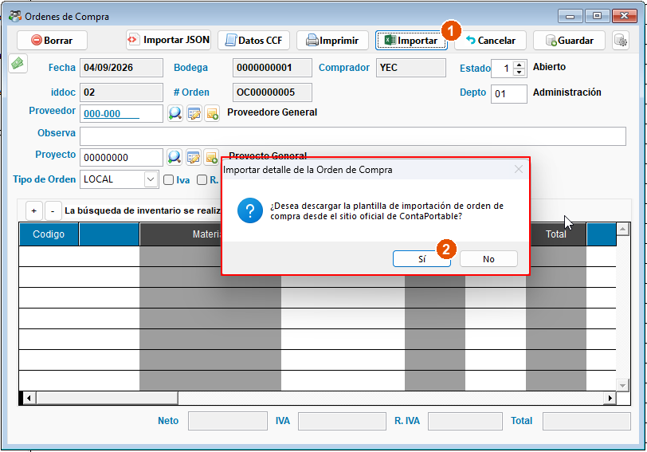
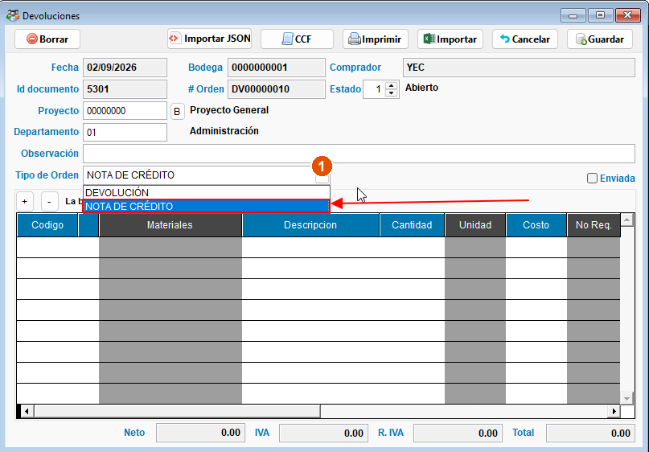
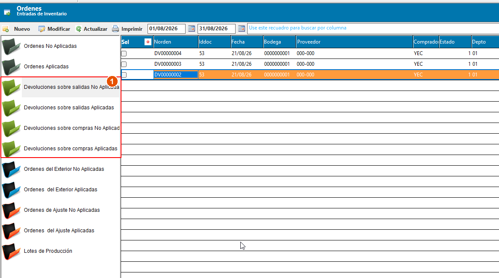

<!---
description: Guía para registrar órdenes de compra, órdenes de ajuste, órdenes del exterior y devoluciones en ContaPortable, con carga de datos desde Excel o archivo JSON y su efecto en el inventario.
--->

# 🛒 Registro de órdenes de compra

Use este módulo para registrar la mercadería que entra al inventario. Por ejemplo, una compra a un proveedor. También sirve para devolver mercadería.

!!! info "De un vistazo"
    - ⏱️ **Tiempo:** 10 minutos por documento
    - 🎚️ **Nivel:** Básico
    - ✅ **Resultado:** Documento aplicado y costos recalculados

A diferencia de la [orden de gasto](registro_ordenes_gasto.md), la orden de compra sí cambia el inventario y el costo de los productos.

Todos los documentos de este módulo usan la misma pantalla. Cambia el tipo de documento.

!!! abstract "En esta guía aprenderá a"
    - Elegir el tipo de documento correcto.
    - Crear un documento y llenar su detalle.
    - Cargar el detalle desde Excel o desde un archivo JSON.
    - Registrar una devolución.
    - Aplicar el documento y recalcular costos.

!!! tip "Pasos resumidos"
    1. Cree el documento.
    2. Llene el detalle.
    3. Guarde el documento.
    4. Aplique el documento.
    5. Recalcule costos.
    6. Revise los reportes de inventario.

---

## 📋 Tipos de documento

Elija el tipo en la lista **Tipo de documento**. Cada tipo aparece en su propio grupo del listado.

| Tipo de documento | Qué significa | Efecto en el inventario |
| :--- | :--- | :--- |
| **Orden de compra** | Compra de mercadería a un proveedor local. | Suma |
| **Orden de ajuste** | Corrige las existencias de un producto. | Suma |
| **Orden del exterior** | Compra de mercadería a un proveedor del exterior. | Suma |
| **Devolución sobre salida** | Regresa a bodega mercadería que salió con una requisición. | Suma |
| **Devolución sobre compra** | Devuelve mercadería al proveedor. | Resta |
| **Requisición de almacén** | Saca mercadería de bodega para un uso interno. | Resta |
| **Merma o pérdida** | Registra mercadería dañada, vencida o perdida. | Resta |

!!! warning "Revise el nombre antes de guardar"
    - **Orden del exterior** es para compras de importación. No es una orden de entrega.
    - **Orden de ajuste** corrige las existencias. No es un anticipo.
    - Hay dos devoluciones. Una es sobre salida y la otra es sobre compra. Elija la correcta.

---

## 🚪 Crear un documento

!!! example "Paso a paso"
    1. Elija el tipo de documento.
    2. Pulse **Nuevo**.
    3. Llene el encabezado.
    4. Llene el detalle o cárguelo, como se explica más abajo.
    5. Pulse **Guardar**.
    6. Aplique el documento y recalcule costos.

### Encabezado

| Campo | Qué escribir |
| :--- | :--- |
| **Fecha** | La fecha del documento. Define el mes en que aparece el movimiento. |
| **Proveedor** | Obligatorio en las órdenes de compra. El proveedor define los impuestos del documento. |
| **Bodega** | La bodega donde entra o sale la mercadería. |
| **Departamento** | El centro de costo del documento. |
| **Proyecto** | Opcional. Sirve para agrupar movimientos por proyecto en los reportes. |
| **Comprobante de crédito fiscal (CCF) y su fecha** | Los datos del comprobante que entregó el proveedor. Aparecen en el libro de compras. |
| **Observaciones** | Un texto libre. Los documentos creados desde otro documento indican el origen. |

---

## 🧾 Llenar el detalle

Cada línea tiene cuatro datos: **código del producto**, **descripción**, **cantidad** y **costo**. Según la configuración, también puede pedir lote, número de serie (IMEI) y fecha de vencimiento.

!!! danger "Revise el signo de la cantidad"
    - **Devolución sobre compra:** el sistema pone la cantidad en negativo. Escriba la cantidad en positivo. El sistema resta el producto del inventario.
    - **Devolución sobre salida:** el sistema respeta el signo que usted escribe.
        - Un número positivo devuelve producto a la bodega.
        - Un número negativo saca producto de la bodega.
        - El sistema no corrige el signo. Revíselo antes de guardar.

---

## 📥 Cargar el detalle

Puede cargar el detalle sin escribirlo línea por línea. Use Excel o un archivo JSON.

| Documento | Excel | Archivo JSON |
| :--- | :---: | :---: |
| Orden de compra | Sí | Sí |
| Orden de ajuste | Sí | No |
| Orden del exterior | Sí | Sí |
| Devolución sobre salida | Sí | No |
| Devolución sobre compra | Sí | Sí |

=== "1️⃣ Desde Excel"

    !!! example "Cómo cargar el detalle desde Excel"
        1. Pulse **Importar**. Aparece un menú con dos opciones.
        2. Elija **Obtener plantilla** y pulse **Sí** para descargar la plantilla oficial de ContaPortable.
        3. Abra la plantilla y escriba las líneas. Guárdela y ciérrela.
        4. Pulse **Importar**, elija **Importar plantilla** y seleccione el archivo. Se aceptan archivos **.xls** y **.xlsx**.
        5. Revise el detalle antes de guardar.

    En la captura, **①** marca el botón **Importar** y **②** marca la respuesta **Sí**.

    { align=center }

    La plantilla tiene el encabezado en la **fila 3**. Los datos empiezan en la **fila 4**. Use las columnas en este orden:

    | Columna | Qué escribir |
    | :--- | :--- |
    | **CODIGO** | El código del producto. Puede ser el código interno, un número o el código de barras. |
    | **DESCRIPCION** | La descripción de la línea. |
    | **CANTIDAD** | La cantidad, en número. |
    | **COSTO** | El costo por unidad, en número. |

    Al terminar, el sistema le indica:

    - Cuántas líneas agregó.
    - Cuántas filas sin código omitió.
    - Cuántos códigos no existen en el inventario.

    Corrija los códigos que no existen antes de guardar.

    !!! warning "Si el archivo está bloqueado"
        - **Archivo descargado de Internet:** si el sistema lo detecta, ofrece desbloquearlo antes de importar.
        - **Excel no puede abrirlo:** guárdelo como **.xlsx** y vuelva a importarlo. Si el problema continúa, haga clic derecho sobre el archivo, elija **Propiedades**, marque **Desbloquear** y pulse **Aceptar**.

    !!! tip "Búsqueda por código de barras"
        El botón de configuración (engranaje) tiene la opción **Búsqueda de inventario por código de barra**. Esta opción cambia cómo se buscan los productos al escribir el código.

=== "2️⃣ Desde archivo JSON (factura electrónica)"

    Pulse **Importar JSON** y elija el archivo que envió el proveedor. El sistema toma el proveedor, el documento y el detalle.

    | Formulario | Documentos que acepta |
    | :--- | :--- |
    | **Orden de compra** | Factura, comprobante de crédito fiscal (CCF) y factura de sujeto excluido |
    | **Orden del exterior** | Factura de exportación |
    | **Devolución sobre compra** | Nota de crédito |

    Si el archivo no corresponde al formulario, el sistema muestra un aviso y no lo importa. El aviso indica qué documentos acepta el formulario.

    !!! note "Costo de una factura"
        Una factura incluye el IVA en el total. El sistema quita el 13 % de IVA y guarda el costo sin IVA. El IVA queda como crédito fiscal.

    Esta es la forma recomendada cuando el proveedor le envía un documento electrónico. Evita errores al escribir códigos y montos.

---

## ↩️ Devoluciones

Hay dos tipos de devolución.

| Devolución | Para qué sirve | Efecto en el inventario |
| :--- | :--- | :--- |
| **Sobre salida** | Regresar a bodega mercadería que salió con una requisición y no se usó. | Suma, según el signo que usted escribe. |
| **Sobre compra** | Devolver mercadería al proveedor. | Resta siempre. |

### Devolver sobre salida

1. Elija **Devolución sobre salida** en la lista de tipos.
2. Escriba el detalle o cárguelo desde Excel.
3. Revise el signo de cada cantidad.
4. Pulse **Guardar**.

Esta devolución no usa nota de crédito ni archivo JSON.

### Devolver sobre compra

Hay dos formas de crearla.

=== "1️⃣ Desde la orden de compra (recomendado)"

    !!! example "Cómo crearla"
        1. Abra la orden de compra guardada en modo de edición.
        2. Haga clic derecho sobre el detalle y elija **Generar devolución sobre compra**.
        3. Confirme. El sistema copia el detalle con las cantidades en negativo.
        4. Ajuste la devolución. Deje solo lo que realmente devuelve.

    La devolución queda enlazada a la orden de origen. Así los reportes pueden seguir la compra.

    !!! note "Una devolución por orden"
        El sistema no crea una segunda devolución para una orden que ya tiene una. Si necesita devolver más, modifique la devolución existente.

    !!! warning "La orden debe estar aplicada"
        Una orden que no está aplicada no cambia el inventario. El sistema no crea la devolución y muestra un aviso.

=== "2️⃣ Desde la lista de tipos"

    Elija **Devolución sobre compra** en la lista de tipos. Escriba el detalle, cárguelo desde Excel o cárguelo desde el archivo JSON de la nota de crédito.

### Tipo de devolución: devolución o nota de crédito

En la ventana de la devolución, elija el **Tipo de orden**.

| Opción | Cuándo usarla | Efecto en el libro de compras |
| :--- | :--- | :--- |
| **DEVOLUCIÓN** | El proveedor no emitió nota de crédito. | Solo cambia el inventario. |
| **NOTA DE CRÉDITO** | El proveedor emitió una nota de crédito. | Aparece como nota de crédito en el libro de compras. |

**①** marca la lista **Tipo de orden**.

{ align=center }

Si carga el archivo JSON de una nota de crédito, el tipo cambia solo a **NOTA DE CRÉDITO**. Si el proveedor no emitió nota, cambie el tipo a **DEVOLUCIÓN**.

!!! example "Datos de la nota de crédito"
    Con el tipo **NOTA DE CRÉDITO**, pulse el botón **Datos NC**. Se abre la ventana con los datos fiscales de la nota.

    | Campo | Qué escribir |
    | :--- | :--- |
    | **Número de nota de crédito** | En una nota electrónica, el código de generación de 36 caracteres. |
    | **Serie** y **clase de documento** | Los datos del documento que emitió el proveedor. |
    | **Fecha del documento** | La fecha en que se emitió la nota. |
    | **Período en que se declara** | El mes y el año. El IVA de la nota se incluye en ese período. |
    | **Registro de IVA** | El NRC del proveedor. |
    | **Formulario único** | Un dato adicional, si aplica. |

    Pulse **Guardar y regresar** para confirmar. Pulse **Cancelar y regresar** para descartar los datos. Si cargó el JSON, estos datos ya vienen llenos.

!!! warning "Sin registro de IVA y período, la nota no aparece en el libro"
    Una nota de crédito aparece en el libro de compras y en los anexos, en el período que usted declara. Si no llena el **Registro de IVA** y el **período**, la nota no aparece.

---

## ✅ Aplicar el documento

Un documento recién guardado **no está aplicado**. Aplicarlo confirma el movimiento.

Un documento que no está aplicado puede no cambiar el inventario. Esta es la causa más común de que una compra no aparezca en las existencias.

En el listado, cada tipo tiene dos grupos: **No aplicadas** y **Aplicadas**. Las devoluciones tienen cuatro grupos:

- Devoluciones sobre salidas, no aplicadas.
- Devoluciones sobre salidas, aplicadas.
- Devoluciones sobre compras, no aplicadas.
- Devoluciones sobre compras, aplicadas.

**①** marca los cuatro grupos de devoluciones.

{ align=center }

Para mover un documento de un grupo a otro, haga clic derecho sobre el documento y elija **Enviar** o **Devolver**. Sus permisos de usuario controlan si ve estas opciones.

---

## 📊 Efecto en el inventario

!!! danger "Los cambios no aparecen al guardar"
    Al guardar un documento, las existencias y los costos de los reportes **no cambian de inmediato**. Los cambios aparecen cuando usted pulsa **Recalcular costos**.

Si registró una compra y el reporte de existencias no la muestra, lo más probable es que falte recalcular. El documento puede estar bien.

**Pulse Recalcular costos:**

- Después de registrar, modificar o anular un documento de inventario.
- Después de aplicar o desaplicar un documento.
- Después de cambiar un parámetro de inventario.
- Antes de emitir un reporte de kardex o de costos para un cierre o una auditoría.

El recálculo revisa las órdenes de compra, las requisiciones y las ventas. Luego vuelve a calcular las entradas, las salidas, los saldos y el costo promedio de cada producto.

!!! info "Costo promedio en cero"
    Si una salida deja la existencia de un producto en cero, el costo promedio de ese movimiento queda en cero. Es el resultado esperado. No es un error.

!!! tip "Costo de la devolución sobre compra"
    Con el parámetro **Respetar costo en OA kits y devoluciones sobre compra** activado, la devolución sale con el costo que tiene el documento original. Si está desactivado, el sistema recalcula el costo. Antes de cambiar este parámetro, lea [Parámetros de inventario](../../Parametros/Modulos/Inventario/ParametrosInventario.md). El kardex y el valor del inventario pueden no coincidir.

---

## ❓ Problemas frecuentes

??? question "La compra no aparece en las existencias"
    Confirme que el documento esté aplicado. Luego pulse **Recalcular costos**.

??? question "El archivo de Excel no se importa"
    Guárdelo como .xlsx. Revise que el encabezado esté en la fila 3 y que los datos empiecen en la fila 4.

??? question "Un código del Excel no aparece en el detalle"
    El código no existe en el inventario. Corrija el código en la plantilla y vuelva a importarla.

??? question "El sistema no importa el archivo JSON"
    El archivo no corresponde a ese formulario. Lea el aviso. Indica qué documentos acepta el formulario. Abra el formulario correcto y vuelva a importar el archivo.

---

## 📌 Buenas prácticas

- Pulse **Recalcular costos** antes de emitir cualquier reporte de inventario.
- Aplique los documentos el mismo día que los registra.
- Cree las devoluciones desde la orden de origen. Así conserva el vínculo con la compra.
- Revise el signo de las cantidades en las devoluciones sobre salida.
- Use la carga desde JSON cuando el proveedor le envíe un documento electrónico, incluidas sus notas de crédito.
- Use siempre la plantilla oficial al cargar desde Excel.

---

## 🔗 Páginas relacionadas

- [Parámetros de inventario](../../Parametros/Modulos/Inventario/ParametrosInventario.md): opciones de costo, decimales y documentos que afectan las existencias.
- [Gestión de cuentas por pagar (CXP)](gestion_cuentas_por_pagar.md): el pago de las órdenes de compra.
- [Registro de órdenes de gasto (OG)](registro_ordenes_gasto.md): egresos que no son de inventario.
- [Requisiciones y mermas](../inventario/requisiciones-mermas-y-perdidas.md): las salidas de inventario.
- [Gestión de inventario](../inventario/GestionInventario.md): visión general del módulo.

---
