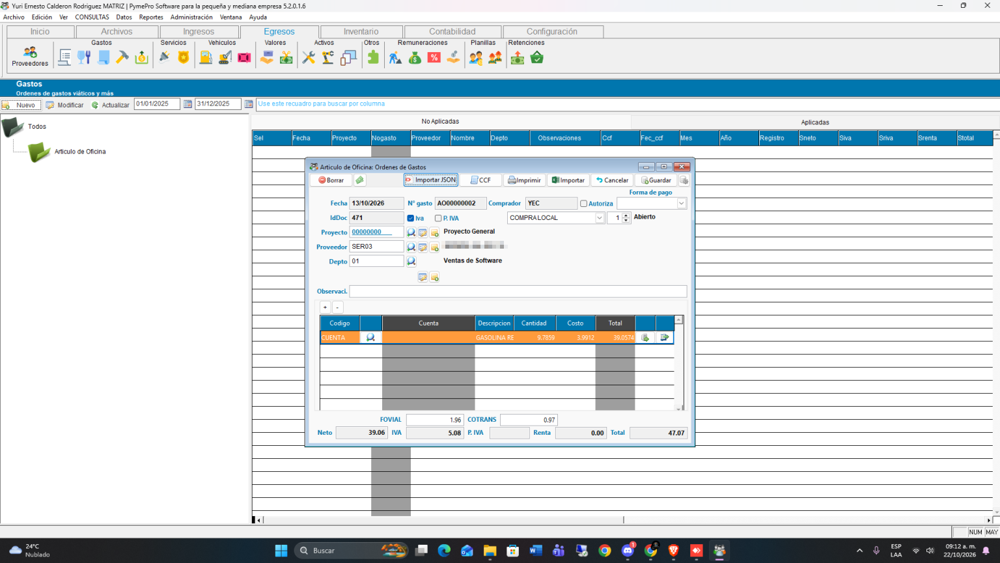
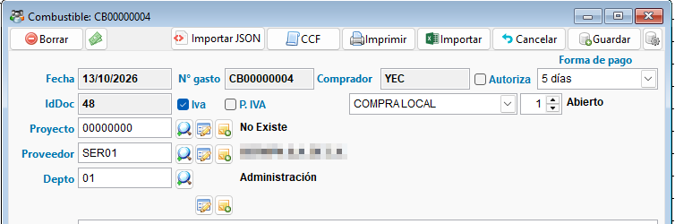
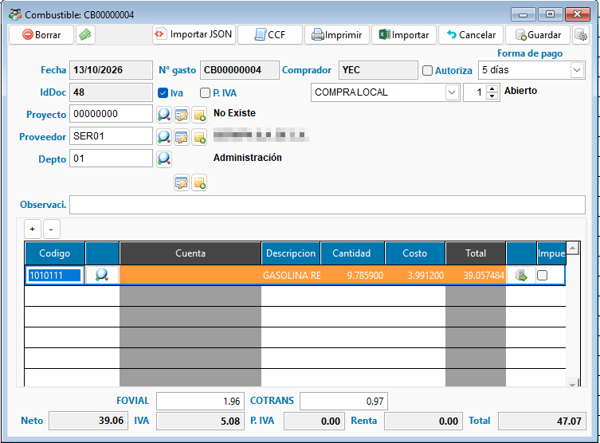
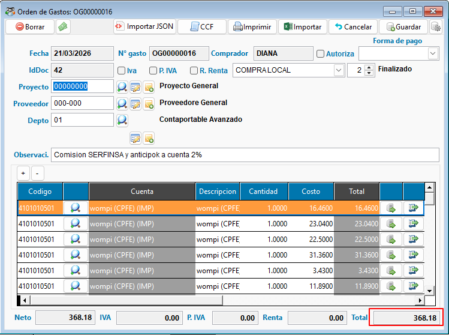

<!---
description: Guía para registrar una Orden de Gasto en ContaPortable: encabezado, líneas de detalle, impuestos y totales, precisión de decimales y pago posterior.
--->

# 🧾 Registro de Órdenes de Gasto (OG)

Use la Orden de Gasto para registrar los gastos operativos de la empresa: combustible, reparaciones, servicios, gastos administrativos y cualquier egreso que no sea una compra de inventario.

!!! abstract "En esta guía aprenderá a"
    - Crear una orden de gasto con su encabezado y sus líneas de detalle.
    - Revisar los impuestos y los totales.
    - Importar líneas desde Excel o desde un DTE en JSON.
    - Configurar los decimales de los costos.
    - Registrar el pago después de guardar.

---

## 📌 Antes de empezar

!!! info "Requisitos"
    - El proveedor debe estar creado.
    - Tenga a la mano la fecha, la forma de pago y el detalle del gasto.
    - Para líneas de gasto, use **cuentas de detalle**. Las cuentas de mayor no se pueden usar en la orden.

---

## 🚀 Crear una orden de gasto

!!! example "Paso a paso"
    1. Abra **Compras** en la barra de herramientas y elija **Órdenes de gasto**.
    2. Presione **Nuevo**.
    3. Complete el encabezado: proveedor, fecha, forma de pago y proyecto o departamento.
    4. Agregue las líneas de gasto en el detalle: código o cuenta, cantidad y costo.
    5. Revise los impuestos y los totales.
    6. Presione **Guardar**.
    7. Registre el pago desde la [gestión de CXP](gestion_cuentas_por_pagar.md).

{ align=center }

---

## 🚪 Encabezado del documento

Estos son los campos que se capturan en la parte superior:

| Campo | Qué escribir |
| :--- | :--- |
| **Fecha** | La fecha del gasto. |
| **Proveedor** | El proveedor al que corresponde el gasto. |
| **Comprador** | La persona que hizo la compra o la gestión. |
| **Forma de pago** | Cómo se pagará o se pagó el gasto. |
| **Proyecto / Depto** | El proyecto o departamento al que se imputa el gasto. |
| **Vehículo** | La unidad relacionada, cuando el gasto es de combustible o reparación. Vea [OG por mantenimiento de vehículos](OG_mantenimiento_vehiculos.md). |
| **Observaciones** | Un texto libre sobre el gasto. |

Las casillas **IVA**, **Retención de IVA**, **Retención de Renta** y **Autoriza** determinan qué impuestos aplican y si la orden requiere autorización.

{ align=center }

---

## 📋 Líneas de detalle

Agregue una línea por cada concepto del gasto. Use los botones **+** y **-** para añadir o quitar líneas.

| Columna | Qué hace |
| :--- | :--- |
| **Código / Cuenta** | La cuenta contable o el código de inventario del gasto. |
| **Descripción** | El detalle de la línea. |
| **Cantidad** y **Costo** | Con estos dos datos se calcula el **Total** de la línea. |
| **IVA**, **R. IVA**, **Renta** | Los impuestos que aplican a esa línea. |
| **Proyecto / Depto** | Permite asignar otro proyecto o departamento a la línea. |
| **Vehículo** | Vincula la línea con una unidad, en combustible o reparación. |

{ align=center }

!!! warning "Use cuentas de detalle"
    La columna **Código** no acepta cuentas de mayor. Si elige una, el sistema muestra el aviso *"La cuenta XXXX es de mayor y no se puede usar en la Orden de Gasto. Elija una cuenta de detalle."* y vacía la celda.

    Al guardar, si una línea tiene una cuenta de mayor, el sistema muestra *"Lineas No. N contiene una cuenta de mayor"* y no guarda la orden. Corrija esas líneas y guarde de nuevo.

### Importar líneas

!!! tip "Desde Excel"
    El botón **Importar** carga las líneas desde un archivo Excel con las columnas **Código, Descripción, Cantidad y Costo**. Es útil cuando la orden tiene muchas líneas.

!!! tip "Desde un DTE en JSON"
    El botón **Importar JSON** carga un comprobante DTE en formato JSON. Vea el detalle en [Importar JSON del DTE en OG](importJsonOG.md).

---

## 💵 Impuestos y totales

En la parte inferior se muestran **Neto**, **IVA**, **R. IVA**, **Renta** y **Total**. Se calculan a partir del detalle.

Para combustible, también aparecen **FOVIAL** y **COTRANS**. Forman parte del total y se llenan al importar el DTE de la compra. Vea [Importar JSON del DTE en OG](importJsonOG.md).

Si cambió líneas a mano y los impuestos no se actualizan, use el botón de recálculo de la barra superior.

{ align=center }

!!! warning "Montos fuera de rango"
    Si el neto, el IVA, las retenciones, el monto exento o el total superan **99,999,999.999999**, la orden no se guarda y aparece el mensaje *"El monto calculado excede el máximo permitido..."*. Revise la cantidad y el costo de las líneas.

---

## 🔢 Precisión de decimales

Puede definir entre **2 y 6 decimales** para los costos y totales. La configuración aplica a esta orden.

!!! example "Cómo cambiarla"
    1. Abra o cree una orden de gasto.
    2. Presione el botón de **Configuración**, en la parte superior del formulario.
    3. Elija **Configuración** en el menú.
    4. Escriba la cantidad de decimales, entre 2 y 6.
    5. Acepte. Los costos y totales se actualizan sin cerrar la orden.

!!! warning "Falta captura"
    Ventana de configuración de decimales. Nombre sugerido: `05_precision_decimales.png`.

!!! info "Dónde se refleja"
    La precisión también aparece en los cheques, los depósitos y los reportes impresos de la orden, hasta 6 decimales. Los montos de los documentos bancarios siguen mostrando 2 decimales.

---

## 🖨️ Otros botones

| Botón | Función |
| :--- | :--- |
| **Guardar** | Guarda la orden. |
| **Cancelar** | Descarta los cambios sin guardar. |
| **Borrar** | Elimina la orden actual. |
| **Imprimir** | Genera el reporte impreso de la orden. |
| **CCF** | Gestiona el comprobante de crédito fiscal asociado. |

---

## 💰 Después de guardar

Registre el pago desde la [gestión de CXP](gestion_cuentas_por_pagar.md): clic derecho sobre la orden en el listado y **Gestionar CXP**.

---

## ❓ Problemas frecuentes

??? question "No puedo guardar la orden"
    Revise si hay líneas con cuentas de mayor, o si un monto supera el máximo permitido. El sistema indica el número de la línea o el monto afectado.

??? question "Los totales no coinciden con el comprobante"
    Revise la cantidad y el costo de cada línea, y que los impuestos estén marcados. Si importó un JSON, compare los totales contra el DTE.

---

## 🔗 Páginas relacionadas

- [Gestión de cuentas por pagar (CXP)](gestion_cuentas_por_pagar.md)
- [Registro de Órdenes de Compra (OC) y Ajuste (OA)](registro_ordenes_compra.md)
- [OG por mantenimiento de vehículos](OG_mantenimiento_vehiculos.md)
- [Importar JSON del DTE en OG](importJsonOG.md)

---
