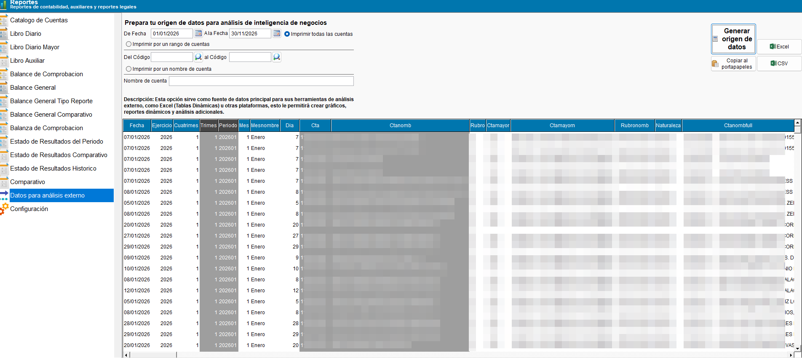

<!---
description: Guía de los reportes de la pantalla Reportes Contables de ContaPortable: catálogo, libros, balances, estados de resultados y datos para análisis externo.
-->

# 📒 **Reportes contables**

Esta guía explica cómo preparar los libros contables, los balances y los estados de resultados. Todos se preparan en la pantalla **Reportes Contables** de **ContaPortable**.

!!! abstract "En esta guía"
    - Encontrar el reporte que necesita.
    - Preparar, calcular, imprimir y exportar un reporte.
    - Entender cómo el sistema calcula los saldos.

---

## 📌 Introducción

### 🖥️ Cómo usar la pantalla

La pantalla tiene la lista de reportes a la izquierda y los filtros en el centro. Los botones están a la derecha.

!!! example "Cómo generar un reporte"
    1. Seleccione el reporte en la lista de la izquierda.
    2. Escriba los filtros en el panel **Prepara tu reporte**.
    3. Presione **Calcular**.
    4. Presione **Imprimir** para ver la vista previa, o **Excel** para exportar.

    { align=center }

| Botón | Qué hace |
| :--- | :--- |
| **Calcular** | Genera la información con los filtros que escribió. |
| **Imprimir** | Abre la vista previa del reporte. |
| **Excel** | Exporta el reporte a una hoja de cálculo. |
| **Copiar al portapapeles** | Copia los datos para pegarlos en otro programa. Está disponible solo en **Libro Auxiliar** y en **Datos para análisis externo**. |
| **CSV** | Guarda los datos en un archivo CSV. Está disponible solo en **Libro Auxiliar** y en **Datos para análisis externo**. |

### 🔎 Filtro de cuentas

Casi todos los reportes usan el mismo filtro de cuentas. Elija una de estas tres opciones:

| Opción | Qué hace |
| :--- | :--- |
| **Imprimir todas las cuentas** | Incluye todo el catálogo. |
| **Imprimir por un rango de cuentas** | Incluye las cuentas entre **Del código** y **al código**. Si deja vacío **al código**, el sistema usa el mismo código de **Del código**. |
| **Imprimir por un nombre de cuenta** | Busca el texto que escriba en cualquier parte del nombre de la cuenta. |

!!! warning "Avisos del filtro de cuentas"
    Si falta un dato, el sistema muestra un aviso. Escriba el dato que falta y presione **Calcular** de nuevo.

    - **Código uno no ha sido introducido**
    - **Digite un nombre de cuenta**

### 🧮 Cómo se calculan los saldos

!!! note "Reglas de cálculo"
    - El **saldo inicial** es la suma de todos los movimientos anteriores a la fecha inicial.
    - El **saldo final** es la suma de todos los movimientos hasta la fecha final.
    - Una cuenta deudora calcula **Debe − Haber**.
    - Una cuenta acreedora calcula **Haber − Debe**.

!!! tip "Cambios recientes"
    - **Libro Auxiliar en Excel:** la columna **Saldo** ya no se suma hacia abajo. La fila final muestra el saldo final de la cuenta.
    - **Libro Diario:** al imprimir, cada partida muestra primero los cargos y después los abonos.
    - **Reportes impresos:** el título tiene más espacio para el nombre de la empresa. Un nombre largo ya no se corta.

---

## 🧭 Qué necesito hacer

Busque su objetivo y vaya al reporte que corresponde.

| Quiero... | Use este reporte |
| :--- | :--- |
| Consultar o imprimir las cuentas de la empresa | [Catálogo de cuentas](reportes_contables/catalogo_y_libros.md#11-catalogo-de-cuentas) |
| Revisar las partidas del período | [Libro Diario](reportes_contables/catalogo_y_libros.md#12-libro-diario) |
| Resumir los movimientos por cuenta de mayor | [Libro Diario Mayor](reportes_contables/catalogo_y_libros.md#13-libro-diario-mayor) |
| Revisar los movimientos y el saldo de una cuenta | [Libro Auxiliar](reportes_contables/catalogo_y_libros.md#14-libro-auxiliar) |
| Comprobar que la contabilidad cuadra | [Balance de Comprobación](reportes_contables/balances.md#21-balance-de-comprobacion) con **Balance de Saldos Comprobatorio** |
| Ver la situación financiera a una fecha | [Balance General](reportes_contables/balances.md#22-balance-general) |
| Comparar la situación financiera de dos años | [Balance General Comparativo](reportes_contables/balances.md#24-balance-general-comparativo) |
| Ver los resultados de un mes y del año | [Estado de Resultados del Periodo](reportes_contables/estados_de_resultados.md#31-estado-de-resultados-del-periodo) |
| Comparar los resultados de dos años | [Estado de Resultados Comparativo](reportes_contables/estados_de_resultados.md#32-estado-de-resultados-comparativo) |
| Ver el historial de resultados | [Estado de Resultados Histórico](reportes_contables/estados_de_resultados.md#33-estado-de-resultados-historico) |
| Comparar cuentas mes por mes | [Comparativo](reportes_contables/analisis.md#41-comparativo) |
| Analizar los movimientos en Excel u otra herramienta | [Datos para análisis externo](reportes_contables/analisis.md#42-datos-para-analisis-externo) |
| Ajustar las cuentas del catálogo y la impresora de los reportes | [Configuración](reportes_contables/configuracion.md) |

<!-- Diagrama de las categorías de reportes de la pantalla Reportes Contables -->
!!! tip "Diagrama de las categorías de **Reportes contables**"
    ``` mermaid
    graph TD
      A[Reportes contables]:::root

      subgraph "Categorías"
        B[1. Catálogo y libros]
        C[2. Balances]
        D[3. Estados de resultados]
        E[4. Análisis]
        F[5. Configuración]
      end

      A --> B
      A --> C
      A --> D
      A --> E
      A --> F

    click B "reportes_contables/catalogo_y_libros.md" "Ir a catálogo y libros"
    click C "reportes_contables/balances.md" "Ir a balances"
    click D "reportes_contables/estados_de_resultados.md" "Ir a estados de resultados"
    click E "reportes_contables/analisis.md" "Ir a análisis"
    click F "reportes_contables/configuracion.md" "Ir a configuración"
    ```

---

## 📚 Categorías

- [1. Catálogo y libros](reportes_contables/catalogo_y_libros.md): catálogo de cuentas, Libro Diario, Libro Diario Mayor y Libro Auxiliar.
- [2. Balances](reportes_contables/balances.md): balance de comprobación, balance general y sus variantes.
- [3. Estados de resultados](reportes_contables/estados_de_resultados.md): período, comparativo e histórico.
- [4. Análisis](reportes_contables/analisis.md): reporte comparativo y datos para análisis externo.
- [5. Configuración](reportes_contables/configuracion.md): opciones de impresión y de reportes.

---

## 🔗 Módulos relacionados

- [Contabilización automática](contabilizacion_automatica.md): generación de las partidas automáticas.
- [Control de periodos](control_periodos.md): cierres y vigencia contable.
- [Reportes de clientes](../../Reports/categorias/clientes.md): incluye la antigüedad de saldos y los estados de cuenta de clientes.
- [Reportes generales](../../Reports/reportes.md): vista general de las categorías de reportes del sistema.
