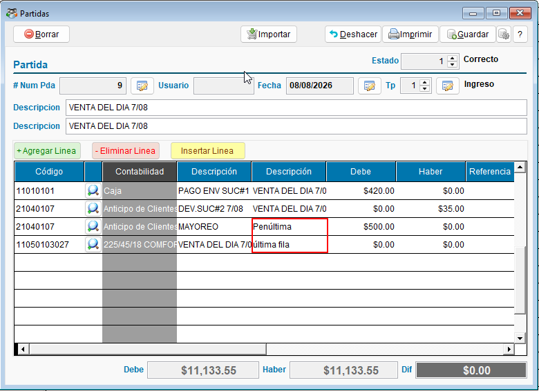
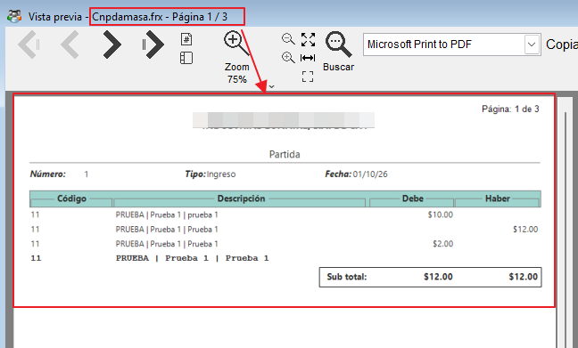

<!---
description: Guía para capturar, revisar e imprimir partidas contables a mano en ContaPortable, incluidas las partidas únicas y la vista previa de varias partidas.
--->

# 📘 Captura y edición de partida contable

Use la captura de partidas para registrar asientos que no vienen de la contabilización automática, como ajustes o movimientos especiales. También sirve para corregir partidas ya creadas.

!!! abstract "En esta guía aprenderá a"
    - Abrir y capturar el detalle de una partida.
    - Entender las líneas que el sistema marca en rojo.
    - Imprimir una partida o varias a la vez.
    - Mantener el orden de las líneas al imprimir.

!!! tip "¿Busca crear partidas desde documentos?"
    Para crear partidas a partir de ventas, cheques o depósitos, vea [Contabilización automática](contabilizacion_automatica.md).

---

## 📌 Antes de empezar

!!! info "Requisitos"
    - El **periodo** de la partida debe estar abierto. Vea [Control de cierre de períodos contables](control_periodos.md).
    - Tenga claras las cuentas y los montos del asiento.
    - Use cuentas de **detalle**. Las cuentas de mayor no se usan para registrar movimientos.

---

## 🚀 Capturar una partida

!!! example "Paso a paso"
    1. Abra el módulo de **Contabilidad** y elija **Partidas**.
    2. Seleccione la partida que quiere modificar, o presione **Nuevo** para crear una.
    3. En la cuadrícula de detalle, elija la **cuenta** de la línea.
    4. Escriba la **descripción** del movimiento.
    5. Registre el monto en **Debe** o en **Haber**, según corresponda.
    6. Repita los pasos 3 a 5 hasta completar el asiento.
    7. Revise que la partida esté cuadrada: el total de **Debe** debe ser igual al total de **Haber**.
    8. Presione **Guardar**.

{ align=center }

!!! warning "Falta captura"
    Pantalla de acceso a **Partidas** desde el módulo de Contabilidad. Nombre sugerido: `01_acceso_partida_contable.png`.

### ➕ Agregar líneas

- **Insertar Línea:** agrega una línea justo en la posición donde está el cursor. Así no tiene que mover las líneas que ya capturó.
- **Flecha abajo, en una partida única:** cuando el cursor está en la última línea, presione la **flecha abajo** para agregar una línea nueva. El cursor queda en la columna de **fecha**.

!!! note "Cuándo la flecha no agrega línea"
    - La última línea está en blanco.
    - La cuenta de la última línea no existe o es una cuenta de mayor. El sistema avisa, y debe corregir la cuenta.
    - La partida pertenece a un periodo cerrado.

---

## 🚦 Líneas marcadas en rojo

El formulario resalta en **rojo** las líneas con una inconsistencia. Corríjalas antes de guardar.

!!! warning "Falta captura"
    Captura con las líneas en rojo. Nombre sugerido: `03_validaciones_visuales.png`.

Las **cuentas de mayor** también se resaltan, porque lo normal es registrar en cuentas de detalle.

!!! tip "Cuenta sin cuenta específica"
    Si una línea no corresponde a una cuenta de mayor específica, puede usar el código **SinCuenta** para guardar la partida.

---

## 🛑 Si no se puede guardar

Si el sistema no logra guardar el detalle al cerrar la partida, la ventana **no se cierra**. Las líneas quedan en pantalla para que corrija el problema y vuelva a guardar.

- Para descartar la partida sin guardar, elija **No deseo guardar** al cerrar.
- Al descartar una partida nueva que nunca se guardó, las líneas de otra partida con el mismo número no se borran.

---

## 🔢 Número de partida

El sistema puede asignar el número de la partida al guardar. Quien administra el sistema define si esta asignación está activa.

- **Activa:** no escribe el número. El sistema lo asigna y no lo repite, aunque varios usuarios guarden al mismo tiempo.
- **Inactiva:** escribe el número a mano.

### Partidas únicas

En una **partida única** (una por mes y tipo), los movimientos se numeran **1, 2, 3...** según su fecha, sin saltos por los días sin movimientos. Los movimientos de una misma fecha comparten número. Al guardar, el sistema vuelve a numerar la partida.

---

## 🔒 Periodos cerrados

No se pueden crear ni borrar partidas en un periodo cerrado o fuera del rango autorizado. Si recibe un mensaje de bloqueo por fecha:

1. Revise que la fecha de la partida sea la correcta.
2. Si la fecha es correcta, pida a un administrador la apertura temporal del periodo.
3. Vuelva a intentar la operación.

---

## 🖨️ Imprimir una partida

La partida se puede imprimir en formato compacto. Este formato muestra el asiento en una vista resumida.

{ align=center }

En el formato compacto:

- El encabezado admite nombres de empresa largos sin recortarlos.
- El código de cuenta se muestra completo.
- Los encabezados de columna se repiten en cada página.

### Mantener el orden de las líneas

Por defecto, la partida impresa muestra primero los cargos y después los abonos, ordenados por cuenta. Si prefiere que las líneas salgan **en el orden en que las capturó**, active **Mantener orden exacto al imprimir**.

Puede activarla desde:
- **Partida única:** el botón de **Configuración**, junto a **Salir**, o clic derecho sobre **Imprimir**.
- **Partida individual:** el menú de configuración de la partida.
- **Configuración de contabilidad:** la casilla con el mismo nombre.

La opción aplica a todas las partidas de la empresa, incluida la vista previa de varias partidas.

!!! note "En la partida única, el orden por fecha no cambia"
    Aunque la opción esté activa, la partida única sigue agrupada por fecha. Dentro de cada fecha, las líneas salen en el orden en que las capturó.

---

## 👁️ Vista previa de varias partidas

Puede revisar o imprimir varias partidas en un solo reporte:

1. En el listado de partidas, marque con la casilla **Sel** las partidas que quiere ver.
2. Haga clic derecho y elija **Vista previa de Partida**.
3. El reporte muestra las partidas marcadas, ordenadas por fecha y número.

- Cada partida tiene su propio encabezado, subtotal y página.
- Si alguna partida marcada no tiene líneas, el sistema avisa cuántas omitió y muestra las demás.
- Con una sola partida marcada, la vista previa muestra la partida donde está el cursor.

---

## 📌 Buenas prácticas

- Revise las líneas en rojo antes de guardar.
- Verifique que la partida esté cuadrada antes de guardar, sobre todo si tiene valores negativos.
- Use **SinCuenta** solo cuando no aplique una cuenta de mayor específica.
- Revise la fecha de la partida al inicio de cada ejercicio, para evitar bloqueos por periodo cerrado.
- Para revisar varias partidas, márquelas en el listado y use **Vista previa de Partida**.

---

## 🔗 Páginas relacionadas

- [Contabilización automática](contabilizacion_automatica.md)
- [Control de cierre de períodos contables](control_periodos.md)
- [Reportes Contables](ReportesContables.md)

---
