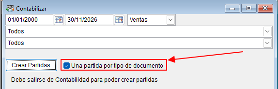
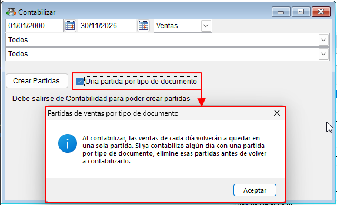
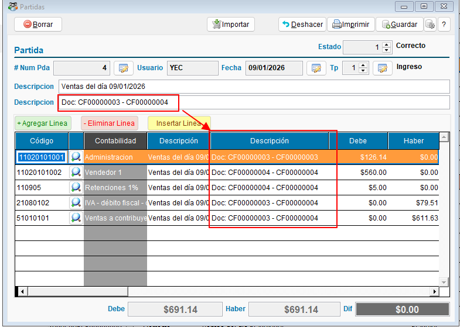
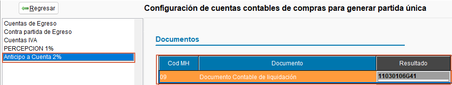
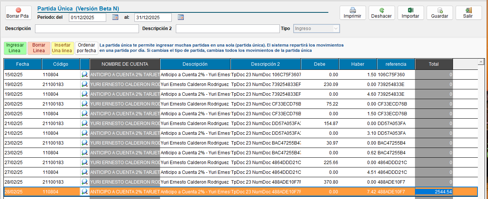
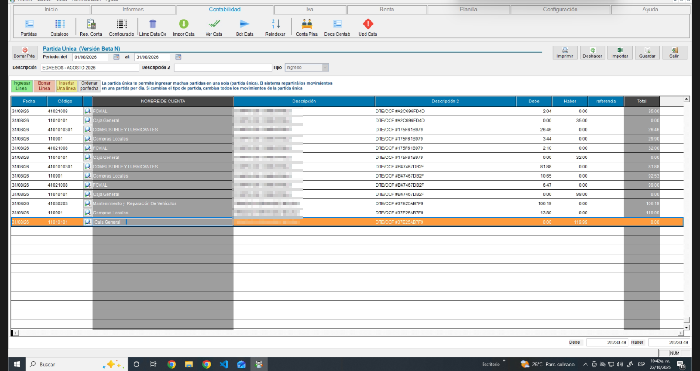

<!---
description: Guía para contabilizar automáticamente los documentos de un periodo en ContaPortable, agrupar las ventas por tipo de documento y revisar las partidas generadas.
--->

# ⚙️ Contabilización automática Actualizado

La contabilización automática crea las partidas contables a partir de los documentos del periodo: ventas, cheques, depósitos, quedans, caja chica y retaceos. Así no tiene que capturar cada asiento a mano.

!!! abstract "En esta guía aprenderá a"
    - Contabilizar los documentos de un periodo.
    - Crear una partida por tipo de documento en las ventas.
    - Revisar la configuración de cuentas que usa el proceso.
    - Resolver los avisos más comunes.

!!! tip "¿Busca capturar una partida a mano?"
    Esta página explica la contabilización automática. Para capturar o editar una partida manualmente, vea [Captura y edición de Partida Contable](captura_partida_contable.md).

---

## 📌 Antes de empezar

!!! info "Requisitos"
    - La **configuración de cuentas** de su empresa debe estar revisada. Las cuentas que usa el proceso dependen de su catálogo.
    - El **periodo** que va a contabilizar debe estar abierto. Vea [Control de cierre de períodos contables](control_periodos.md).
    - Los documentos del periodo deben estar completos.

!!! warning "Salga de Contabilidad antes de empezar"
    El sistema indica **"Debe salirse de Contabilidad para poder crear partidas"**. Cierre la pantalla de Contabilidad antes de presionar **Crear Partidas**.

---

## 🚀 Contabilizar los documentos de un periodo

!!! example "Paso a paso"
    1. Abra **Contabilizar**, desde el módulo de **Contabilidad**.
    2. Escriba la fecha inicial y la fecha final del periodo.
    3. Elija el tipo de documento en la lista: **Cheques**, **Depósitos**, **Quedans**, **Caja chica**, **Ventas** o **Retaceos**.
    4. Si elige **Ventas** y quiere una partida por tipo de documento, marque la casilla de la sección [Partidas de ventas por tipo de documento](#partidas-de-ventas-por-tipo-de-documento).
    5. Presione **Crear Partidas**.
    6. Revise las partidas generadas en el módulo de **Partidas**.

{ align=center }

!!! note "Qué hace el proceso"
    El sistema revisa cada documento del periodo, identifica su tipo y aplica la regla de cuentas que le corresponde. Con esas reglas genera las partidas. Las partidas quedan disponibles para revisión y para los reportes contables.

!!! warning "Periodos cerrados"
    Si el periodo está cerrado o fuera del rango autorizado, el proceso se detiene o marca los documentos afectados. Pida a un administrador que abra el periodo o amplíe el rango, y vuelva a intentar.

---

## 🧾 Partidas de ventas por tipo de documento

Por defecto, todas las ventas de un día quedan en una sola partida. Si marca la casilla **Una partida por tipo de documento**, el sistema crea una partida por cada tipo de documento del día. Así puede revisar por separado, por ejemplo, las facturas y los créditos fiscales.

!!! example "Cómo activarla"
    1. Abra **Contabilizar** y elija el tipo **Ventas**.
    2. Marque la casilla **Una partida por tipo de documento**.
    3. Presione **Crear Partidas**.

Al marcarla, aparece un aviso. Léalo antes de continuar.

{ align=center }

!!! warning "Si ya contabilizó ese día"
    Si ya contabilizó un día con la otra opción, **elimine primero las partidas de ventas de ese día**. Luego vuelva a contabilizarlo. Si no lo hace, quedan partidas repetidas o mezcladas. Para eliminar una partida, vea [Captura y edición de Partida Contable](captura_partida_contable.md).

### 🔎 Cómo se ve el resultado

Cada partida de ventas muestra en su descripción el rango de documentos que contiene. El formato es **Doc:** primer documento y último documento.

{ align=center }

---

## ⚙️ Configuración de cuentas

La configuración de cuentas indica qué cuenta se usa para cada tipo de movimiento. La configura quien administra la contabilidad de la empresa.

{ align=center }

!!! tip "Revise la configuración después de cambiar el catálogo"
    Si cambia cuentas del catálogo, revise la configuración antes de contabilizar. Una cuenta incorrecta se propaga a todas las partidas del periodo.

---

## 💵 Anticipo a cuenta 2% (documentos de liquidación)

El anticipo a cuenta 2% se configura dentro de las cuentas de ventas y de compras. Aplica a los **Documentos Contables de Liquidación (DCL)**.

En una partida única de estos documentos, el cargo y el abono del anticipo se registran por el **mismo monto**: el anticipo, no el total sujeto a retención.

{ align=center }

!!! tip "Si la partida de liquidación aparece descuadrada"
    Revise que el anticipo esté configurado tanto en las cuentas de ventas como en las de compras.

---

## ⛽ Cuentas de FOVIAL y COTRANS

Las operaciones con combustible y las ventas gravadas con estos cargos se contabilizan en cuentas separadas. Así la partida cuadra con el documento.

| Condición | Tipo | Qué representa | Documentos |
| :--- | :--- | :--- | :--- |
| **FOVIAL** | Compras | Fondo de Conservación Vial | Órdenes de gasto de combustible y compras |
| **COTRANS** | Compras | Compensación del transporte | Órdenes de gasto de combustible y compras |
| **FOVIALVENTA** | Ventas | Fondo de Conservación Vial | Facturas y créditos fiscales emitidos |
| **COTRANSVENTA** | Ventas | Compensación del transporte | Facturas y créditos fiscales emitidos |

- **En compras de combustible:** el sistema carga a estas cuentas los montos de FOVIAL y COTRANS del documento. El total cuadra con la cuenta por pagar o con el banco.
- **En ventas:** el sistema abona estas cuentas por separado. No se mezclan con el IVA débito fiscal.

En una partida de compras de combustible, el FOVIAL aparece en su propia línea, separado del gasto y de la cuenta de pago.

{ align=center }

!!! tip "Si la partida de combustible no cuadra"
    Confirme que las filas de FOVIAL y COTRANS tengan asignada su cuenta en la pestaña de **Impuestos** de la configuración de cuentas.

---

## 🏢 Ventas agrupadas por departamento

Si su empresa agrupa las ventas por departamento, el sistema genera **una partida por departamento** en lugar de una partida por factura. Esta forma de agrupar la define quien administra el sistema.

Vea el detalle en [Formulario de contabilización](contabilizar.scx.md).

---

## ❓ Problemas frecuentes

??? question "El sistema no crea las partidas"
    Revise que haya cerrado la pantalla de Contabilidad, que el periodo esté abierto y que los documentos estén completos.

??? question "Una partida quedó descuadrada por un centavo"
    En las facturas con **IVA retenido**, el cuadre considera el total del cliente redondeado más las retenciones (IVA retenido y renta), cada una redondeada a 2 decimales. La cuenta de ingreso absorbe la diferencia de redondeo.

??? question "Quedaron partidas repetidas de ventas"
    Se contabilizó un día con las dos opciones de ventas. Elimine las partidas de ese día y vuelva a contabilizarlo con la opción que necesite. Vea [Captura y edición de Partida Contable](captura_partida_contable.md).

---

## 🔗 Páginas relacionadas

- [Captura y edición de Partida Contable](captura_partida_contable.md)
- [Formulario de contabilización](contabilizar.scx.md)
- [Control de cierre de períodos contables](control_periodos.md)
- [Reportes Contables](ReportesContables.md)

---
