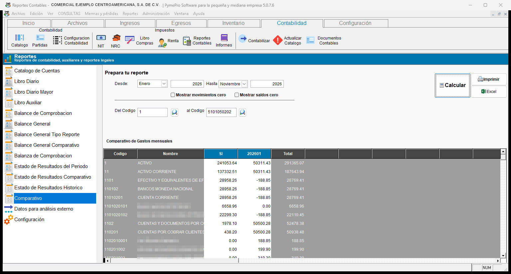
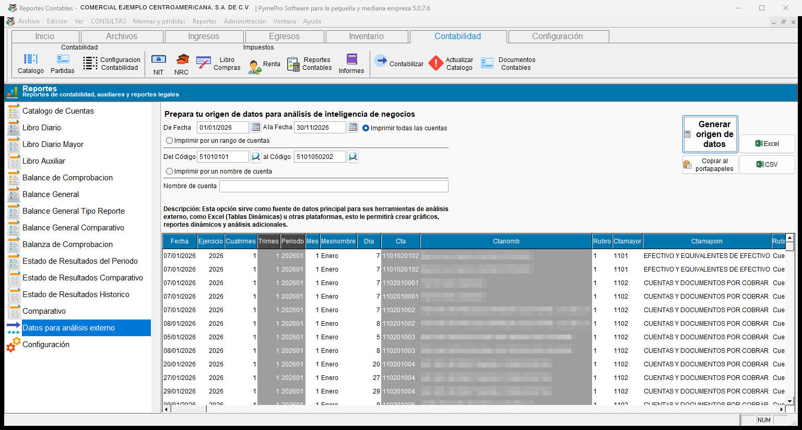
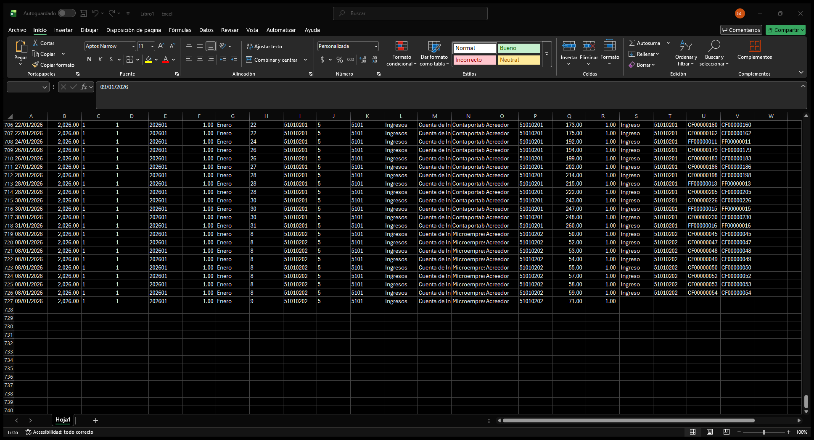

# **Análisis**

!!! abstract "En esta categoría"
    - Comparar los montos de las cuentas mes por mes.
    - Generar un origen de datos con los movimientos contables.
    - Analizar los datos en Excel con tablas dinámicas.

## **4. Análisis**

### 4.1 Comparativo

!!! info "Descripción del reporte"
    Este reporte compara los montos de las cuentas mes por mes. Sirve para analizar el comportamiento de los gastos y de los ingresos por período.

| Opción | Qué hace |
| :--- | :--- |
| **Desde** (mes y año) | Indica el mes y el año en que empieza la comparación. |
| **Hasta** (mes y año) | Indica el mes y el año en que termina la comparación. |
| **Del Codigo** y **al Codigo** | Definen el rango de cuentas del reporte. |
| **Mostrar movimientos cero** | Casilla opcional para incluir cuentas con movimientos en cero. |
| **Mostrar saldos cero** | Casilla opcional para incluir cuentas con saldo en cero. |

!!! example "Cómo comparar los gastos de un año"
    1. Seleccione **Comparativo** en la lista.
    2. Elija el mes y escriba el año en **Desde**.
    3. Elija el mes y escriba el año en **Hasta**.
    4. Escriba el rango de cuentas de gastos en **Del Codigo** y **al Codigo**.
    5. Presione **Calcular**.
    6. Revise la cuadrícula en pantalla.
    7. Presione **Excel** para guardar el análisis.

    { align=center }

!!! note "Qué verá"
    La cuadrícula muestra las columnas **Codigo**, **Nombre**, **SI** (saldo inicial), una columna por cada mes entre las dos fechas y **Total**. El título del reporte es **Comparativo de Gastos mensuales**.

!!! tip "Exportar el reporte"
    Para sacar el reporte, presione **Excel**. El archivo se llama **Reporte comparativo por periodos**.

---

### 4.2 Datos para análisis externo

!!! info "Descripción del reporte"
    Esta opción genera un origen de datos con los movimientos contables. Sirve para analizarlos en Excel con tablas dinámicas, o en otra herramienta, y crear gráficos y reportes dinámicos.

    En esta opción, el botón **Calcular** cambia a **Generar origen de datos**.

| Opción | Qué hace |
| :--- | :--- |
| **De Fecha** y **A la Fecha** | Definen el período de los movimientos. |
| Filtro de cuentas | Elige las cuentas: todas, un rango o un nombre. |

!!! example "Cómo preparar los datos para Excel"
    1. Seleccione **Datos para análisis externo** en la lista.
    2. Escriba **De Fecha** y **A la Fecha**.
    3. Presione **Generar origen de datos**.
    4. Espere el aviso **Proceso finalizado**.
    5. Presione **CSV** o **Copiar al portapapeles**.
    6. Abra el archivo en Excel.
    7. Cree una tabla dinámica.

    { align=center }

!!! note "Qué verá"
    Cada línea es un movimiento contable. Al exportar, cada movimiento queda en una fila de Excel. Estas son las columnas:

    | Grupo | Columnas |
    | :--- | :--- |
    | **Fecha** | Fecha, ejercicio, cuatrimestre, trimestre, periodo, mes, nombre del mes y día. |
    | **Cuenta** | Cuenta, nombre de la cuenta, nombre completo de la cuenta, cuenta de mayor y su nombre. |
    | **Clasificación** | Rubro, nombre del rubro y naturaleza. |
    | **Partida** | Número, tipo (número y nombre), código y referencia. |
    | **Descripción** | Descripción 1 y descripción 2. |
    | **Importes** | **Debe**, **Haber** y saldo, con seis decimales. |

    { align=center }

### 📤 Opciones de exportación

Después de generar los datos, use uno de estos botones:

| Botón | Resultado |
| :--- | :--- |
| **Copiar al portapapeles** | Copia los datos para pegarlos en Excel u otro programa. |
| **CSV** | Guarda un archivo CSV. El archivo se llama **ETL Export**. |
| **Excel** | Exporta los datos a una hoja de cálculo. |

!!! warning "Avisos del sistema"
    | Aviso | Qué significa y qué hacer |
    | :--- | :--- |
    | **No hay cuentas contables** | El catálogo está vacío. Cree las cuentas del catálogo. |
    | **No se encontraron coincidencias de nombres** | El texto de **Nombre de cuenta** no coincide con ninguna cuenta. Revise el texto. |
    | **No se ingresó ningún nombre de cuenta** | Eligió filtrar por nombre y dejó el campo vacío. Escriba el nombre. |
    | **No hay datos para generar, favor reintente con parámetros diferentes** | No hay movimientos con esos filtros. Cambie las fechas o las cuentas. |
    | **Proceso finalizado, puede proceder con la exportación por medio de los botones correspondientes** | Los datos están listos. Presione un botón de exportación. |
