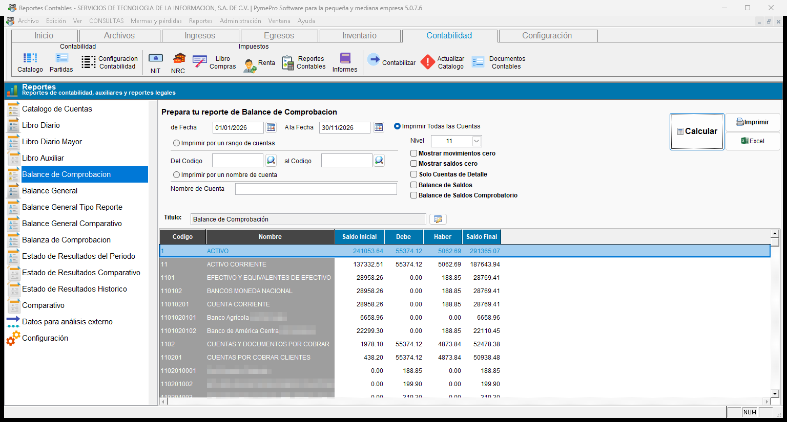
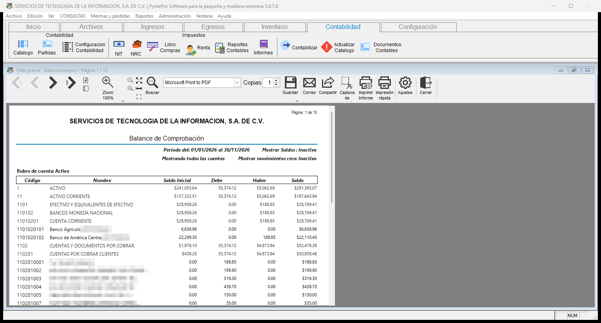
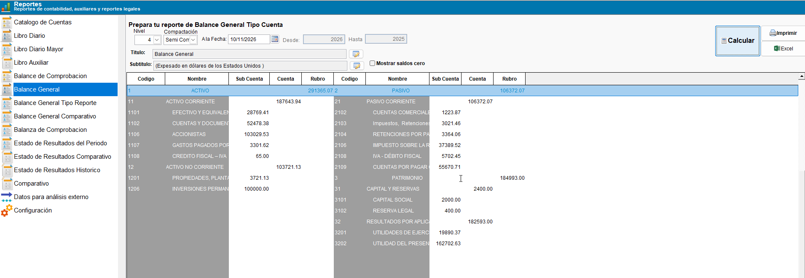
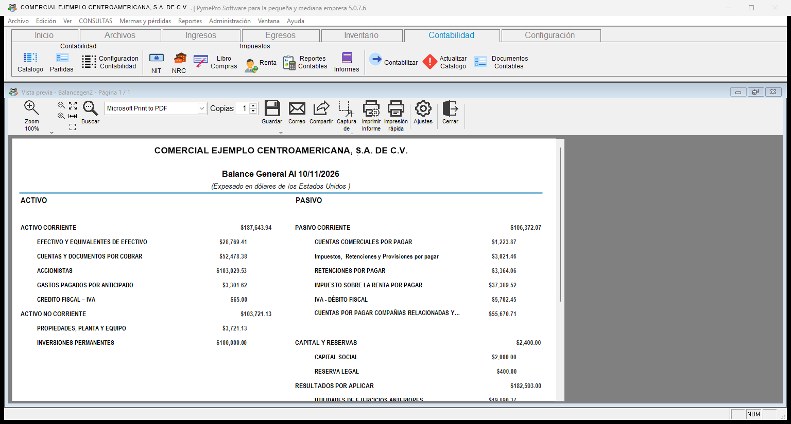
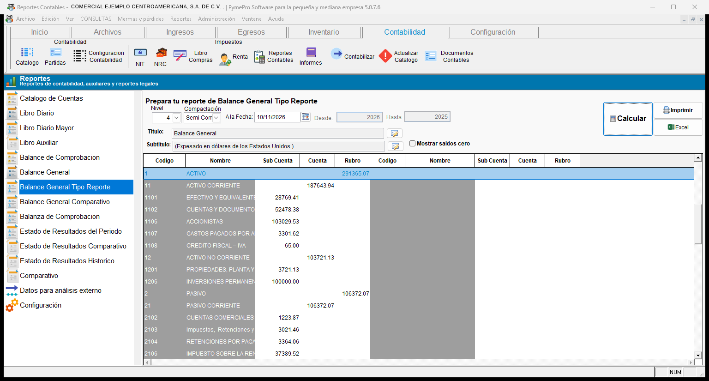
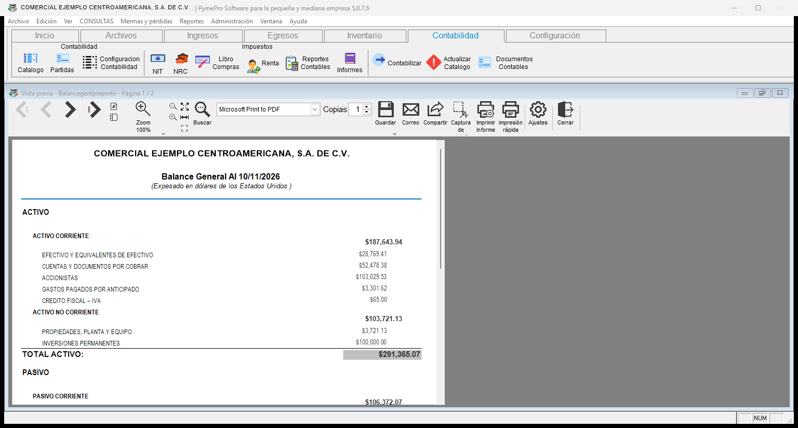
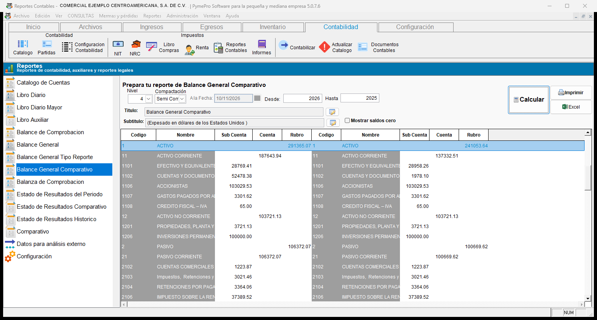
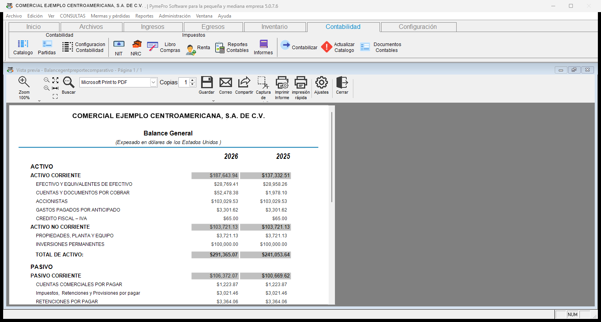

# **Balances**

!!! abstract "En esta categoría"
    - Comprobar que la contabilidad cuadra con el Balance de Comprobación.
    - Ver la situación financiera de la empresa a una fecha con el Balance General.
    - Comparar la situación financiera de dos años.

## **2. Balances**

<!-- Diagrama de los reportes de la categoría balances -->
!!! tip "Diagrama de los reportes de la categoría **Balances**"
    ``` mermaid
    graph LR
      A[Balances]:::root

      subgraph "Listado de reportes:"
        B[2.1 Balance de Comprobación]
        C[2.2 Balance General]
        D[2.3 Balance General Tipo Reporte]
        E[2.4 Balance General Comparativo]
      end

      A --> B
      A --> C
      A --> D
      A --> E

    click B "#21-balance-de-comprobacion" "Ir a balance de comprobación"
    click C "#22-balance-general" "Ir a balance general"
    click D "#23-balance-general-tipo-reporte" "Ir a balance general tipo reporte"
    click E "#24-balance-general-comparativo" "Ir a balance general comparativo"
    ```
---

### 2.1 Balance de Comprobación

!!! info "Descripción del reporte"
    Este reporte muestra, por cuenta, el saldo inicial, el **Debe**, el **Haber** y el saldo final. Sirve para comprobar que la contabilidad cuadra.

    Incluye las cuentas de mayor. El sistema calcula cada una con la suma de sus cuentas de detalle.

| Opción | Qué hace | Valor inicial |
| :--- | :--- | :--- |
| **de Fecha** y **A la Fecha** | Definen el período del reporte. | — |
| Filtro de cuentas | Elige las cuentas: todas, un rango o un nombre. | **Imprimir Todas las Cuentas** |
| **Nivel** | Indica la longitud máxima del código que el reporte muestra. El reporte omite las cuentas con un código más largo. | Todos los niveles (en la captura, **11**) |
| **Mostrar movimientos cero** | Si no la marca, el reporte quita las cuentas con saldo inicial, **Debe**, **Haber** y saldo final en cero. | Sin marcar |
| **Mostrar saldos cero** | Si no la marca, el reporte quita las cuentas con saldo final en cero. | Sin marcar |
| **Solo Cuentas de Detalle** | Quita las cuentas de mayor. Quedan solo las cuentas que reciben saldo directo en las partidas. | Sin marcar |
| **Balance de Saldos** | Muestra el saldo neto de cada cuenta en una sola columna, según su naturaleza. Una cuenta deudora muestra su saldo en **Debe**. Una cuenta acreedora lo muestra en **Haber**. | Sin marcar |
| **Balance de Saldos Comprobatorio** | Igual que **Balance de Saldos**, pero el saldo acreedor sale negativo. Esta opción es la balanza de comprobación. | Sin marcar |

!!! example "Cómo comprobar que la contabilidad cuadra"
    1. Seleccione **Balance de Comprobacion** en la lista.
    2. Escriba **de Fecha** y **A la Fecha**.
    3. Marque **Balance de Saldos Comprobatorio**.
    4. Presione **Calcular**.
    5. Sume los saldos finales. El total debe ser cero.
    6. Si el total no es cero, revise las partidas del período.

    { align=center }

!!! note "Qué verá"
    **En pantalla:** la cuadrícula muestra las columnas **Codigo**, **Nombre**, **Saldo Inicial**, **Debe**, **Haber** y **Saldo Final**.

    **En la vista previa:** el encabezado muestra el período y si **Mostrar Saldos** y **Mostrar movimientos cero** están activos. Las cuentas aparecen agrupadas por rubro, por ejemplo **Activo**.

    { align=center }

---

### 2.2 Balance General

!!! info "Descripción del reporte"
    Este reporte muestra la situación financiera de la empresa a una fecha. Presenta **Activo** y **Pasivo** en dos columnas, con sus rubros, subcuentas y saldos.

    En la lista aparece como **Balance General**. La pantalla de filtros lo titula **Balance General Tipo Cuenta**.

| Opción | Qué hace | Valor inicial |
| :--- | :--- | :--- |
| **Nivel** | Indica la profundidad de las cuentas que se muestran. | **4** |
| **Compactación** | Cambia el espacio entre las líneas. Puede elegir **Compacto**, **Semi Compacto** o **Normal**. | **Semi Compacto** |
| **A la fecha** | Define la fecha de corte del balance. | La fecha de hoy |
| **Título** | Cambia el título del encabezado. | **Balance General** |
| **Subtítulo** | Cambia el subtítulo del encabezado. | Indica que el reporte está expresado en dólares de los Estados Unidos |
| **Mostrar saldos cero** | Incluye las cuentas con saldo cero. | Sin marcar |

!!! note "Campos deshabilitados"
    **Desde** y **Hasta** aparecen en gris en este reporte. Solo se usan en el [Balance General Comparativo](#24-balance-general-comparativo).

!!! example "Cómo sacar el balance general"
    1. Seleccione **Balance General** en la lista.
    2. Escriba la fecha de corte en **A la fecha**.
    3. Elija la **Compactación** y el **Nivel** que necesite.
    4. Presione **Calcular**.
    5. Presione **Imprimir** para ver la vista previa.

    { align=center }

!!! note "Qué verá"
    **En pantalla:** la cuadrícula muestra las columnas **Código**, **Nombre**, **Sub Cuenta**, **Cuenta** y **Rubro**.

    **Utilidad del ejercicio:** aparece bajo **Resultados por aplicar**, en dos líneas: **Utilidades de ejercicios anteriores** y **Utilidad del presente ejercicio**. La utilidad del ejercicio es igual a los ingresos menos los costos y los gastos.

    { align=center }

---

### 2.3 Balance General Tipo Reporte

!!! info "Descripción del reporte"
    Este reporte muestra los mismos saldos que el [Balance General](#22-balance-general), con el formato de cuentas por rubro. Sirve cuando necesita presentar el balance agrupado por rubros.

    Los filtros son los mismos del Balance General: **Nivel**, **Compactación**, **A la fecha**, **Título**, **Subtítulo** y **Mostrar saldos cero**. **Desde** y **Hasta** aparecen en gris.

!!! example "Cómo sacar el balance tipo reporte"
    1. Seleccione **Balance General Tipo Reporte** en la lista.
    2. Escriba la fecha de corte en **A la fecha**.
    3. Presione **Calcular**.
    4. Presione **Imprimir** para ver la vista previa.

    { align=center }

!!! note "Qué verá"
    **En pantalla:** la cuadrícula muestra **Activo** primero y **Pasivo** debajo, en una sola columna de filas.

    **En la vista previa:** aparece **Activo** con sus rubros y el **Total Activo**. Después aparece **Pasivo**, con el mismo formato.

    { align=center }

---

### 2.4 Balance General Comparativo

!!! info "Descripción del reporte"
    Este reporte compara los saldos de dos años. Sirve para ver cómo cambió la situación financiera de un año a otro.

| Opción | Qué hace |
| :--- | :--- |
| **Desde** | Indica el año del bloque de la izquierda. |
| **Hasta** | Indica el año del bloque de la derecha. |
| **A la fecha** | Aparece en gris. No se usa en este reporte. |
| **Nivel**, **Compactación**, **Título**, **Subtítulo** y **Mostrar saldos cero** | Funcionan igual que en el [Balance General](#22-balance-general). |

!!! example "Cómo comparar dos años"
    1. Seleccione **Balance General Comparativo** en la lista.
    2. Escriba el año en **Desde**.
    3. Escriba el año en **Hasta**.
    4. Presione **Calcular**.
    5. Revise los dos bloques de cuentas en la cuadrícula.
    6. Presione **Imprimir** para ver el reporte.

    { align=center }

!!! note "Qué verá"
    **En pantalla:** dos bloques de cuentas, uno al lado del otro. Cada bloque tiene las columnas **Código**, **Nombre**, **Sub Cuenta**, **Cuenta** y **Rubro**.

    **En la vista previa:** los saldos aparecen en dos columnas, una por cada año. Cada rubro tiene su total. Después del **Total de Activo** aparece **Pasivo**.

    { align=center }
