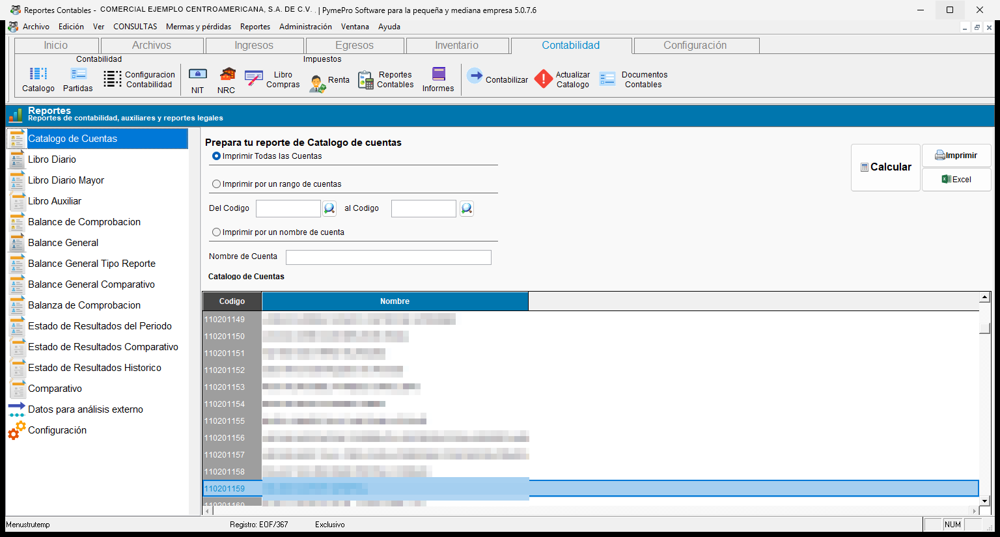
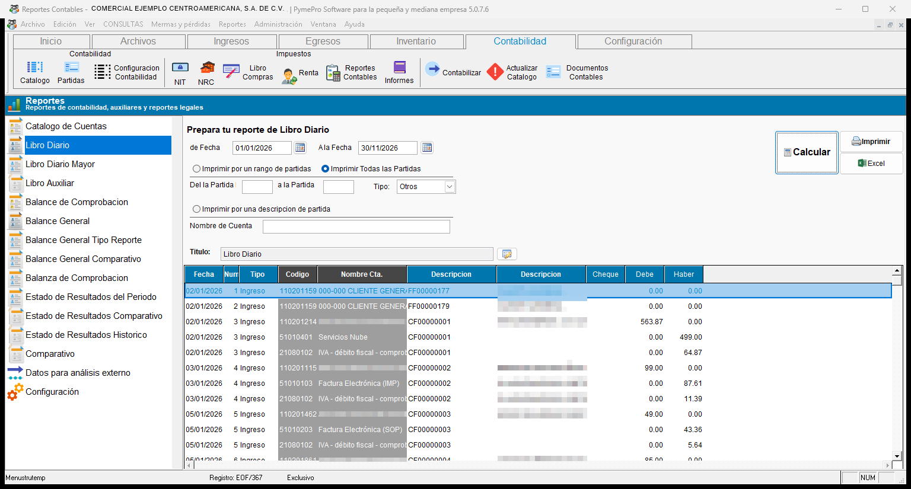
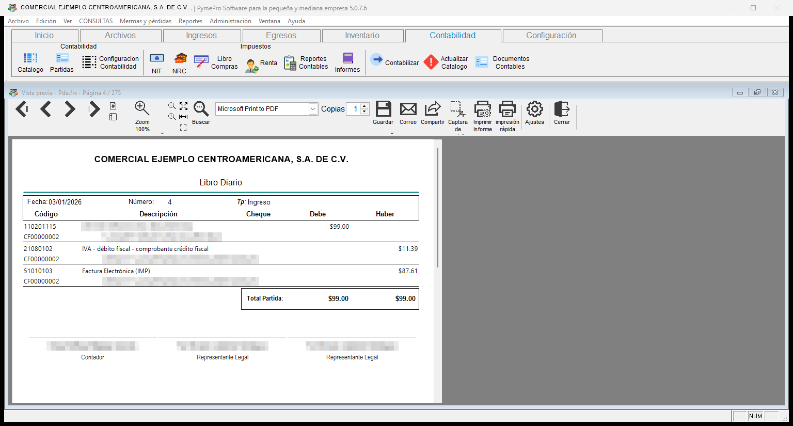
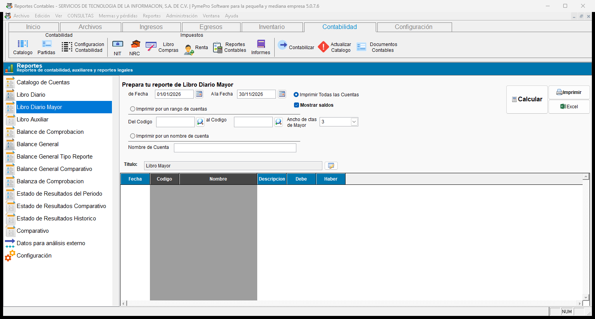
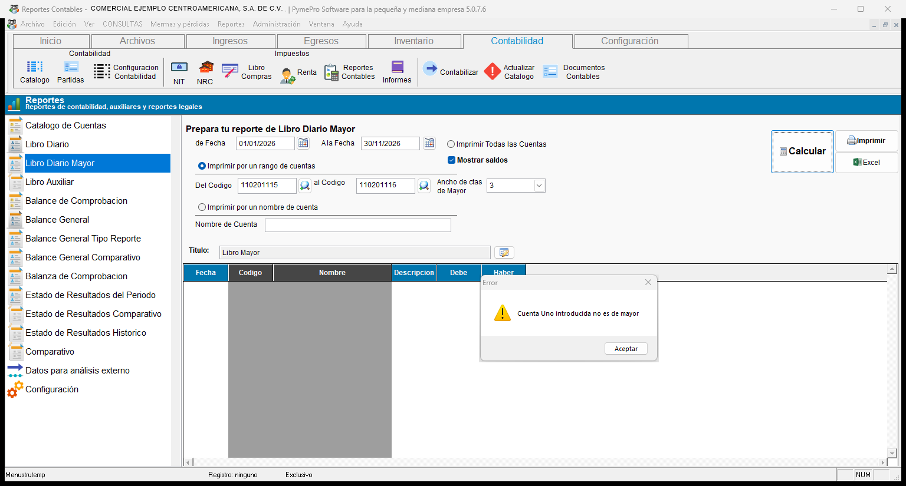
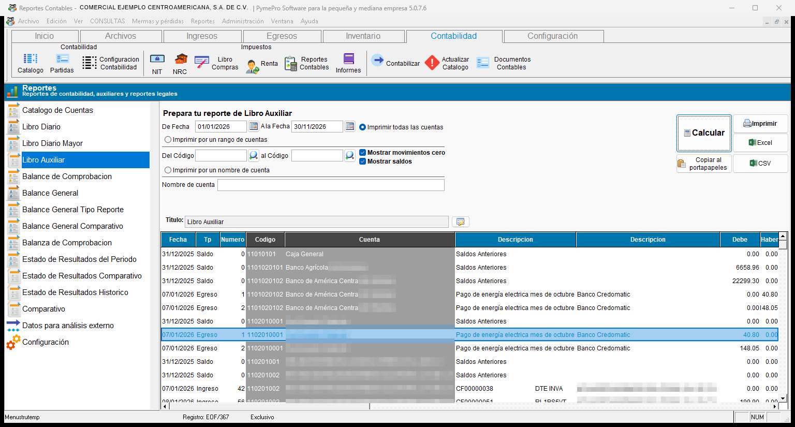
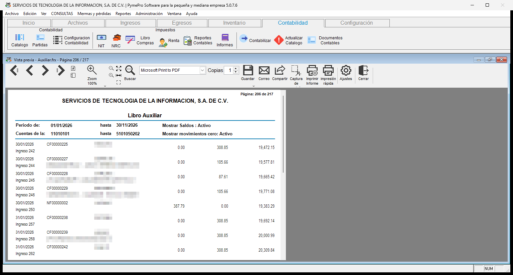
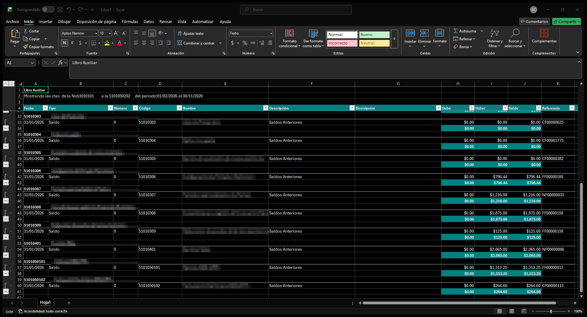

# **Catálogo y libros**

## **1. Catálogo y libros**

<!-- Diagrama de los reportes de la categoría catálogo y libros -->
!!! tip "Diagrama de los reportes de la categoría **Catálogo y libros**"
    ``` mermaid
    graph LR
      A[Catálogo y libros]:::root

      subgraph "Listado de reportes:"
        B[1.1 Catálogo de cuentas]
        C[1.2 Libro Diario]
        D[1.3 Libro Diario Mayor]
        E[1.4 Libro Auxiliar]
      end

      A --> B
      A --> C
      A --> D
      A --> E

    click B "#11-catalogo-de-cuentas" "Ir a catálogo de cuentas"
    click C "#12-libro-diario" "Ir a libro diario"
    click D "#13-libro-diario-mayor" "Ir a libro diario mayor"
    click E "#14-libro-auxiliar" "Ir a libro auxiliar"
    ```
---

### 1.1 Catálogo de cuentas

!!! info "Descripción del reporte"
    Este reporte lista las cuentas contables de la empresa. Muestra el **código**, el **nombre** y el **rubro** de cada cuenta.

    El rubro sale del primer dígito del código. Puede ser Activo, Pasivo, Capital, Gastos, Ingresos, Resultados, Contingencias, Presupuestos u Otros.

    Puede filtrarse por:

    - Todas las cuentas
    - Rango de cuentas (**Del código** / **al código**)
    - Nombre de cuenta

    Los botones disponibles son **Calcular**, **Imprimir** y **Excel**.

!!! example "Cómo generar el catálogo"
    1. Seleccione **Catalogo de Cuentas** en la lista.
    2. Elija el filtro de cuentas.
    3. Presione **Calcular**. El catálogo aparece en la cuadrícula, con las columnas **Codigo** y **Nombre**.
    4. Presione **Imprimir** para ver el reporte, o **Excel** para exportarlo.

   { align=center }

---

### 1.2 Libro Diario

!!! info "Descripción del reporte"
    Este reporte muestra las partidas contables en orden de fecha y número. Cada línea muestra estas columnas:

    - Fecha, número y tipo de partida
    - Código y nombre de la cuenta
    - Descripción 1 y descripción 2
    - Cheque
    - **Debe** y **Haber**

    Puede filtrarse por:

    - Rango de fechas (**De fecha** / **A la fecha**)
    - **Imprimir Todas las Partidas**
    - **Imprimir por un rango de partidas** (**Del No.** / **a la partida**)
    - **Imprimir por una descripcion de partida**
    - **Tipo** de partida

    También puede escribir un **Título** para el encabezado del reporte.

!!! tip "Búsqueda por descripción"
    El texto que escriba se busca en la **descripción 1**, en la **descripción 2** y en el **número de cheque**.

!!! note "Orden de cargos y abonos"
    En cada partida, el reporte impreso muestra primero los cargos y después los abonos.

!!! note "Exportar a Excel"
    El botón **Excel** exporta las mismas diez columnas del reporte.

!!! example "Cómo imprimir un rango de partidas"
    1. Seleccione **Libro Diario** en la lista.
    2. Escriba **De fecha** y **A la fecha**.
    3. Elija **Imprimir por un rango de partidas**.
    4. Escriba **Del No.** y **a la partida**. Si falta un dato, el sistema muestra el aviso **Partida uno no ha sido introducida**.
    5. Presione **Imprimir**.

   { align=center }

!!! note "Vista previa del reporte"
    Cada partida se imprime en un bloque con estos datos:

    - Encabezado con la **Fecha**, el **Número** y el tipo (**Tp**) de la partida.
    - Una línea por cuenta, con el **Código**, la **Descripción**, el **Cheque**, el **Debe** y el **Haber**.
    - El **Total Partida**, con la suma del **Debe** y la suma del **Haber**.
    - Las firmas del contador y del representante legal.

   { align=center }

---

### 1.3 Libro Diario Mayor

!!! info "Descripción del reporte"
    Este reporte resume los movimientos del período por cuenta de mayor. Puede filtrarse por:

    - Rango de fechas
    - Filtro de cuentas (todas, rango o nombre)
    - **Ancho de ctas de Mayor**: la longitud del código de las cuentas de mayor.
    - **Mostrar saldos**: agrega el saldo inicial de cada cuenta.

    La cuadrícula muestra las columnas **Fecha**, **Codigo**, **Nombre**, **Descripcion**, **Debe** y **Haber**.

    También puede escribir un **Título** para el encabezado del reporte.

!!! note "Formato del reporte"
    Según la configuración de la empresa, el reporte muestra cada movimiento o un resumen con la leyenda **Movimientos Diarios**.

!!! warning "Use solo cuentas de mayor"
    En el rango de cuentas, escriba cuentas de mayor. Si escribe otra cuenta, el sistema muestra el aviso **Cuenta Uno introducida no es de mayor** (o **Cuenta dos**).

    Si el reporte no muestra datos, revise el parámetro que indica cuáles cuentas son de mayor. El sistema muestra el aviso **Debes configurar adecuadamente el parámetro que indica qué cuentas son de mayor** y un recuadro rojo que señala dónde configurarlo.

   { align=center }

   { align=center }

---

### 1.4 Libro Auxiliar

!!! info "Descripción del reporte"
    Este reporte muestra, cuenta por cuenta, los movimientos del período. Cada línea muestra estas columnas:

    - Fecha, tipo y número de partida
    - Código y nombre de la cuenta
    - Descripción 1 y descripción 2
    - **Debe**, **Haber** y **Saldo**

    El **Saldo** es acumulado. Empieza de nuevo en cada cuenta.

    Puede filtrarse por:

    - Rango de fechas
    - Filtro de cuentas (todas, rango o nombre)
    - **Mostrar saldos**
    - **Mostrar movimientos cero**

!!! tip "Opciones del reporte"
    - **Mostrar saldos:** agrega una primera línea **Saldo** en cada cuenta. Su fecha es el día anterior a la fecha inicial. Esa línea trae lo acumulado antes del período. Si no marca la casilla, el saldo empieza en cero.
    - **Mostrar movimientos cero:** muestra las líneas con **Debe** y **Haber** en cero, por ejemplo los cheques anulados. Si no marca la casilla, el reporte oculta esas líneas.

!!! warning "Use solo cuentas de detalle"
    En el rango de cuentas, escriba cuentas de detalle. Si escribe una cuenta de mayor, el sistema muestra el aviso **Cuenta Uno introducida es de mayor**.

!!! tip "Opciones de exportación"
    Después de presionar **Calcular**, puede enviar los datos fuera del sistema:

    - **Excel:** genera una hoja de cálculo. La columna **Saldo** no se suma hacia abajo. La fila final muestra el saldo final de la cuenta.
    - **Copiar al portapapeles:** copia los datos para pegarlos en Excel u otro documento.
    - **CSV:** guarda un archivo de valores separados por comas.

!!! example "Cómo revisar una cuenta"
    1. Seleccione **Libro Auxiliar** en la lista.
    2. Escriba **De Fecha** y **A la Fecha**.
    3. Elija **Imprimir por un rango de cuentas** y escriba la cuenta en **Del Código**.
    4. Marque **Mostrar saldos**.
    5. Presione **Calcular**. El mensaje **Generando los registros del libro auxiliar, por favor espere** indica que el reporte se está preparando.
    6. Revise los movimientos en pantalla. Presione **Imprimir** o **Excel** para sacar el reporte.

   { align=center }

!!! note "Vista previa del reporte"
    El encabezado muestra el período, el rango de cuentas y el estado de las opciones **Mostrar Saldos** y **Mostrar movimientos cero**. Cada línea muestra la fecha, el tipo y número de partida, el folio del documento, el nombre, el **Debe**, el **Haber** y el saldo acumulado.

   { align=center }

!!! note "Hoja de Excel"
    Cada cuenta se exporta en un bloque. El bloque muestra el nombre de la cuenta, sus movimientos y una fila de cierre con el **Debe**, el **Haber** y el saldo final. Las columnas son **Fecha**, **Tipo**, **Número**, **Código**, **Nombre**, **Descripción** (dos columnas), **Debe**, **Haber**, **Saldo** y **Referencia**.

   { align=center }
