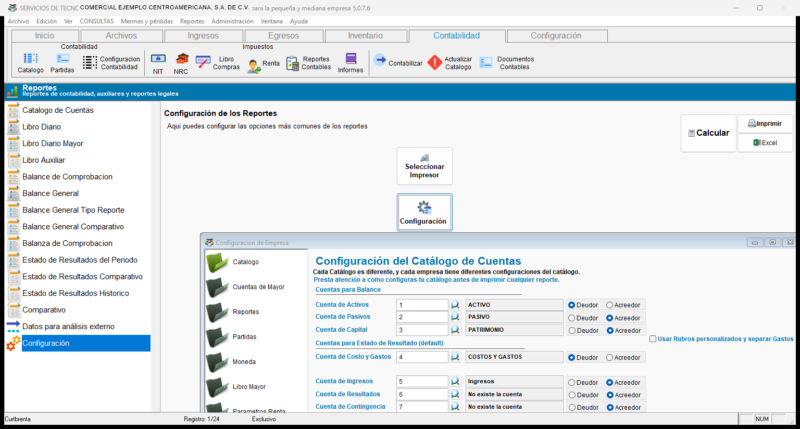

# **Configuración**

## **5. Configuración**

!!! info "Configuración de los reportes"
    Esta opción tiene dos botones:

    - **Configuración:** abre la ventana donde se ajustan las opciones más comunes de los reportes.
    - **Seleccionar Impresor:** elige la impresora que usan los reportes.

!!! note "Ventana de configuración"
    Al presionar **Configuración** se abre la ventana **Configuración de Empresa**. A la izquierda hay secciones como **Catálogo**, **Cuentas de Mayor**, **Reportes**, **Partidas**, **Moneda**, **Libro Mayor** y **Parámetros Renta**.

    En la sección **Catálogo** se indica qué cuenta del catálogo corresponde a cada grupo del balance y del estado de resultados: **Activos**, **Pasivos**, **Capital**, **Costos y Gastos**, **Ingresos**, **Resultados** y **Contingencia**. Para cada una se elige si su saldo es **Deudor** o **Acreedor**.

    Si marca **Usar Rubros personalizados y separar Gastos**, el estado de resultados separa los gastos según los rubros de la empresa.

   { align=center }

