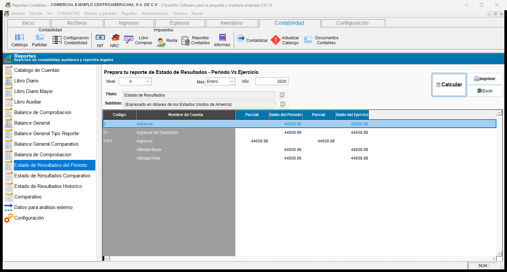
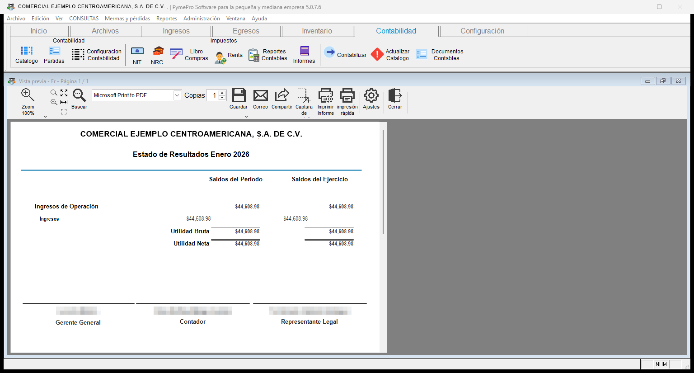
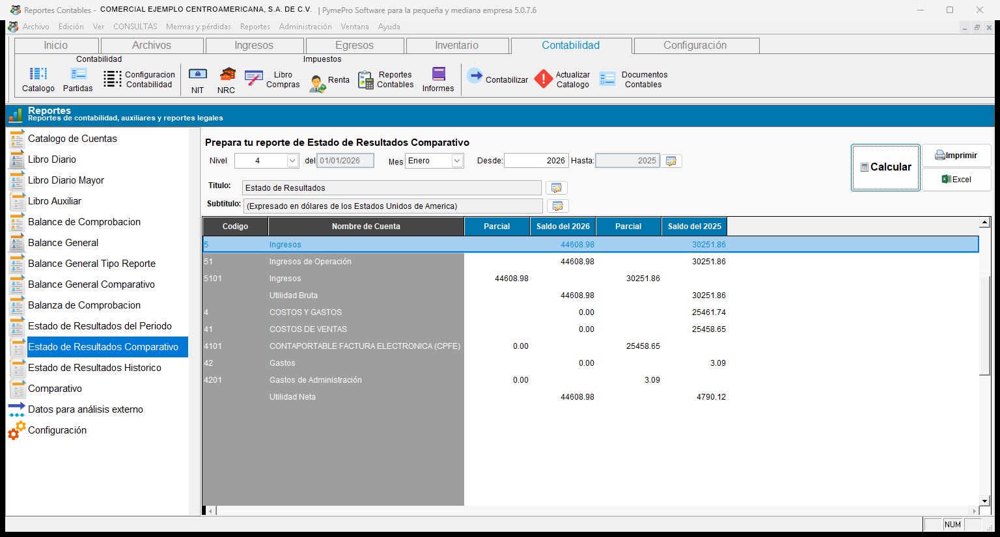
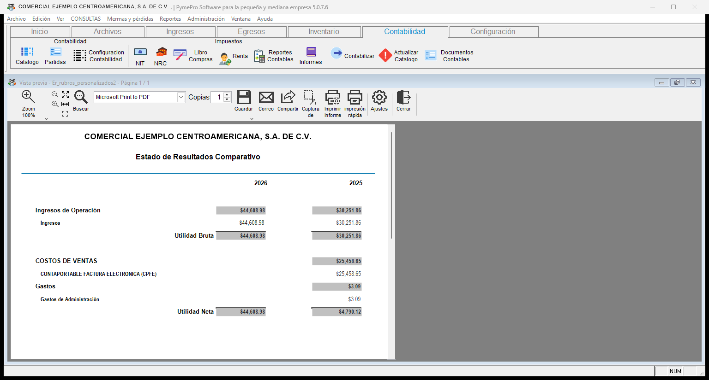
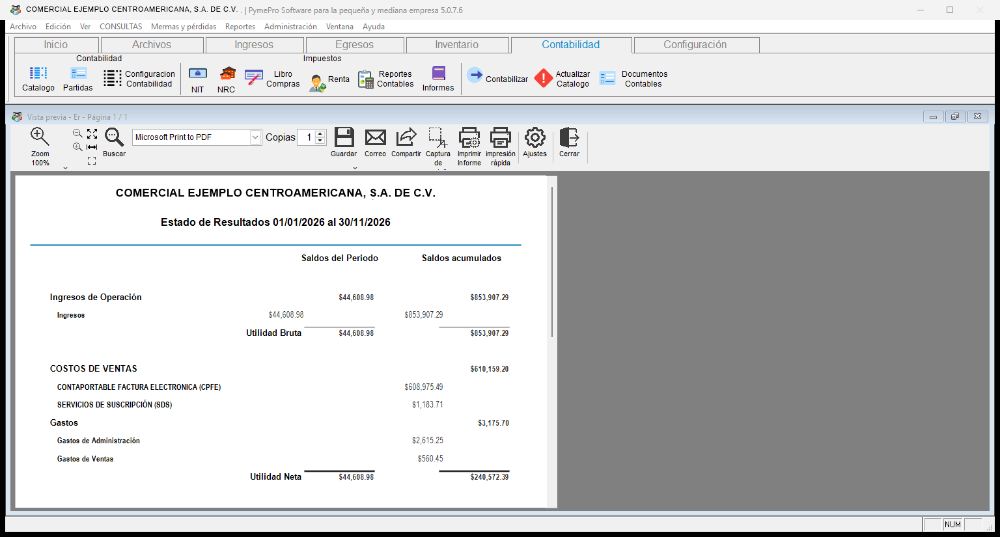

# **Estados de resultados**

!!! abstract "En esta categoría"
    - Ver los resultados de un mes y el acumulado del año.
    - Comparar los resultados de dos años.
    - Consultar el historial de resultados hasta una fecha.

## **3. Estados de resultados**

<!-- Diagrama de los reportes de la categoría estados de resultados -->
!!! tip "Diagrama de los reportes de la categoría **Estados de resultados**"
    ``` mermaid
    graph LR
      A[Estados de resultados]:::root

      subgraph "Listado de reportes:"
        B[3.1 Estado de Resultados del Periodo]
        C[3.2 Estado de Resultados Comparativo]
        D[3.3 Estado de Resultados Histórico]
      end

      A --> B
      A --> C
      A --> D

    click B "#31-estado-de-resultados-del-periodo" "Ir a estado de resultados del periodo"
    click C "#32-estado-de-resultados-comparativo" "Ir a estado de resultados comparativo"
    click D "#33-estado-de-resultados-historico" "Ir a estado de resultados histórico"
    ```
---

!!! note "Reglas de los estados de resultados"
    - Los tres reportes usan la misma pantalla. La opción elegida cambia la forma de calcular.
    - Los tres reportes dejan fuera las partidas de cierre.
    - Los tres reportes tienen el filtro **Nivel**, que indica la profundidad de las cuentas.

### 3.1 Estado de Resultados del Periodo

!!! info "Descripción del reporte"
    Este reporte compara los resultados de un mes contra el acumulado del año. Sirve para ver el resultado del mes y cuánto va del año.

    En la lista aparece como **Estado de Resultados del Periodo**. La pantalla lo titula **Estado de Resultados - Periodo Vs Ejercicio**.

| Opción | Qué hace |
| :--- | :--- |
| **Mes** | Indica el mes del reporte. |
| **Año** | Indica el año del reporte. |
| **Nivel** | Indica la profundidad de las cuentas que se muestran. |
| **Título** y **Subtítulo** | Cambian los textos del encabezado. |

!!! tip "Cómo se calculan las columnas"
    - **Periodo:** va del primer día al último día del mes elegido.
    - **Acumulado:** va del 1 de enero al último día del mes elegido.

!!! example "Cómo sacar el estado de resultados de un mes"
    1. Seleccione **Estado de Resultados del Periodo** en la lista.
    2. Elija la opción **Periodo Vs Acumulado (Ejercicio)**.
    3. Escriba el **Año**.
    4. Elija el **Mes**.
    5. Presione **Calcular**. El mensaje **Estado de Resultado finalizado** indica que el cálculo terminó.
    6. Presione **Imprimir** para ver el reporte.

    { align=center }

!!! note "Qué verá"
    **En pantalla:** la cuadrícula muestra el **Código**, el **Nombre de Cuenta** y dos pares de columnas: **Parcial** y **Saldo del Periodo**, y **Parcial** y **Saldo del Ejercicio**. Entre las cuentas aparecen subtotales, como la **Utilidad Bruta** y la **Utilidad Neta**.

    **En la vista previa:** el encabezado muestra el mes y el año, por ejemplo **Estado de Resultados Enero 2026**. Hay dos columnas de saldos: **Saldos del Periodo** y **Saldos del Ejercicio**. Al final aparecen las firmas del gerente general, el contador y el representante legal.

    { align=center }

---

### 3.2 Estado de Resultados Comparativo

!!! info "Descripción del reporte"
    Este reporte compara los resultados de dos años. Sirve para ver cómo cambiaron los ingresos, los costos y los gastos de un año a otro.

    En los dos años, el cálculo va del 1 de enero al último día del mes elegido.

| Opción | Qué hace |
| :--- | :--- |
| **Mes** | Indica el último mes que incluye el cálculo. |
| **Desde** | Indica el año principal. |
| **Hasta** | Aparece en gris. Muestra el año con el que se compara. |
| **Nivel** | Indica la profundidad de las cuentas que se muestran. |
| **Título** y **Subtítulo** | Cambian los textos del encabezado. |

!!! example "Cómo comparar dos años"
    1. Seleccione **Estado de Resultados Comparativo** en la lista.
    2. Elija la opción **Comparativo**.
    3. Escriba el año en **Desde**.
    4. Elija el **Mes**.
    5. Presione **Calcular**.
    6. Presione **Imprimir** para ver el reporte.

    { align=center }

!!! note "Qué verá"
    **En pantalla:** la cuadrícula muestra una columna de saldos por cada año.

    **En la vista previa:** el encabezado es **Estado de Resultados Comparativo**. Hay una columna para cada año. Cada columna muestra los ingresos, los costos, los gastos y las utilidades. Este reporte se imprime con los rubros personalizados de la empresa.

    { align=center }

---

### 3.3 Estado de Resultados Histórico

!!! info "Descripción del reporte"
    Este reporte muestra el historial de resultados de las cuentas. Sirve para ver cuánto acumula cada cuenta hasta una fecha.

| Columna | Qué incluye |
| :--- | :--- |
| **Periodo** | El rango de fechas que usted elige. |
| **Acumulado** | Todo el movimiento hasta la fecha final. |

!!! example "Cómo sacar el estado de resultados histórico"
    1. Seleccione **Estado de Resultados Historico** en la lista.
    2. Elija la opción **Solo Acumulado - Historico**.
    3. Escriba el rango de fechas.
    4. Presione **Calcular**.
    5. Presione **Imprimir** para ver el reporte.

!!! note "Qué verá"
    **En la vista previa:** el encabezado muestra el rango de fechas, por ejemplo **Estado de Resultados 01/01/2026 al 30/11/2026**. Hay dos columnas: **Saldos del Periodo** y **Saldos acumulados**.

    { align=center }
