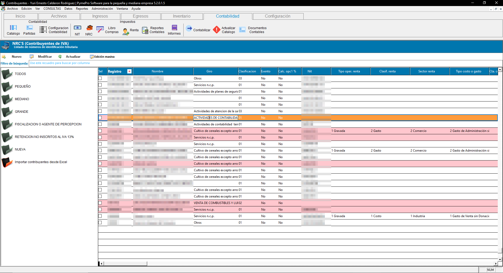
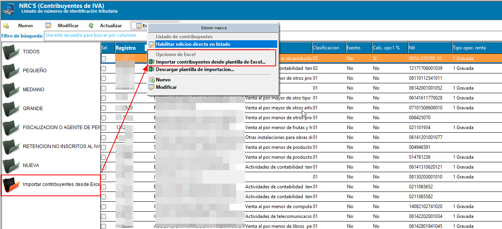
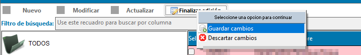
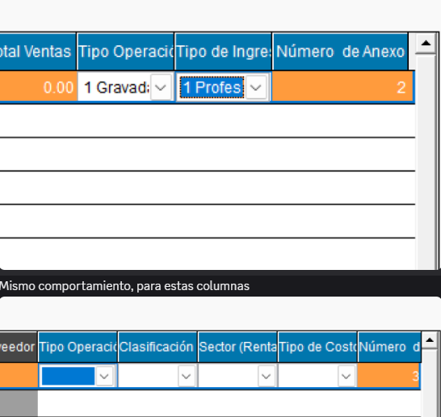
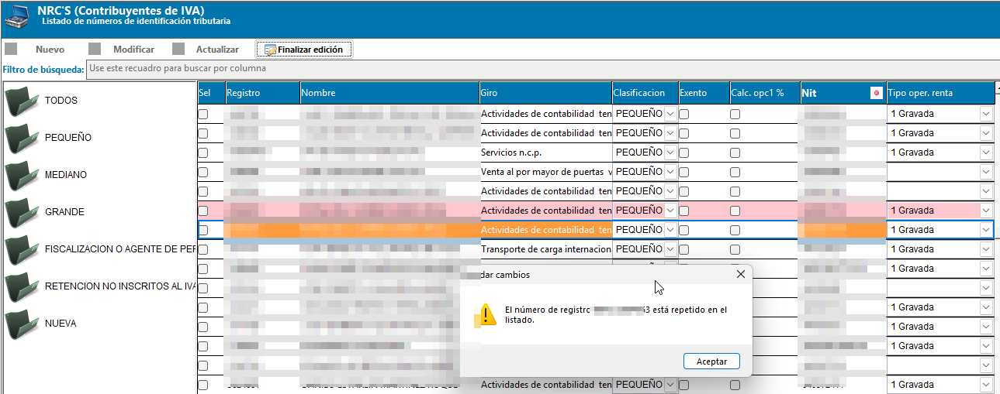

# 🧾 **Edición del listado de contribuyentes**

El **modo de edición directa** del listado de contribuyentes (NRC) permite completar o corregir los **datos de ISR** y la **clasificación contable** de varios contribuyentes desde la misma cuadrícula, sin abrir la ficha de cada uno.

Está pensado para poner al día una contabilidad rápidamente: en lugar de entrar contribuyente por contribuyente a asignar el tipo de operación de renta, el sector, las cuentas contables y el código de actividad económica, se completan todos desde el listado y se guardan de una sola vez.

!!! warning "No da de alta contribuyentes nuevos"
    Este modo **solo modifica contribuyentes que ya existen** en el listado. Para registrar un contribuyente nuevo debe usarse su ficha individual o la [importación desde plantilla de Excel](#7-importar-contribuyentes-desde-una-plantilla-de-excel).

    No debe confundirse con [Importar Clientes y Facturas desde plantilla Excel](../facturacion/importar_clientes_desde_plantilla.md), que trabaja sobre clientes, una entidad distinta de los contribuyentes.

## 📋 **1. El listado de contribuyentes**

Junto al árbol de clasificaciones se muestra la cuadrícula con los contribuyentes registrados, con sus datos generales, sus datos de ISR y la configuración de cuentas contables:

| Columna | Descripción |
| ------- | ----------- |
| Sel | Casilla de selección. |
| Registro | Número de registro (NRC) del contribuyente. |
| Nombre | Nombre o razón social. |
| Giro | Giro o actividad declarada. |
| Clasificación | Clasificación del contribuyente. |
| Exento | Indica si el contribuyente es exento. |
| Calc. opc1 % | Indica si aplica el cálculo de la opción 1 por porcentaje. |
| NIT | Número de identificación tributaria. |
| Tipo oper. renta | Tipo de operación para renta. |
| Clasif. renta | Clasificación de renta (costo, gasto, etc.). |
| Sector renta | Sector económico para renta. |
| Tipo costo o gasto | Tipo de costo o gasto para renta. |
| Cta. costo o gasto | Cuenta contable de costo o gasto. |
| Cta. ingreso | Cuenta contable de ingreso. |
| Cta. c/p costo o gasto | Cuenta por pagar asociada al costo o gasto. |
| Cta. c/c ingreso | Cuenta por cobrar asociada al ingreso. |
| Tipo ingreso renta | Tipo de ingreso para renta. |
| Cod. actividad económica | Código de actividad económica del Ministerio de Hacienda. |

{ align=center }

## ✏️ **2. Activar el modo de edición**

Para editar directamente sobre la cuadrícula:

1. En la barra de herramientas del listado, presione el botón **Editar listado**.
2. La cuadrícula habilita la edición sobre todas las columnas de datos; la casilla de selección y el número de línea permanecen bloqueados.
3. Modifique los valores directamente sobre las celdas.
4. Al terminar, presione el mismo botón —ahora identificado como **Finalizar edición**— y elija una de las dos opciones del menú:
    - **Guardar cambios**: valida y aplica todas las modificaciones realizadas.
    - **Descartar cambios**: solicita confirmación y, si se acepta, revierte el listado a su estado original sin guardar nada.

{ align=center }

{ align=center }

!!! warning "Solo una clasificación a la vez"
    Mientras el modo de edición esté activo no es posible seleccionar otro nodo del árbol de clasificaciones. Si lo intenta, el sistema muestra el aviso *"Finalice el proceso actual antes de continuar seleccionando otro elemento"*. Debe guardar o descartar los cambios pendientes antes de continuar navegando.

!!! info "Al cerrar con cambios pendientes"
    Si intenta cerrar el formulario mientras el listado sigue en modo edición, el sistema le advierte que hay cambios sin guardar y le pide confirmar antes de descartarlos.

## 📑 **3. Columnas con catálogo**

Durante la edición, estas columnas se llenan desde un combo con los valores válidos, para evitar que se escriban datos que después rechace el Ministerio de Hacienda:

| Columna | Catálogo |
| ------- | -------- |
| Clasificación | Clasificación de contribuyentes |
| Tipo oper. renta | Tipo de operación de renta |
| Clasif. renta | Clasificación de renta |
| Sector renta | Sector de renta |
| Tipo costo o gasto | Tipo de costo o gasto de renta |
| Tipo ingreso renta | Tipo de ingreso de renta |
| Cod. actividad económica | Catálogo de actividad económica del MH |

Las cuatro columnas de cuentas contables se escriben directamente y se validan contra el catálogo de cuentas.

{ align=center }

!!! info "Instalaciones sin contabilidad"
    Si la instalación no tiene módulo de contabilidad, el catálogo de cuentas no está disponible: las columnas de cuentas siguen siendo editables como texto libre y no se validan.

## ✅ **4. Validaciones al guardar**

Solo se validan las filas que efectivamente fueron modificadas. En esas filas:

- El **número de registro (NRC)**, el **nombre**, la **clasificación** y el **código de actividad económica** no pueden quedar vacíos.
- El **NRC** y el **NIT** no pueden quedar repetidos, ni dentro del listado ni contra otro contribuyente ya registrado. Si hay conflicto, el sistema indica a qué contribuyente corresponde el valor duplicado.
- Los valores de las columnas con catálogo deben existir en su catálogo correspondiente.

{ align=center }

!!! warning "El guardado es todo o nada"
    Si alguna fila no pasa las validaciones, **no se guarda ningún cambio**. El sistema indica el contribuyente y el dato que debe corregirse; una vez corregido, vuelva a presionar **Finalizar edición → Guardar cambios**.

## 🔄 **5. Sincronización con personas naturales**

Al guardar, cada contribuyente modificado que tenga NIT sincroniza automáticamente sus datos de ISR y de cuentas contables hacia el registro de personas naturales con ese mismo NIT, creándolo si no existía.

Es la misma sincronización que realiza la ficha individual del contribuyente al guardar, de modo que ambos registros quedan consistentes.

## 🕘 **6. Registro en bitácora**

Cada campo modificado queda registrado individualmente en la bitácora del sistema, indicando el contribuyente afectado, el campo editado, el valor anterior y el nuevo valor.

Al finalizar la edición:

- Si hubo cambios y se guardan correctamente, el sistema confirma la cantidad de contribuyentes actualizados.
- Si no se modificó ningún dato, se informa que no hay cambios que guardar.
- Si se descartan los cambios, también queda registrada la cancelación en la bitácora.

## 📥 **7. Importar contribuyentes desde una plantilla de Excel**

Además de la edición directa, el listado permite crear y actualizar contribuyentes de forma masiva desde un archivo de Excel. A diferencia del modo de edición, la importación **sí puede dar de alta contribuyentes nuevos**: los que ya existen se actualizan por su **NRC**, y los campos que vengan vacíos en un contribuyente existente **no modifican** el valor actual.

!!! example "Procedimiento"
    1. En el listado, abra el menú de **Edición masiva** y, en **Opciones de Excel**, elija **Descargar plantilla de importación...** para guardar la plantilla.
    2. Complete la plantilla. La columna **COD. ACT. ECONOMICA** se llena con una lista desplegable que contiene solo el **código** de la actividad; la hoja **CATALOGOS** está visible y trae la descripción de cada actividad como referencia.
    3. En el mismo menú, elija **Importar contribuyentes desde plantilla de Excel...** (también está el nodo **Importar contribuyentes desde Excel** al final del árbol).
    4. Presione **Seleccionar archivo** y luego **Cargar datos** para ver la vista previa; con **Mostrar** puede filtrar las filas por acción.
    5. Revise la vista previa y presione **Aplicar cambios**.

!!! info "Código de actividad económica"
    La importación sigue aceptando el formato anterior `código - descripción`, por lo que las plantillas descargadas antes de este cambio continúan funcionando. El listado exportado (reporte CLI64) ahora también muestra solo el código en esa columna, porque la descripción ya aparece en el **Giro**.

### 🧪 Filas con error

- En la vista previa, las filas con error se resaltan en **rojo**, y el número de fila que se informa es la **fila real del Excel**, aunque haya filas en blanco entre los datos.
- Las filas con error **no se cargan**. Al terminar, si hubo filas omitidas, el estado final indica *"Completado con observaciones"* y el resumen lista cada una con su fila, NRC, nombre y motivo, para que las corrija en el Excel y vuelva a cargarlo.

!!! note "Correcciones recientes"
    Se corrigió la importación desde la plantilla y el error que aparecía al dar clic derecho en el listado de contribuyentes.

---

## 📌 **8. Buenas prácticas**

- Filtre primero por clasificación desde el árbol y trabaje por bloques: es más fácil revisar un grupo homogéneo de contribuyentes que el listado completo.
- Revise los valores antes de guardar; los cambios se aplican de una sola vez a todos los contribuyentes editados.
- Use **Descartar cambios** si detecta un error grave antes de guardar, en lugar de corregir celda por celda.
- Consulte la bitácora periódicamente para auditar los cambios realizados desde este modo de edición masiva.

## 🔗 **9. Páginas relacionadas**

- [Importar Clientes y Facturas desde plantilla Excel](../facturacion/importar_clientes_desde_plantilla.md)
- [Gestión de clientes y Resumen de Facturas](../facturacion/gestion_clientes.md)
- [Anexos F07 — Generales](../Informes_anexos/F07/anexos_f07.md)
