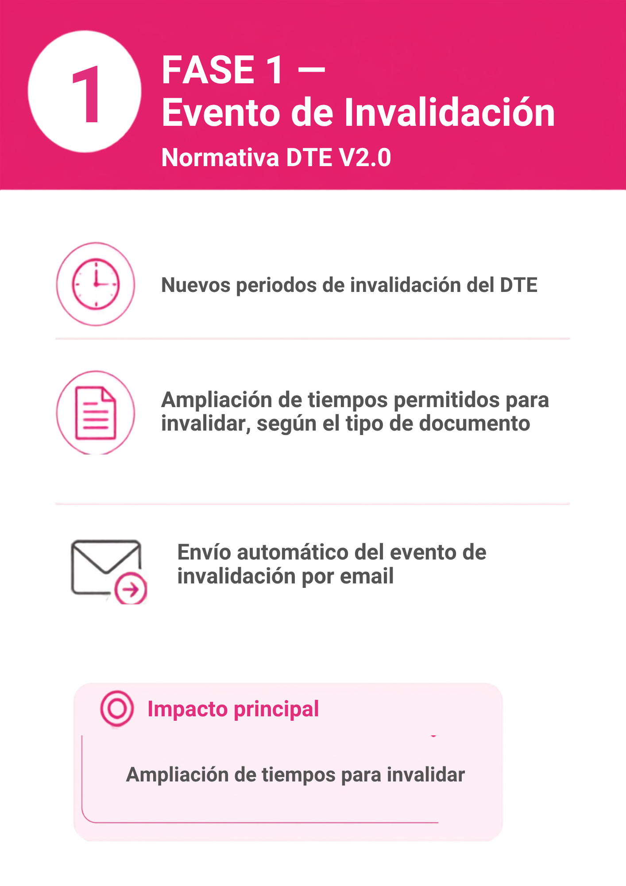

# DTE Normativa V2 — Fase 1: Evento de Invalidación Actualizado

## 📌 Introducción

!!! abstract "Nuevo evento de invalidación"
    La Fase 1 de la implementación de la Normativa V2 introduce nuevos periodos para el evento de invalidación, ampliando los tiempos permitidos para invalidar un DTE según su tipo de documento.
    Nueva Representación Gráfica del evento de invalidación y envio del evento por email.

## ⚙️ Configuración

!!! note "Sin parametrización adicional"
    Activar fase1 desde el menu de instalación de implementación normativa v2

!!! tip "Activación automática"
    Si su empresa emite DTE, esta fase se activa automáticamente al terminar la actualización de ContaPortable o al iniciar el sistema. Consulte [Activación automática de la Normativa DTE 2.0](../actualizador/actualizador_contaportable.md#normativa-dte-20).

## 🚀 Implementación

 { width="480" align=center }

---
