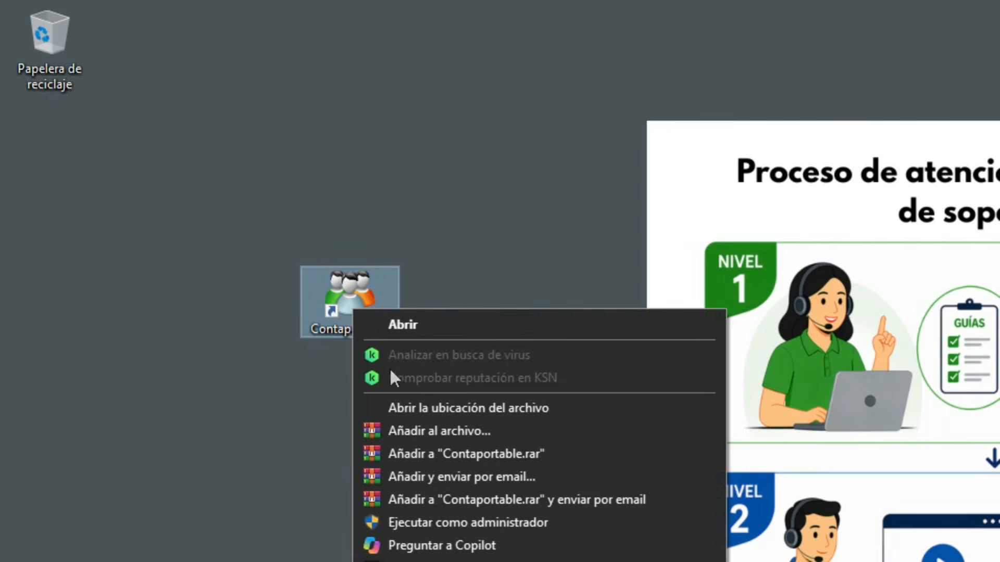
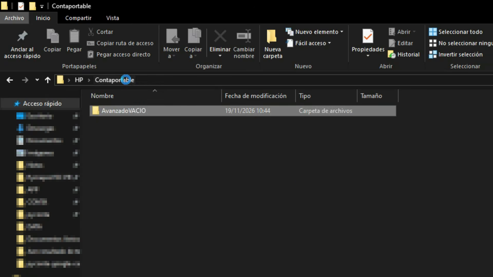
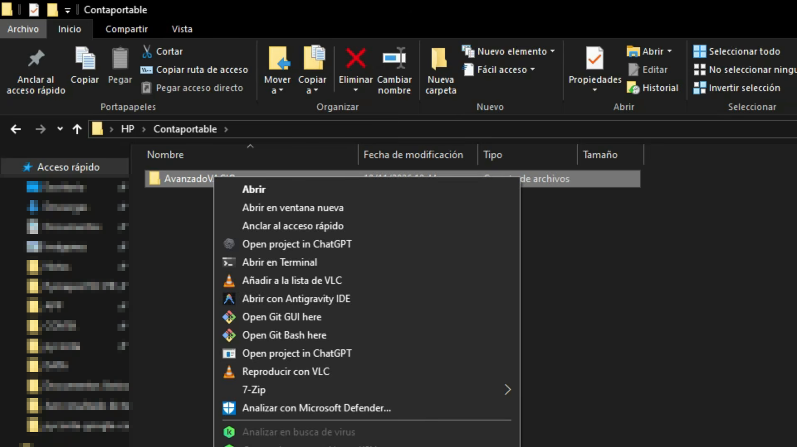
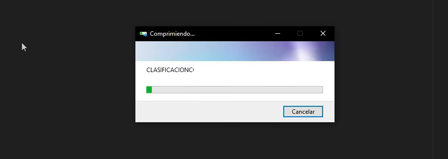
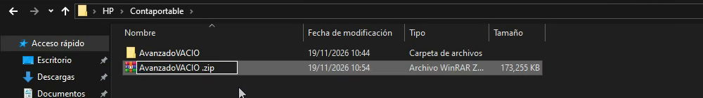
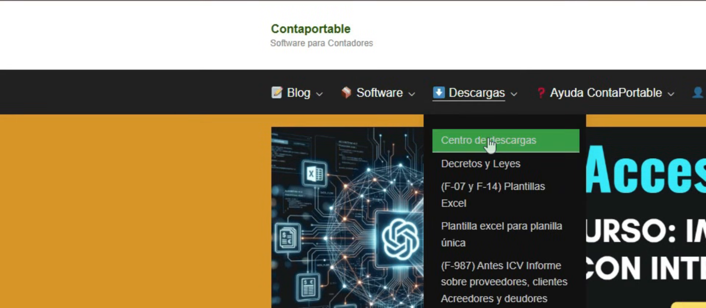
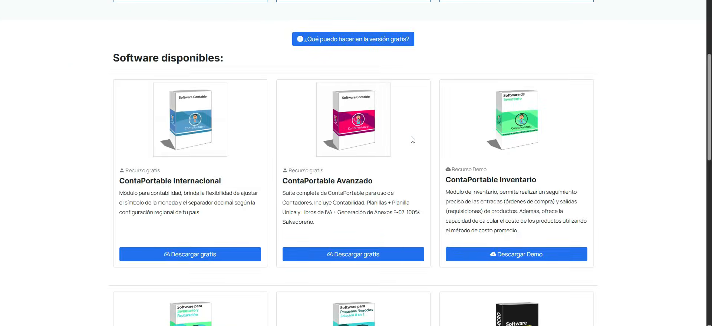
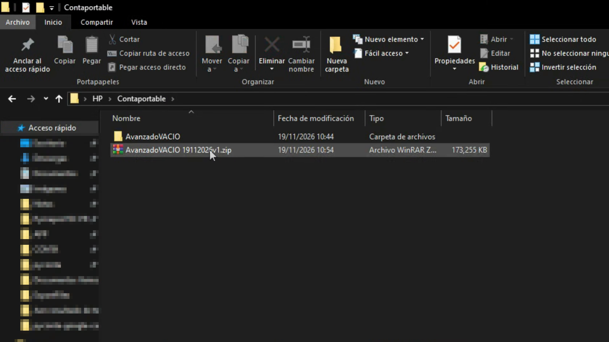
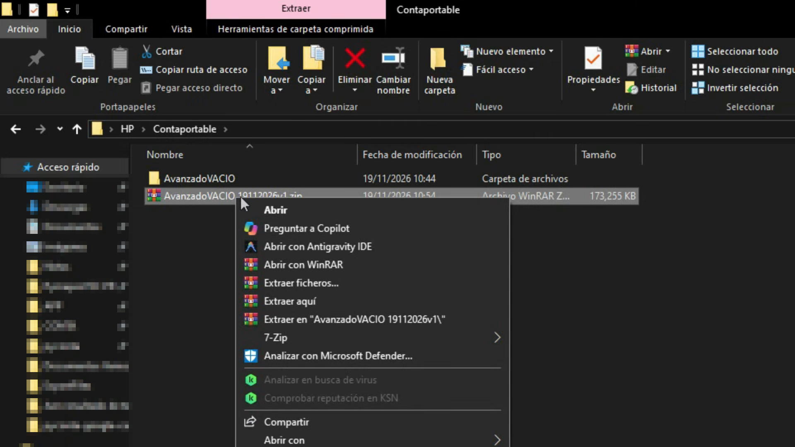
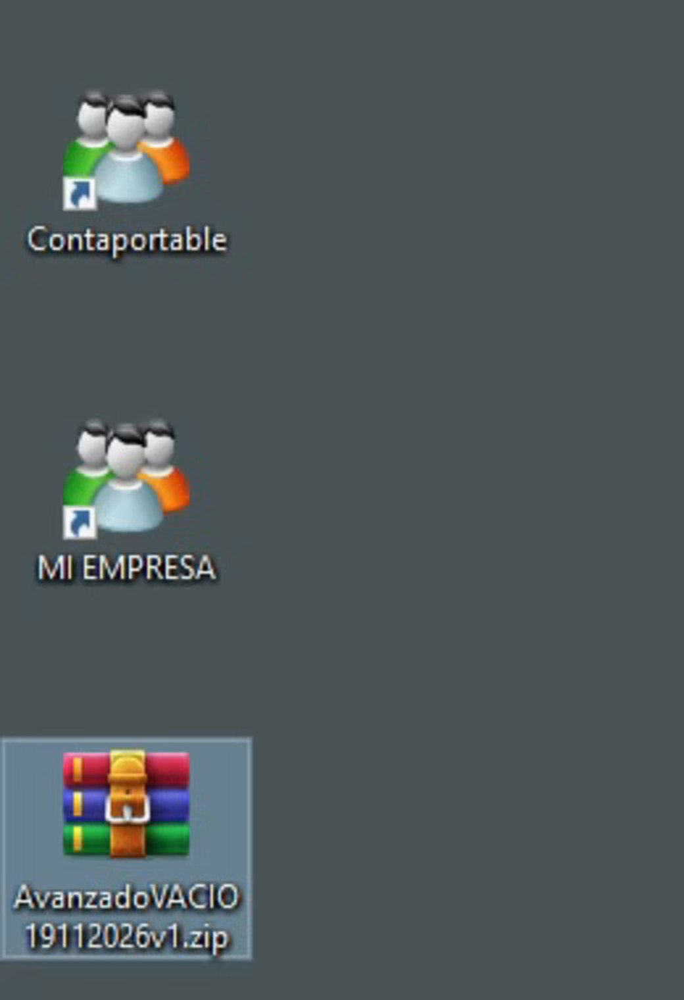

<!---
description: Guía de usuario de los respaldos (backups) de ContaPortable. Cómo guardar una copia completa de su sistema, cómo restablecerla en la misma computadora o en otra, y qué casos requieren apoyo de soporte técnico.
--->

# Respaldos de ContaPortable Nuevo

Un **respaldo** (o *backup*) es una copia completa de su sistema guardada en un archivo comprimido. Si su computadora falla o si desea cambiar de equipo, usted puede **restablecer** ese archivo y recuperar su información.

!!! info "De un vistazo"
    - ⏱️ **Tiempo:** 10 a 20 minutos
    - 🎚️ **Nivel:** Básico
    - ✅ **Resultado:** un archivo de respaldo guardado fuera de su computadora, o su sistema recuperado desde uno

---

## 📌 Introducción

!!! abstract "En esta guía aprenderá a"
    - Hacer un respaldo completo de su sistema.
    - Guardar el respaldo en un lugar seguro.
    - Restablecer un respaldo en otra computadora o en la misma.
    - Saber en qué casos debe pedir apoyo a soporte técnico.

!!! note "Un respaldo por empresa"
    Si usted tiene más de un sistema instalado, cada uno tiene su propia carpeta. Haga el respaldo **de cada empresa por separado**.

---

## 📦 Antes de empezar

!!! info "Requisitos"
    - **ContaPortable cerrado.** Cierre el sistema antes de hacer el respaldo. Los archivos que están en uso no se pueden comprimir y el respaldo queda incompleto.
    - **Un programa para comprimir archivos.** Sirve el compresor de Windows, WinRAR o 7-Zip.
    - **Un lugar seguro donde guardar el archivo,** como Google Drive, OneDrive, Dropbox o una memoria USB.

---

## 💾 Hacer un respaldo

!!! tip "Véalo en video"
    <iframe width="100%" style="aspect-ratio: 16 / 9; border: 0;" src="https://www.youtube.com/embed/PR0hiwOKxGY" title="Cómo realizar un respaldo en ContaPortable" allow="accelerometer; clipboard-write; encrypted-media; gyroscope; picture-in-picture; web-share" referrerpolicy="strict-origin-when-cross-origin" allowfullscreen></iframe>

!!! example "Paso a paso"
    1. Cierre ContaPortable.
    2. Presione clic derecho sobre el **acceso directo** del sistema.
    3. Elija **Abrir la ubicación del archivo**. Se abre la carpeta donde está instalado el sistema.

        { align=center }

    4. Suba una carpeta. Presione la carpeta anterior, llamada **ContaPortable**.
    5. Busque la carpeta con el nombre **Avanzado** seguido del nombre con el que instaló la empresa.

        { align=center }

    6. Presione clic derecho sobre esa carpeta y elija **Enviar a** > **Carpeta comprimida**. Si usa WinRAR u otro compresor, comprima la carpeta con él.

        { align=center }

    7. Espere a que termine la compresión.

        { align=center }

    8. Cambie el nombre del archivo y agregue la fecha. Si hace más de un respaldo el mismo día, agregue también un número de versión.

        { align=center }

    9. Copie el archivo a un lugar seguro, fuera de su computadora.

!!! success "Qué verá"
    Un archivo comprimido con todo el contenido de su sistema. Por ejemplo: **Avanzado Mi Empresa 2026-11-19 v1.zip**.

!!! tip "Dónde guardar el respaldo"
    Guarde el archivo en Google Drive, OneDrive, Dropbox o una memoria USB. **No lo deje solo en la misma computadora.** Si el equipo se daña, perderá el sistema y el respaldo juntos.

!!! warning "Haga respaldos con frecuencia"
    Un respaldo solo recupera la información hasta el día en que lo hizo. Haga uno al terminar cada jornada y siempre antes de hacer cambios grandes.

---

## ♻️ Restablecer un respaldo

!!! tip "Véalo en video"
    <iframe width="100%" style="aspect-ratio: 16 / 9; border: 0;" src="https://www.youtube.com/embed/47KOuqjj65A" title="Cómo restablecer un respaldo en ContaPortable" allow="accelerometer; clipboard-write; encrypted-media; gyroscope; picture-in-picture; web-share" referrerpolicy="strict-origin-when-cross-origin" allowfullscreen></iframe>

Puede restablecer un respaldo en otra computadora o en la misma.

=== "1️⃣ En otra computadora"
    !!! example "Paso a paso"
        1. Si la computadora nunca ha tenido ContaPortable, **instale el sistema desde cero**. En [contaportable.com](https://contaportable.com) entre a **Descargas** > **Centro de descargas**.

            { align=center }

        2. Presione **Descargar gratis** en **ContaPortable Avanzado**. Se abre una página de Google Drive donde descarga el instalador.

            { align=center }

        3. Instale el sistema. La instalación crea un **acceso directo**.
        4. Presione clic derecho sobre el acceso directo y elija **Abrir la ubicación del archivo**.
        5. Suba una carpeta.
        6. Pegue aquí el archivo comprimido que guardó como respaldo.

            { align=center }

        7. Presione clic derecho sobre el archivo y elija **Extraer aquí** con WinRAR o 7-Zip. Si usa solo Windows, elija **Extraer todo**.

            { align=center }

        8. Abra la carpeta extraída. Debe ver todos los archivos del sistema.
        9. Busque el programa del sistema, llamado **ContaPortable** o **PymePro**. Presione clic derecho y elija **Enviar a** > **Escritorio (crear acceso directo)**.
        10. En el escritorio, cambie el nombre del nuevo acceso directo. Por ejemplo, ponga el nombre de la empresa.

            { align=center }

    !!! success "Qué verá"
        Al abrir el nuevo acceso directo, el sistema aparece tal como estaba el día en que hizo el respaldo.

    !!! warning "La carpeta no debe llevar el mismo nombre"
        La carpeta del respaldo debe tener un nombre distinto al de la carpeta del sistema recién instalado. Así evita que los archivos se mezclen. Normalmente el nombre ya es distinto.

=== "2️⃣ En la misma computadora"
    !!! info "Si el sistema se dañó"
        Si el sistema dejó de funcionar y usted quiere restablecer el respaldo en el mismo equipo, **pida apoyo a soporte técnico**. Ellos revisan el daño antes de reemplazar archivos.

    !!! tip "Si solo quiere mover el sistema"
        Para mover el sistema a otra carpeta o a otro equipo, use los pasos de la pestaña **En otra computadora**. Funciona bien.

---

## 🧭 Qué sistemas puede restablecer usted

| Su sistema | Qué debe hacer |
|---|---|
| **ContaPortable Avanzado**, **ContaPortable Plus** y sus variantes (planillas, solo inventario) | Siga esta guía. No necesita configuración adicional. |
| Sistema de **facturación electrónica** | Pida apoyo a soporte técnico. |
| Sistema con **módulo de facturación electrónica**, como PymePro, inventario con facturación o ERP | Pida apoyo a soporte técnico. |

!!! note "Computadora nueva"
    Si la computadora nunca tuvo ContaPortable, instale primero el sistema, como se explica en la pestaña **En otra computadora**.

---

## 🛠️ Problemas frecuentes

??? question "El respaldo no incluye todo o aparece un error al comprimir"
    Probablemente el sistema estaba abierto. Ciérrelo por completo, incluidos los demás módulos, y comprima la carpeta de nuevo.

??? question "No encuentro la carpeta Avanzado"
    Abra la ubicación del acceso directo de su sistema y suba una carpeta. Busque la carpeta **ContaPortable**. Dentro verá la carpeta con el nombre **Avanzado** y el nombre de su empresa.

??? question "Perdí mi computadora y mi respaldo estaba en ella"
    Si el respaldo no se guardó fuera del equipo, no se puede recuperar desde ahí. Por eso guarde siempre una copia en la nube o en una memoria USB.

??? question "El sistema restablecido no abre"
    Comuníquese con soporte técnico. Indique el tipo de sistema que usa y la computadora donde lo restableció.

---

## 📝 Historial de actualizaciones

??? info "Historial"
    - **19/11/2026:** primera versión de la guía de respaldos.
